# ksproxy logic in diagrams

This document draws the complete logic of ksproxy as Mermaid diagrams, as the code is today. Part 1 follows the flows that cross modules: one tool call, `ksproxy start` up to READY, shutdown, a stale session, the health check, the MCP message loop and the life of a session. Part 2 has one section per source file, with diagrams that cover every exported function and every decision inside it.

How to read the diagrams:

- Flowcharts run top to bottom in the order the code checks things. A diamond is a check; the first check that fails decides the outcome.
- `REFUSE:` starts a refusal, followed by the short reason the code returns (the `short` field, which the log prints in brackets). `ALLOW` and `OK` start successful outcomes. `ERROR:` is a thrown error, `FAIL:` a target that could not be opened.
- Labels cannot contain double quotes, so a double quote inside a reason is drawn as a single quote: `REFUSE: contains '..'` stands for the short reason `contains ".."`. Words in capitals (NAME, PORT, FLAG, CWD) are placeholders for the actual value. Angle brackets, braces, pipes and the number sign are described in words.
- When the code refers to a function in another module, the label names it; its own diagram is in that module's section.

`test/logic-docs.test.js` keeps this document complete: it fails when a file under `src/` or `bin/` has no section here, when an exported name or any other top-level function is missing from its file's section, when a short refusal text (a plain `short: '...'` string in the code) or an event name (a plain `event: '...'` string) does not appear in it, when a section names a file that no longer exists, or when a diagram breaks the syntax rules these diagrams follow.

# PART 1: Flows across modules

## 1. One tool call, from the agent to a target and back

### 1.1 The call arrives and is routed

This diagram shows how the line is read and which branch of the tool the call takes.

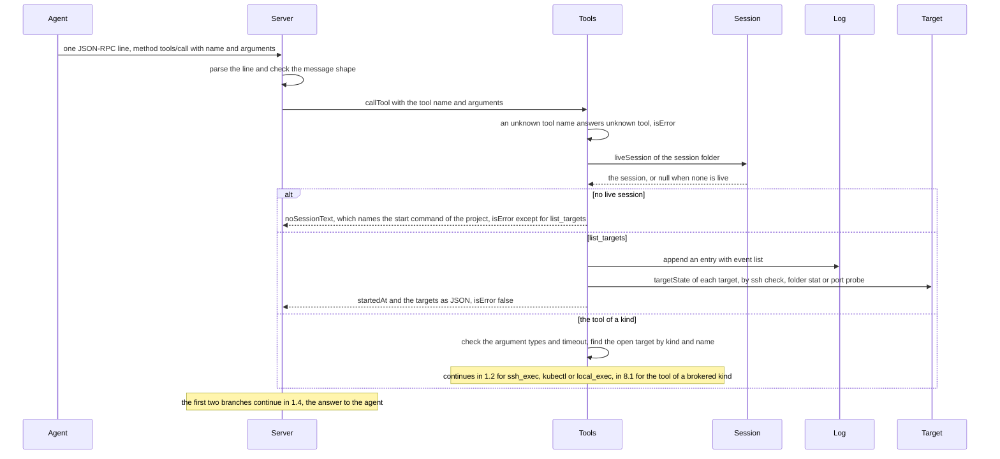

### 1.2 The decision and the review

This diagram shows the rule check, the optional review, and the refusal.

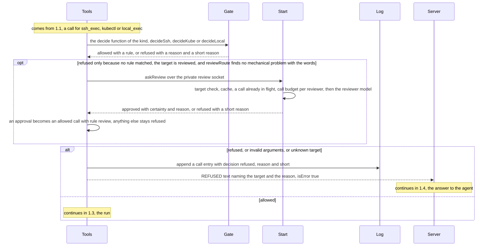

### 1.3 The run and its log entry

This diagram shows an allowed call going to the target and its result coming back.

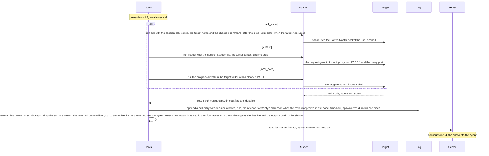

### 1.4 The answer to the agent

This diagram shows the last step, common to every branch of 1.1, 1.2 and 1.3.

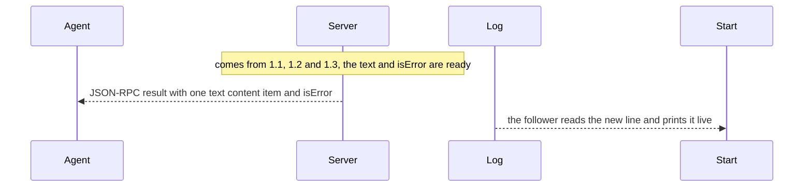

## 2. ksproxy start, from launch to READY

OPENING, UP, SKIPPED, WARN, REVIEW, READY, CLOSING, CLOSED, DOWN and UP in these diagrams are the lifecycle events `target_opening`, `target_up`, `target_skipped`, `target_warn`, `target_review`, `session_start`, `session_closing`, `session_end`, `target_down` and `target_recovered`, recorded in logs/audit.log and printed on stderr (READY on stdout).

### 2a. Inventory, existing session, selection

#### 2a.1 Start, inventory, existing session

This diagram shows the first steps of start, up to the check for a live session.

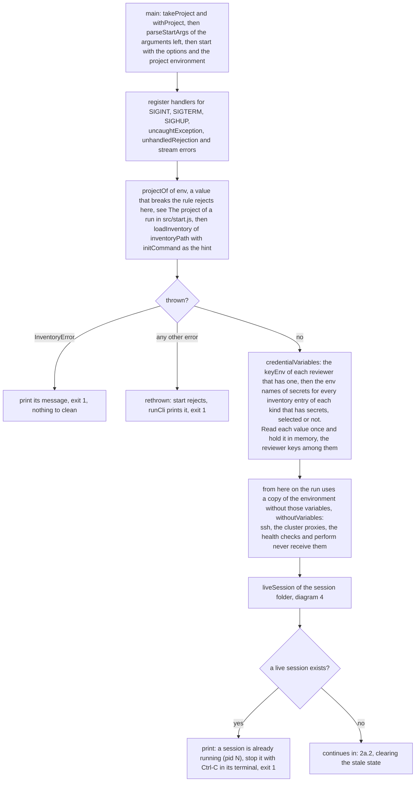

#### 2a.2 Clearing the stale state

This diagram shows how a run that owns the state removes what an earlier run left.

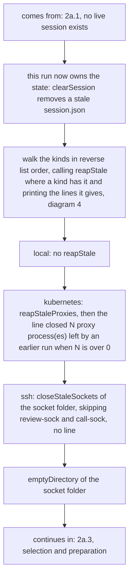

#### 2a.3 Selection and preparation

This diagram shows the choice of targets, the folders, the old logs and the socket paths, up to the opening.

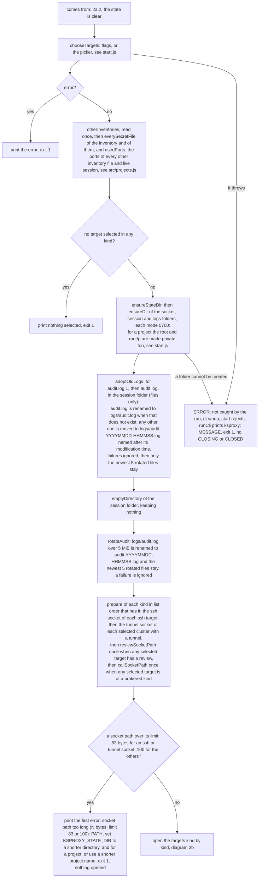

The exact texts behind the two labels that had to drop a semicolon: `a session is already running (pid N); stop it with Ctrl-C in its terminal` and `socket path too long (N bytes, limit 100): PATH; set KSPROXY_STATE_DIR to a shorter directory`, with `limit 83` for an ssh or tunnel socket, which for a project ends with ` or use a shorter project name`. The picker (`chooseTargets`) and the folder step (`ensureDir`) run before the `try` block that guards the opening, so an error thrown there leaves through `start` and `runCli` and prints no CLOSING or CLOSED line.

### 2b. Opening the targets, kind by kind

The kinds are walked in list order (ssh, kubernetes, local, then the brokered kinds), and inside a kind its selected targets in inventory order, one at a time. The log label is the kind's label (`ssh`, `kube`, `loc`, `http` and so on). The secret files are `secretFilesOf` of the whole inventory, every entry and not only the selected ones, then those that every other inventory file names (`everySecretFile` in `src/projects.js`): today the kubeconfig of every cluster entry and the client file of every Kafka entry. When another inventory file cannot be read, `secretFilesProblem` is set and every local target is refused by its `open` with it.

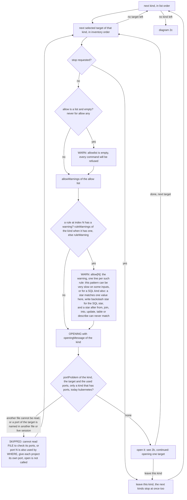

The pattern warning is advice: the rule still works. WHERE is `project NAME`, or `the default inventory`, and the real text has a semicolon before `give each project its own port`.

### 2b, continued: opening one target

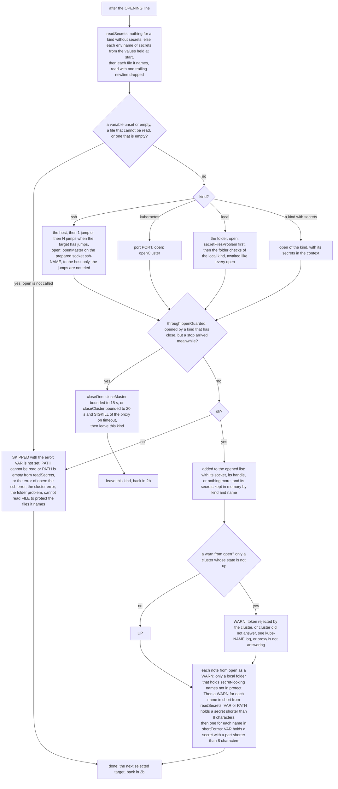

### 2c. The checks before writing

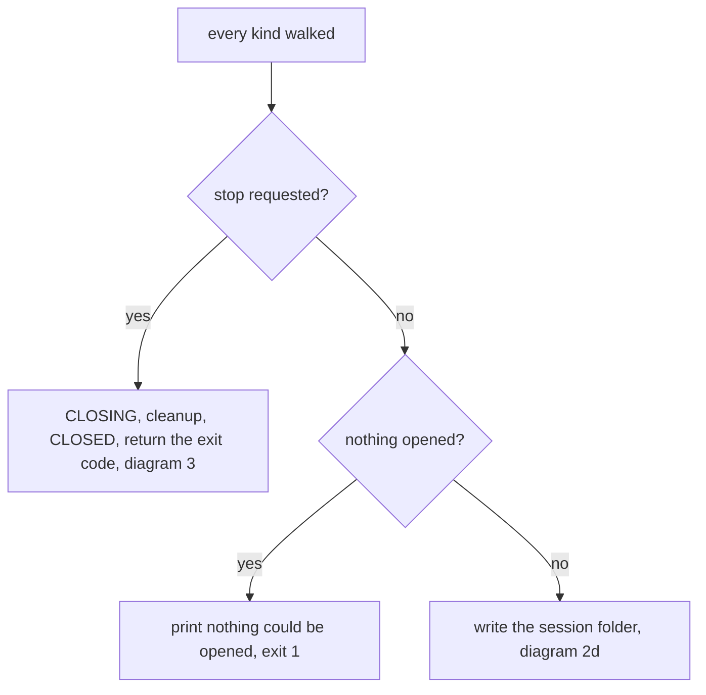

### 2d. Writing the session folder, the summary, READY

#### 2d.1 The review service

This diagram shows which reviewed targets are kept and whether the review service starts.

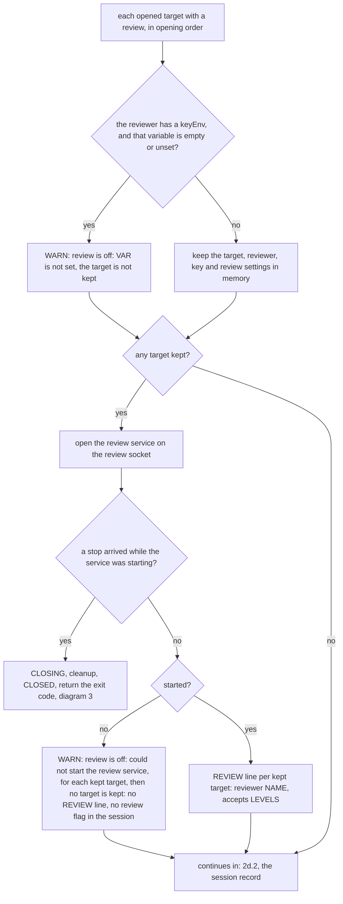

#### 2d.2 The session record of each target

This diagram shows the record written for each opened target, by kind.

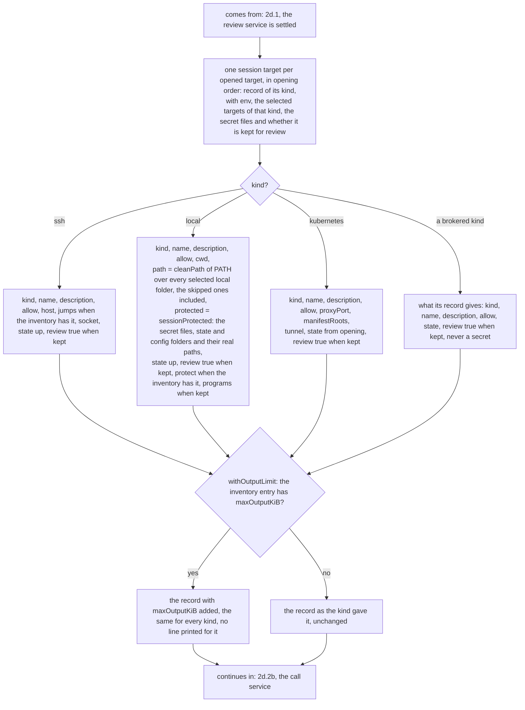

#### 2d.2b The call service

This diagram shows how the call service starts when a brokered target is open, see diagram 8 for a call.

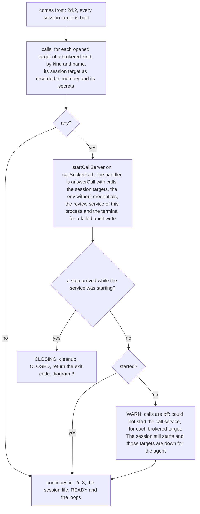

#### 2d.3 The session file, READY and the loops

This diagram shows how the session is written, READY is printed and the health loop starts.

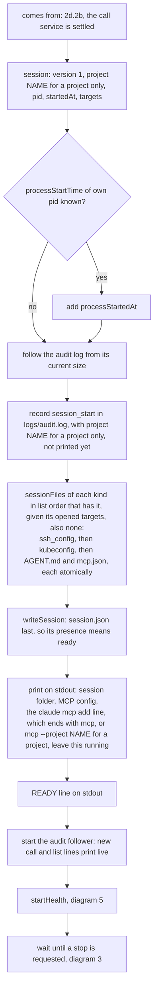

## 3. Shutdown and clean-up

### 3a. What triggers a stop

#### 3a.1 Signals and requestStop

This diagram shows each signal that asks for a stop and how requestStop remembers the first reason.

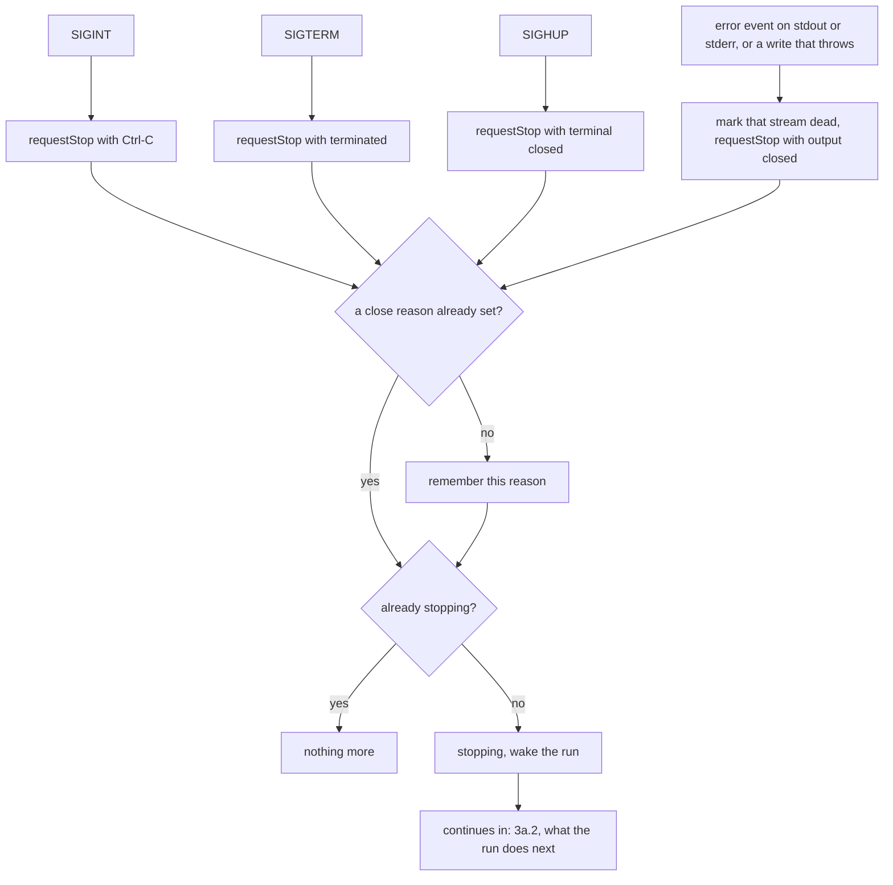

#### 3a.2 What the run does when it is woken

This diagram shows how the stop is handled, depending on where the run is.

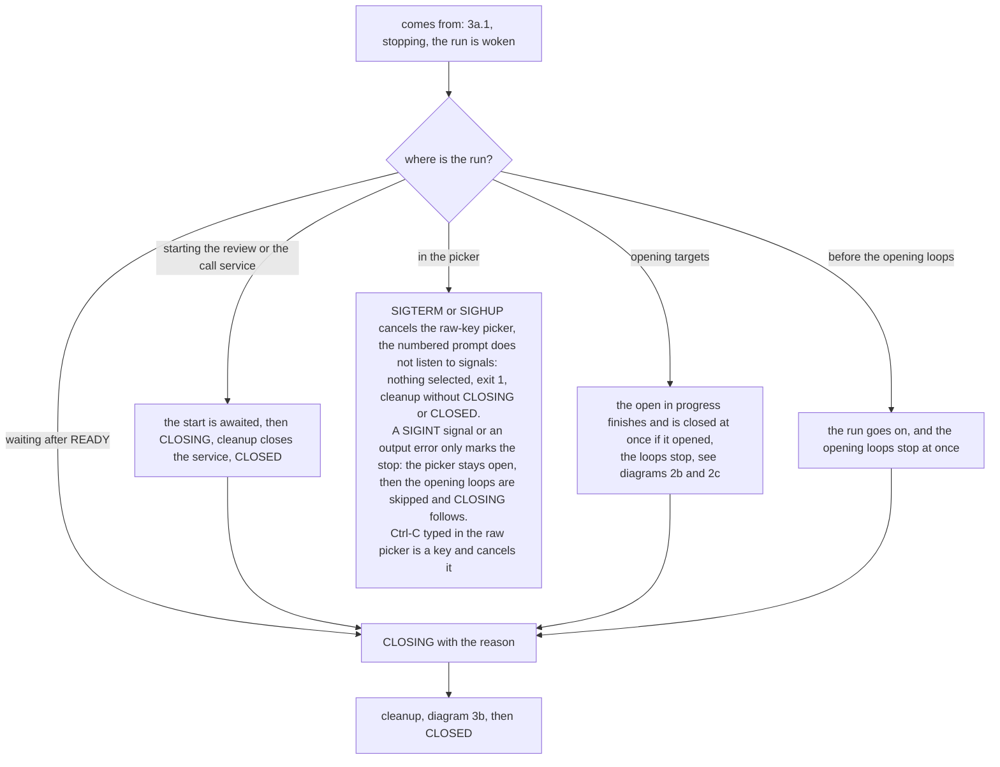

#### 3a.3 Fatal errors and errors while opening

This diagram shows the stops that come from an error and not from a signal.

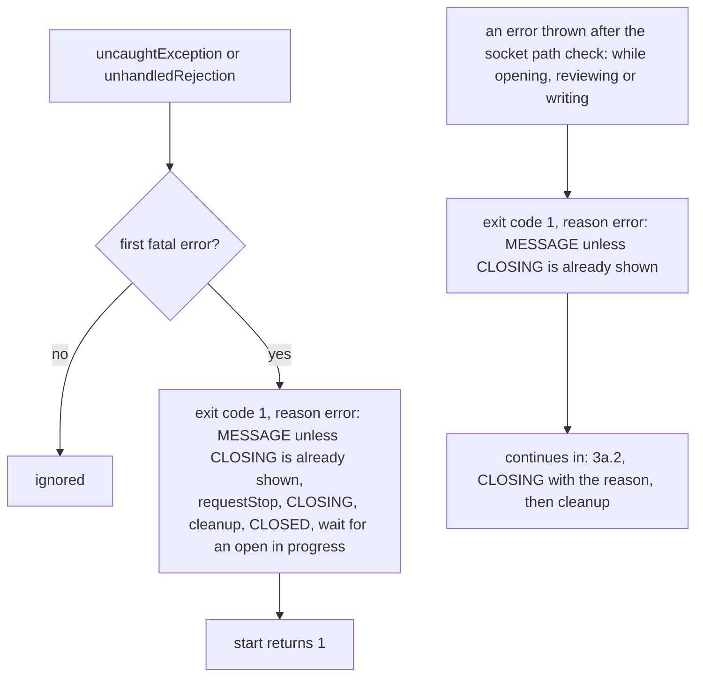

### 3b. Clean-up, in order

```mermaid
flowchart TD
    K1["cleanup, runs once whoever calls it"] --> K2["requestStop without a reason, stop the health timer"]
    K2 --> K3{"a health check running?"}
    K3 -->|"yes"| K4["wait for it, at most 6 s"]
    K3 -->|"no"| KC["call service, when its start was begun: wait for its start, then close it, at most 2 s:<br/>a call in flight is cut off and its agent gets the session did not answer, the socket file is removed"]
    K4 --> KC
    KC --> K5{"follower started?"}
    K5 -->|"yes"| K6["follower stop: one last read of the audit log with no size limit, then the renamed files still held are read once more and closed"]
    K5 -->|"no"| K6a["review service: wait for its start, then close it, at most 2 s, whenever its start was begun"]
    K6 --> K6a
    K6a --> K7["in parallel, closeOne for each opened target whose kind has close, each bounded by its kind's limit:<br/>closeMaster for each ssh target, at most 15 s each,<br/>closeCluster for each cluster, at most 20 s then SIGKILL of its proxy,<br/>nothing for local targets, the local kind has no close"]
    K7 --> K8{"this run owns the state?"}
    K8 -->|"no"| K10["CLOSED: N calls, ok, failed and denied counts, once and only after CLOSING"]
    K8 -->|"yes"| K9["clearSession removes session.json, emptyDirectory of the socket folder"]
    K9 --> K10
    K10 --> K11["remove every signal and stream handler, return the exit code"]
```

An exit before READY that is not caused by a stop (an inventory error, an existing session, nothing selected, a socket path too long, nothing opened) also runs cleanup, but prints no CLOSING or CLOSED line.

## 4. A stale session left by a killed run

### 4.1 Is the old session still live

This diagram shows the checks that decide whether session.json belongs to a live run.

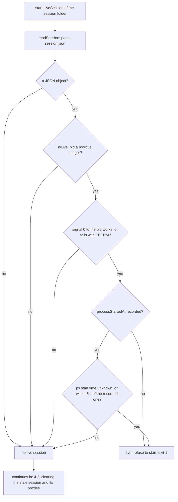

### 4.2 Clearing the stale session and its proxies

This diagram shows the stale session file removed and the proxy processes of the earlier run stopped.

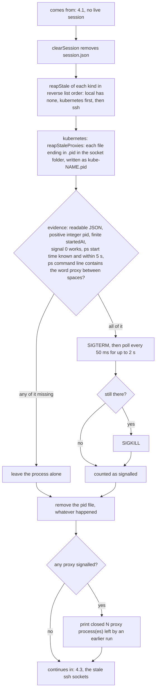

### 4.3 Closing the stale ssh sockets

This diagram shows the last part of the clean-up, for the ssh kind.

```mermaid
flowchart TD
    Y2["comes from: 4.2, the stale proxies are handled"] --> S17["ssh: closeStaleSockets: for each entry not ending in .pid and not named review-sock or call-sock,<br/>the tunnel sockets of clusters included, closeMaster with ssh -O exit, then remove the socket file"]
    S17 --> S18["emptyDirectory of the socket folder"]
```

## 5. Health check loop, DOWN and UP

### 5a. The loop

```mermaid
flowchart TD
    H1["startHealth after READY"] --> H2{"KSPROXY_HEALTH_MS parses as an integer?"}
    H2 -->|"yes"| H3["interval is that value, at least 200 ms"]
    H2 -->|"no"| H4["interval 30000 ms"]
    H3 --> H5["each opened target starts as up when its session state is up"]
    H4 --> H5
    H5 --> H6["timer tick, the timer does not keep the process alive"]
    H6 --> H7{"previous check still running, or stopping?"}
    H7 -->|"yes"| H6
    H7 -->|"no"| H8["checkOnce: next target, in opening order"]
    H8 --> H9{"stopping?"}
    H9 -->|"yes"| H20["check ends"]
    H9 -->|"no"| H10["stateNow: probe of the kind with the target's secrets when the kind has probe, else targetState, diagram 5b"]
    H10 --> H11{"threw?"}
    H11 -->|"yes"| H8
    H11 -->|"no"| H12{"stopping?"}
    H12 -->|"yes"| H20
    H12 -->|"no"| H13{"up now equals up before?"}
    H13 -->|"yes"| H8
    H13 -->|"no"| H14{"up now?"}
    H14 -->|"yes"| H15["UP with backMessage of the kind: folder is back for a local target, else connection is back"]
    H14 -->|"no"| H16["DOWN with downMessage of the kind, diagram 5b"]
    H15 --> H8
    H16 --> H8
    H20 --> H6
```

### 5b. Target state and the DOWN message

```mermaid
flowchart TD
    G1["targetState of a session target: the state function of its kind, or error when no kind has its key"] --> G2{"kind?"}
    G2 -->|"ssh"| G3{"checkMaster: ssh -O check exits 0?"}
    G3 -->|"yes"| G10["up"]
    G3 -->|"no"| G11["down"]
    G2 -->|"local"| G4{"the folder is a directory?"}
    G4 -->|"yes"| G10
    G4 -->|"no, or stat fails"| G11
    G2 -->|"kubernetes"| G5{"portListening on the proxy port?"}
    G5 -->|"no"| G11
    G5 -->|"yes"| G6["the state recorded at opening: up, auth or fail, not probed again"]
    G2 -->|"a brokered kind"| G7{"brokeredState: the call socket path is usable and the call socket accepts a connection?"}
    G7 -->|"yes"| G8["the state recorded at opening"]
    G7 -->|"no"| G11
    D1["downMessage of the kind, given the session target and the state"] --> D2{"kind?"}
    D2 -->|"ssh"| D3["connection lost"]
    D2 -->|"local"| D5["folder is gone"]
    D2 -->|"kubernetes"| D6{"state?"}
    D6 -->|"auth"| D7["token rejected by the cluster, used only by the WARN when the cluster is opened"]
    D6 -->|"fail"| D8["cluster did not answer, see kube-NAME.log, used only by the WARN when the cluster is opened"]
    D6 -->|"anything else"| D9["proxy is not answering, the only message the health loop gives for a cluster"]
```

A cluster that opened with auth or fail starts as down, so the health loop raises no DOWN for it, and it raises UP never.

## 6. The MCP message loop

### 6.1 Reading a line and checking its shape

This diagram shows how serve reads a line and decides whether it is a request, a response, a notification or an error.

```mermaid
flowchart TD
    M1["serve: read stdin line by line"] --> M2{"blank line?"}
    M2 -->|"yes"| M1
    M2 -->|"no"| M3{"valid JSON?"}
    M3 -->|"no"| M4["error -32700 Parse error, id null"]
    M3 -->|"yes"| M5{"an object with no method and a result or error field?"}
    M5 -->|"yes"| M6["a response to us: no answer"]
    M5 -->|"no"| M7{"an object with jsonrpc 2.0 and a string method?"}
    M7 -->|"no"| M8["error -32600 Invalid Request, with its id when valid, else null"]
    M7 -->|"yes"| M9{"has an id that is not a string or a finite number?"}
    M9 -->|"yes"| M10["error -32600 Invalid Request, id null"]
    M9 -->|"no"| M11{"no id at all?"}
    M11 -->|"yes"| M12["a notification: no answer"]
    M11 -->|"no"| Z1["continues in: 6.2, the method"]
    M4 --> Z2["continues in: 6.3, write the answer"]
    M8 --> Z2
    M10 --> Z2
    M6 --> M1
    M12 --> M1
```

### 6.2 The method

This diagram shows what each method of a valid request with an id answers.

```mermaid
flowchart TD
    Y1["comes from: 6.1, a valid request with an id"] --> M13{"method?"}
    M13 -->|"initialize"| M14["protocol version, tools capability, SERVER_INFO, instructionsFor of the env"]
    M13 -->|"ping"| M15["empty result"]
    M13 -->|"tools/list"| M16["toolDefinitions of the inventory: list_targets and the tools of the kinds that are not brokered,<br/>then the tool of each brokered kind with a target in the inventory, every one when it cannot be read"]
    M13 -->|"tools/call"| M17{"params has a string name and arguments absent or a plain object?"}
    M17 -->|"no"| M18["error -32602 Invalid params"]
    M17 -->|"yes"| M19["callTool, diagram 1: result with one text item and isError"]
    M13 -->|"anything else"| M20["error -32601 Method not found: METHOD"]
    M13 -->|"a handler throws"| M22["error -32603 Internal error: MESSAGE"]
    M14 --> Z3["continues in: 6.3, write the answer"]
    M15 --> Z3
    M16 --> Z3
    M18 --> Z3
    M19 --> Z3
    M20 --> Z3
    M22 --> Z3
```

### 6.3 Writing the answer

This diagram shows the one step every answer goes through before the next line is read.

```mermaid
flowchart TD
    Y2["comes from: 6.1 and 6.2, an answer is ready"] --> M21["write one JSON line to stdout"]
    M21 --> Z4["continues in: 6.1, read the next line"]
```

## 7. Life of a session

```mermaid
stateDiagram-v2
    [*] --> NoSession
    NoSession --> NoSession : start stops on an inventory error
    Ready --> Ready : a second start is refused while this one is live
    NoSession --> Preparing : start owns the state, stale files cleared
    Preparing --> NoSession : nothing selected, picker cancelled, socket path too long or error, exit 1
    Preparing --> Opening : targets chosen, folders ready, old logs moved to logs, audit log rotated
    Opening --> Opening : review service started on the review socket, or review is off
    Opening --> Opening : call service started on the call socket when a brokered target is open, or calls are off
    Opening --> NoSession : nothing could be opened, exit 1
    Opening --> Closing : stop requested or error while opening
    Opening --> Ready : session.json written, READY printed
    Ready --> Ready : tool calls and list_targets, DOWN and UP from the health check
    Ready --> Closing : SIGINT, SIGTERM, SIGHUP, output closed or an error
    Ready --> Ready : the follower renames audit.log over 5 MiB and starts a new one
    Closing --> Closed : call service closed, follower stopped, review service, masters and proxies closed, session.json and sockets removed
    Closed --> [*]
    Ready --> Stale : start killed with SIGKILL or the machine stops
    Stale --> Stale : the MCP tools see no live session
    Stale --> Preparing : next start clears session.json, reaps proxies, closes sockets
```

## 8. A brokered call

A brokered kind is decided and carried out inside `ksproxy start`, which holds its credential in memory. `ksproxy mcp` checks the shape of the call and forwards it over the private call socket `call-sock`. The fixed texts of every failure are `CALL_FAILED` in `src/broker.js`.

### 8.1 The mcp side

This diagram shows what `ksproxy mcp` does with the call of a brokered kind.

```mermaid
sequenceDiagram
    participant Agent
    participant Mcp
    participant Start
    Note over Mcp: comes from 1.1, the tool of a brokered kind, arguments checked and the target found in session.json
    Mcp->>Mcp: a refusal of the arguments or an unknown target is answered and audited by mcp, as for every kind
    Mcp->>Mcp: callSocketOrNull, a socket path that cannot be used answers the session did not answer, audited by mcp
    Note over Mcp: a call that is sent on is audited by start only, never by mcp, so no call is audited twice
    Mcp->>Start: askCall over call-sock, one JSON line with kind, name, input and timeoutSeconds, at most 256 KiB
    Note over Start: continues in 8.2, the handler inside start
    Start-->>Mcp: one JSON line with text and isError, at most 4 times the visible limit of the target, 1 MiB by default, then the connection ends
    Note over Mcp: askCall reads at most MAX_ANSWER_BYTES, 16 MiB, the line of the largest limit, counting the bytes of each chunk once
    alt no socket, an error, closed without an answer, too large, unreadable, or the time limit plus 75 s passed
        Mcp-->>Agent: REFUSED with the word and the name and one fixed text of CALL_FAILED, isError true
    else an answer
        Mcp-->>Agent: the text and isError as start gave them, see 1.4
    end
```

### 8.2 The handler inside start

This diagram shows how start finds the target in its own memory and decides the call.

```mermaid
flowchart TD
    Y1["comes from: 8.1, a request on call-sock"] --> C1["startCallServer: at most 64 connections at once, one JSON line of at most 256 KiB within 5 s of connecting, else the connection is dropped"]
    C1 --> C2{"validCall: an object with a string kind and name, an input, and timeoutSeconds an integer from 1 to 600?"}
    C2 -->|"no"| R1["REFUSED: the call could not be read, not audited"]
    C2 -->|"yes"| C3["answerCall: kindByKey of the kind"]
    C3 --> C4{"a brokered kind?"}
    C4 -->|"no"| R2["REFUSED: this target is not open in the session, not audited"]
    C4 -->|"yes"| C4b{"auditedDetailOf of the call, inside a try: it threw?"}
    C4b -->|"yes"| R5
    C4b -->|"no"| C5{"in calls, the targets this run opened, by kind and name? session.json is never read"}
    C5 -->|"no"| R3["REFUSE: target not open"]
    C5 -->|"yes"| C6{"detailProblem: the call has the type the tool takes?"}
    C6 -->|"no"| R4["REFUSE: invalid arguments"]
    C6 -->|"yes"| C7["decide of the kind with the target as recorded in memory"]
    C7 -->|"throws"| R5["REFUSE: call failed, the audit entry has null for the call when auditedDetailOf threw"]
    C7 --> C8["reviewStep with the review service of this process: the same route, cache, budget and checks on the words"]
    C8 -->|"refused by the rules or the reviewer"| R6["REFUSE: the short reason of the decision or of the reviewer"]
    C8 -->|"allowed"| C9{"the session stopped meanwhile, the signal of the server is aborted?"}
    C9 -->|"yes"| R7["REFUSE: session stopped, reason the session stopped before the call ran, perform is not called"]
    C9 -->|"no"| Z1["continues in: 8.3, perform and the answer"]
    R3 --> AU["each REFUSE is audited by start with decision refused, reason and short"]
    R4 --> AU
    R5 --> AU
    R6 --> AU
    R7 --> AU
```

### 8.3 perform and the answer

This diagram shows the run of an allowed brokered call, its limits and its answer.

```mermaid
flowchart TD
    Y2["comes from: 8.2, an allowed decision"] --> P0["hiddenTexts: the secret values of the target and the forms from hiddenForms of the kind, a throw is call failed"]
    P0 --> P1["performWithin: perform of the kind with env, the target's secrets, timeoutMs, maxBytes the read limit,<br/>visibleLimit of the target in memory plus 32768, a signal and the input"]
    P1 --> P2{"what settles first?"}
    P2 -->|"perform"| P3{"it threw?"}
    P3 -->|"yes"| R1["REFUSE: call failed, audited, nothing of the error is kept"]
    P2 -->|"the time limit"| P4["abort the signal, wait at most 1 s more"]
    P4 -->|"perform settles"| P3
    P4 -->|"still busy"| P5["timed out, no output"]
    P2 -->|"the session stops"| P6["abort the signal, REFUSE: session stopped, audited, the agent already got the session did not answer"]
    P3 -->|"no"| P7{"validResult: exitCode an integer or null, stdout and stderr strings?"}
    P7 -->|"no"| R1
    P7 -->|"yes"| P9["audit: decision allowed, rule, review, exitCode, timedOut, spawnError null, durationMs, stdoutBytes and stderrBytes before the cut"]
    P5 --> P9
    P9 --> P8["fitStreams: fitStream on each stream: hide every secret value and form and drop a cut one, scrubOutput,<br/>drop the end of a stream that reached the read limit, then capBytes to the visible limit. See answerCall in the src/tools.js section"]
    P8 -->|"the hiding or the scrub throws"| PF["outputFailed: exit code N or timed out, then the output could not be shown, isError true, the call is audited already"]
    P8 --> P10["formatResult with the truncation note when perform says so or fitStream left something out"]
    P10 --> P11["isError when timed out or the exit code is not 0"]
    P11 --> P12["answerWithin: while the JSON line passes answerLimit, 4 times the visible limit, keep half as much of each stream,<br/>so the agent is told the call ran, then answerLine writes one line and the connection ends"]
```

# PART 2: Module by module

## bin/ksproxy.js

The executable that npm puts on PATH: it hands the arguments to `runCli` and exports nothing. Its first line runs Node with `--disable-sigusr1` (through `env -S`), so Node never opens its inspector on `SIGUSR1`, not even in the first milliseconds of the process, before any code of ksproxy runs; a process of the same user could otherwise read the credentials that `ksproxy start` holds, or call past the rules. The MCP config that `start` prints runs node with the same flag, as the agent does not read the first line. Before it loads any other module the bin also adds an empty listener for `SIGUSR1`, a second guard for a run without the flag (`node bin/ksproxy.js`), where a signal after that point no longer opens the inspector. With the flag, a signal that comes before the listener ends the process, which is the default action of the signal. This covers every command, `start` and `mcp` included. The environment of the process stays readable by the same user; see "What is not in scope" in SECURITY.md.

```mermaid
flowchart TD
    BA["the first line: env -S node with disable-sigusr1, the signal never opens the inspector"] --> B0["bin/ksproxy.js with arguments"]
    B0 --> B1["process.on SIGUSR1 with an empty listener, before any import: a second guard, and the signal no longer ends the process"]
    B1 --> B2["import src/cli.js, then runCli with process.argv from its third element"]
    B2 --> B3["main runs the command: runCli sets process.exitCode to its code, or on a thrown error prints ksproxy: MESSAGE on stderr and sets exit code 1"]
```

## src/agent-md.js

Builds the text of AGENT.md (`agentMdText`) and the MCP config block (`mcpConfig`) that `start` writes into the session folder. The notes of each kind of target and its line in the Tools list are written by the kind itself, drawn in the kind sections; this file names no kind and walks the list. It reads the list when it is called.

### mcpConfig

This diagram shows the MCP config block, for the default and for a project.

```mermaid
flowchart TD
    C1["mcpConfig of nodePath, binPath and project, null by default"] --> C4{"project is null?"}
    C4 -->|"yes"| C2["mcpServers, entry ksproxy: command nodePath, args NODE_FLAGS, binPath and mcp, as before projects"]
    C4 -->|"no"| C5["mcpServers, entry ksproxy: command nodePath, args NODE_FLAGS, binPath, mcp, --project and NAME:<br/>the MCP server of the agent then reads the session of that project only"]
    C2 --> C3["NODE_FLAGS is the disable-sigusr1 flag of the shebang: the agent runs node itself, so the shebang is not read.<br/>start prints the claude mcp add line from these args, so it has the same flag and the same project"]
    C5 --> C3
```

### agentMdText

This diagram shows how the text of AGENT.md is put together.

```mermaid
flowchart TD
    A1["agentMdText of the session"] --> T1{"the session has a project field?"}
    T1 -->|"no"| T2["the title line: ksproxy session, as before projects"]
    T1 -->|"yes"| T3["the title line: ksproxy session: project NAME"]
    T2 --> A2["for each session target, in order: agentSection of the kind with that key"]
    T3 --> A2
    A2 --> L1{"outputLine: outputKiB of the target is DEFAULT_OUTPUT_KIB, 256?"}
    L1 -->|"yes"| L2["nothing more"]
    L1 -->|"no"| L3["one more line under the section: Output is cut at N KiB per stream for this target."]
    L2 --> A3{"for each kind in list order: not brokered, or brokered with a target in the session?"}
    L3 --> A3
    A3 -->|"yes"| A4["its toolBullet in the Tools list, after the fixed list_targets line"]
    A3 -->|"no"| A5["no line: the agent is not told of a tool it cannot use"]
    A4 --> J1
    A5 --> J1
    J1["join: title, tools list, open targets, off limits, the intro and the off limits text are fixed sentences"]
```

## src/allowlist.js

Splits ssh and local commands into tokens, matches tokens against allow rules and decides; a refusal while tokenising is thrown as an `AllowError` that carries the short reason.

### tokenizeSshCommand

```mermaid
flowchart TD
    T1["tokenizeSshCommand of command"] --> T2{"a string?"}
    T2 -->|"no"| R1["REFUSE: invalid command"]
    T2 -->|"yes"| T3{"over 4096 bytes?"}
    T3 -->|"yes"| R2["REFUSE: command too long"]
    T3 -->|"no"| T4["split on runs of spaces and tabs, drop empty pieces"]
    T4 --> T5{"no tokens?"}
    T5 -->|"yes"| R3["REFUSE: empty command"]
    T5 -->|"no"| T6["each token in order"]
    T6 --> T7{"only letters, digits, underscore, at, percent, plus,<br/>equals, colon, comma, dot, slash and dash?"}
    T7 -->|"no"| R4["REFUSE: character C not allowed,<br/>C is written by describeChar: the first bad character in quotes, or U+XXXX for a control or non-ASCII one"]
    T7 -->|"yes"| T8{"first token starts with a dash?"}
    T8 -->|"yes"| R5["REFUSE: starts with '-'"]
    T8 -->|"no"| T9["OK: the tokens"]
```

### checkRawSshCommand, for allow any on ssh

```mermaid
flowchart TD
    W1["checkRawSshCommand of command"] --> W2{"a string?"}
    W2 -->|"no"| R1["REFUSE: invalid command"]
    W2 -->|"yes"| W3{"over 4096 bytes?"}
    W3 -->|"yes"| R2["REFUSE: command too long"]
    W3 -->|"no"| W4{"empty after trimming?"}
    W4 -->|"yes"| R3["REFUSE: empty command"]
    W4 -->|"no"| W5{"contains NUL?"}
    W5 -->|"yes"| R4["REFUSE: control character"]
    W5 -->|"no"| W6{"a control character other than tab:<br/>U+0001 to U+0008, U+000A to U+001F, U+007F to U+009F?"}
    W6 -->|"yes"| R4
    W6 -->|"no"| W7{"starts with a dash after leading whitespace?"}
    W7 -->|"yes"| R5["REFUSE: starts with '-'"]
    W7 -->|"no"| W8["OK: the command exactly as written"]
```

### Short reasons in the log

`tokenizeSshCommand` and `checkRawSshCommand` refuse by throwing an `AllowError` that carries a long reason for the agent and a short one for the log line.

| Short text | Given when |
|---|---|
| `invalid command` | the command is not a string |
| `command too long` | the command is longer than the byte limit |
| `empty command` | the command has no words |
| `starts with "-"` | the first word starts with `-` |
| `control character` | a raw command (allow any) holds a NUL byte or another control character |
| `character <c> not allowed` | a word holds a character outside the plain set; the text names the character |
| `regex rule too slow` | `decide`: no rule matched, and a regex rule ran out of its 100 ms while matching this command |

### The two sorts of rule

A rule is either a word rule or, as a whole, a regex rule: `regex(PATTERN)`. `isRegexRule` is true for a string that, trimmed, starts with `regex(` and ends with `)`; `regexSource` is what lies between them. In a word rule, `*` is one argument that does not start with `-`, `...` is the rest, and the word `\*` (drawn as backslash star) matches only the argument `*`. A regex rule is tried on the arguments joined by single spaces and must match all of it.

```mermaid
flowchart TD
    I1["isRegexRule of rule"] --> I2{"a string?"}
    I2 -->|"no"| I3["false"]
    I2 -->|"yes"| I4{"trimmed, starts with regex and an open bracket and ends with a close bracket?"}
    I4 -->|"yes"| I5["true"]
    I4 -->|"no"| I3
    S1["regexSource of rule"] --> S2["the trimmed rule without regex( at the start and the last close bracket"]
    C1["compileRegexRule of rule"] --> C2["compile the source on its own, with no flags"]
    C2 --> C3{"throws?"}
    C3 -->|"yes"| C4["the error goes to the caller"]
    C3 -->|"no"| C5["compile ^(?: then the source then )$, with no flags"]
    C5 --> C6["the pattern, or the error of that compile"]
```

Compiling the source on its own first means a pattern such as `a)|(b` cannot close the wrapping group and match only part of the command.

### validateRule

```mermaid
flowchart TD
    V1["validateRule of rule, used by the inventory"] --> V2{"a string?"}
    V2 -->|"no"| VE0["ERROR: rule must be a string"]
    V2 -->|"yes"| V3{"trimmed, starts with regex and an open bracket?"}
    V3 -->|"yes"| V4{"ends with a close bracket?"}
    V4 -->|"no"| VE1["ERROR: regex(...) must be the whole rule"]
    V3 -->|"no"| V5{"holds regex and an open bracket anywhere?"}
    V5 -->|"yes"| VE1
    V5 -->|"no"| W1["a word rule: see validateRule, word rules"]
    V4 -->|"yes"| V6{"regexSource is only whitespace?"}
    V6 -->|"yes"| VE2["ERROR: regex pattern is empty"]
    V6 -->|"no"| V7["compileRegexRule"]
    V7 --> V8{"throws?"}
    V8 -->|"yes"| VE3["ERROR: regex does not compile: the engine message"]
    V8 -->|"no"| V9["OK: a regex rule"]
```

### validateRule, word rules

```mermaid
flowchart TD
    W1["a word rule"] --> W2["ruleTokens: trim, split on whitespace, drop empty pieces"]
    W2 --> W3{"no tokens?"}
    W3 -->|"yes"| WE1["ERROR: rule is empty"]
    W3 -->|"no"| W4{"three dots present but not last?"}
    W4 -->|"yes"| WE2["ERROR: three dots only allowed as the last token"]
    W4 -->|"no"| W5["OK: a word rule"]
```

### matchRuleDetail and matchRule

`matchWords` is the part after the split, where a star is one word. The SQL kinds split their rules their own way and match them with their own `matchSqlWords`, where a star is one value.

```mermaid
flowchart TD
    M1["matchRuleDetail of args and rule"] --> M0{"isRegexRule?"}
    M0 -->|"yes"| MR["matchRegexRule: see its diagram"]
    M0 -->|"no"| M2["matchWords of args and ruleTokens of the rule"]
    M2 --> M3{"last token is three dots?"}
    M3 -->|"yes"| M4["open rule: fixed tokens are all but the last"]
    M3 -->|"no"| M5["closed rule: fixed tokens are all tokens"]
    M4 --> M6{"fewer args than fixed tokens?"}
    M5 --> M7{"arg count differs from the fixed count?"}
    M6 -->|"yes"| N1["no match: null"]
    M7 -->|"yes"| N1
    M6 -->|"no"| M8["each fixed token in order: see matchRuleDetail, one word"]
    M7 -->|"no"| M8
    X1["matchRule"] --> X2["true when matchRuleDetail is not null"]
```

### matchRuleDetail, one word

```mermaid
flowchart TD
    M8["next position among the fixed tokens"] --> M9{"fixed token is a star?"}
    M9 -->|"yes"| M10{"arg starts with a dash?"}
    M10 -->|"yes"| N1["no match: null"]
    M10 -->|"no"| M11["record the arg in star"]
    M9 -->|"no"| L1{"fixed token is backslash star?"}
    L1 -->|"yes"| L2{"arg is a star?"}
    L2 -->|"no"| N1
    L2 -->|"yes"| M13{"more fixed tokens?"}
    L1 -->|"no"| M12{"arg equals the token?"}
    M12 -->|"no"| N1
    M12 -->|"yes"| M13
    M11 --> M13
    M13 -->|"yes"| M8
    M13 -->|"no"| M14["OK: star list, and rest is the remaining args when open, else empty"]
```

### matchRegexRule

```mermaid
flowchart TD
    G1["matchRegexRule of args and rule"] --> G2["joined: the args joined by single spaces"]
    G2 --> G3{"joined longer than 1000 characters?"}
    G3 -->|"yes"| N1["no match: null"]
    G3 -->|"no"| G4["compileRegexRule"]
    G4 --> G5{"throws, as for a rule an edited session brought in?"}
    G5 -->|"yes"| N1
    G5 -->|"no"| G6["testWithin: the pattern on joined, from start to end"]
    G6 -->|"no match"| N1
    G6 -->|"a match"| G7["OK: star and rest empty, regex true"]
    T1["testWithin of pattern, text and rule"] --> T2["put the pattern and the text in matchContext, made once, empty otherwise"]
    T2 --> T3["run matchScript, re.test of text, made once, with a time limit of 100 ms, MATCH_TIME_MS"]
    T3 --> T4{"it threw, the time ran out?"}
    T4 -->|"yes"| T5["false: no match, fail closed. The rule is added to slowRules when decide is matching"]
    T4 -->|"no"| T6["what re.test gave"]
    T5 --> T7["matchContext emptied again"]
    T6 --> T7
```

A slow pattern can take seconds or hours on a text of 1000 characters. The time limit makes that impossible: the match is stopped after 100 ms, the rule does not match, and the process that decides goes on.

### ruleWarning and allowWarnings

Advice only: a warning never refuses a rule, and the scanner never throws, whatever the text.

```mermaid
flowchart TD
    U1["ruleWarning of rule"] --> U2{"isRegexRule?"}
    U2 -->|"no"| U3["null"]
    U2 -->|"yes"| U4{"slowPattern of regexSource?"}
    U4 -->|"no"| U6{"compiles: the source compiles as a pattern?"}
    U6 -->|"no"| U3
    U6 -->|"yes"| U7{"adjacentRepeats of the source?"}
    U7 -->|"no"| U3
    U7 -->|"yes"| U5
    U4 -->|"yes"| U5["this pattern can be very slow on some inputs"]
    A1["allowWarnings of allow"] --> A2{"allow a list?"}
    A2 -->|"no, any"| A3["no warnings"]
    A2 -->|"yes"| A4["for each rule at index N with a ruleWarning: allow[N]: the warning"]
    R1["repeatAt of source and position"] --> R2{"star, plus or question mark there?"}
    R2 -->|"yes"| R3["1"]
    R2 -->|"no"| R4{"an open brace, digits, an optional comma and digits, a close brace?"}
    R4 -->|"yes"| R5["its length"]
    R4 -->|"no"| R6["0, no repeat"]
```

`start` and `check` print these lines: see `src/start.js` and `src/cli.js`.

### adjacentRepeats

Two atoms in a row, each repeated without an upper bound, that can match the same character, such as `.*.*`, `\S*\S*` or `.*\S*`, make the matcher try every way of sharing the text between them. The check is simple on purpose: the time limit of `testWithin` is the real guard.

```mermaid
flowchart TD
    J1["adjacentRepeats of source"] --> J2["patternItems of source"]
    J2 --> J3{"two items in a row, both with an unbounded repeat, star, plus or a brace with a lower bound only?"}
    J3 -->|"no"| J4["false"]
    J3 -->|"yes"| J5{"overlap of the two atoms?"}
    J5 -->|"yes"| J6["true"]
    J5 -->|"no"| J3
    K1["patternItems of source"] --> K2{"at this place: a group opening with its marker, a close bracket, a bar, a caret, a dollar, or a repeat after a group?"}
    K2 -->|"yes"| K3["null: it ends a run of items, skip it"]
    K2 -->|"no"| K4["an atom: one character, a backslash and the next character, or a class to its close square bracket"]
    K4 --> K5["the repeat after it, if any, and whether it is unbounded"]
    O1["overlap of two atoms"] --> O2["each atom compiled alone, from start to end"]
    O2 --> O3["true when some ASCII character, or e with an accent, or a no-break space, matches both"]
```

### slowPattern, escapes and classes

The scanner keeps a stack of groups, the outermost being the whole pattern. A group is risky when it holds a repeat or an alternative, directly or in a group inside it.

```mermaid
flowchart TD
    P1["slowPattern of source: stack holds one group, not risky"] --> P2{"past the end?"}
    P2 -->|"yes"| P3["false"]
    P2 -->|"no"| P4{"character is a backslash?"}
    P4 -->|"yes"| P5{"followed by a digit 1 to 9, or by k and an angle bracket?"}
    P5 -->|"yes"| P6["true: a backreference"]
    P5 -->|"no"| P7["skip the backslash and the next character"]
    P7 --> P2
    P4 -->|"no"| P8{"an open square bracket?"}
    P8 -->|"yes"| P9["skip to the first close square bracket that is not escaped, and past it"]
    P9 --> P2
    P8 -->|"no"| P10["see slowPattern, groups and repeats"]
```

### slowPattern, groups and repeats

```mermaid
flowchart TD
    P10["the character"] --> Q1{"an open round bracket?"}
    Q1 -->|"yes"| Q2["push a group that is not risky, skip a question mark right after it"]
    Q1 -->|"no"| Q3{"a close round bracket, and a group is open?"}
    Q3 -->|"yes"| Q4["pop the group, repeatAt right after it"]
    Q4 --> Q5{"a repeat follows and the group was risky?"}
    Q5 -->|"yes"| Q6["true: a repeated group that holds a repeat or an alternative"]
    Q5 -->|"no"| Q7["the parent is risky when the group was, or a repeat follows; skip the repeat"]
    Q3 -->|"no"| Q8{"repeatAt here, or a bar?"}
    Q8 -->|"yes"| Q9["the current group is risky; skip the repeat"]
    Q8 -->|"no"| Q10["next character"]
    Q2 --> P2["back to slowPattern, escapes and classes"]
    Q7 --> P2
    Q9 --> P2
    Q10 --> P2
```

### decide and describeAllow

```mermaid
flowchart TD
    D1["decide of args, allow and match, matchRule unless the kind passes its own, the http engine passes matchRequestRule"] --> D2{"allow is any?"}
    D2 -->|"no"| D0["slowRules starts empty, and is null again after the rules are tried, even when match throws"]
    D0 --> D3
    D2 -->|"yes"| A1["ALLOW: rule any"]
    D3{"first rule, in list order, where match is true?"}
    D3 -->|"found"| A2["ALLOW: that rule"]
    D3 -->|"none"| D5{"a regex rule ran out of time while matching, noted in slowRules?"}
    D5 -->|"yes"| R3["REFUSE: regex rule too slow, marked as no rule matched. The reason lists the rules, then: The rule,<br/>the first slow one clipped to 64 characters, took longer than 100 ms on this command, so it was treated as not matching"]
    D5 -->|"no"| D4{"allow is empty?"}
    D4 -->|"yes"| R1["REFUSE: allowlist is empty, marked as no rule matched"]
    D4 -->|"no"| R2["REFUSE: not on allowlist, marked as no rule matched, the reason lists the rules by describeAllow"]
    E1["describeAllow of allow"] --> E2{"allow?"}
    E2 -->|"any"| E3["any command"]
    E2 -->|"empty list"| E4["nothing, empty allowlist"]
    E2 -->|"rules"| E5["the rules joined by a semicolon and a space"]
```

## src/audit.js

Appends, rotates and reads the JSON-lines audit log, and turns each entry into one log line with `formatLogLine` (also exported as `formatAuditLine`). `MAX_LOG_BYTES` is the 5 MiB rotation size and `ROTATED_KEEP` is the number of rotated files kept, 5. A rotated file is named `audit-YYYYMMDD-HHMMSS.log` in UTC, with `-2`, `-3` added when the name is taken. `rotatedLogs` lists those names newest first, `moveToRotated` renames a file to a new rotated name, `pruneRotated` deletes all but the newest 5, `rotateAudit` renames a log over the limit and prunes, and `adoptOldLogs` moves the files of version 0.1.0 out of the session folder. Only a name that matches `audit-` and 8 digits, a dash, 6 digits and `.log` (with an optional `-N`) is ever deleted. Only `ksproxy start` rotates; `ksproxy mcp` only appends. `clip` lives in `src/text.js` and is imported from there.

### Writing, rotating and reading the log

#### appendAudit

This diagram shows how one entry is clipped and appended.

```mermaid
flowchart TD
    W1["appendAudit of file and entry"] --> W2["clipEntry: target 64, command 2000, first 50 args at 500 each,<br/>reason 500, short 120, message 120 characters, using clip"]
    W2 --> W3["ts is now unless the entry has its own, append one JSON line, file mode 0600"]
```

#### rotateAudit

This diagram shows when a log is renamed and how the follower is told.

```mermaid
flowchart TD
    R1["rotateAudit of file, maxBytes default MAX_LOG_BYTES, now, afterRename"] --> R2{"stat works?"}
    R2 -->|"no"| R3["nothing happens, null"]
    R2 -->|"yes"| R4{"size at most maxBytes?"}
    R4 -->|"yes"| R3
    R4 -->|"no"| R5["moveToRotated: rename to audit-YYYYMMDD-HHMMSS.log in the same folder,<br/>the UTC time written by stamp, -2, -3 and so on while the name exists"]
    R5 --> R5a{"rename works?"}
    R5a -->|"no"| R3
    R5a -->|"yes"| R5b["afterRename, the follower reads the rest of the renamed file here, if it throws the prune is skipped and the result is null"]
    R5b --> R6["pruneRotated, then OK: the new path"]
```

#### pruneRotated and adoptOldLogs

This diagram shows how old rotated files are deleted and how the files of an older version are moved.

```mermaid
flowchart TD
    G1["pruneRotated of dir"] --> G2["rotatedLogs: only names matching audit-DIGITS-DIGITS.log, newest first,<br/>sorted by time, then by the number after the dash, a plain name counting as 1"]
    G2 --> G3["delete every file after the newest ROTATED_KEEP, errors ignored,<br/>nothing else in the folder is touched, a missing folder is an empty list"]
    O1["adoptOldLogs of sessionDir and the new log path"] --> O2["audit.log.1 first, then audit.log, each only when it is a regular file"]
    O2 --> O3{"which?"}
    O3 -->|"audit.log and there is no new log yet"| O4["moved to the new log path"]
    O3 -->|"any other"| O5["moved to a rotated name stamped with its modification time"]
    O4 --> O6["pruneRotated, errors ignored throughout"]
    O5 --> O6
```

#### readAuditEntries

This diagram shows how a log file is read back into entries.

```mermaid
flowchart TD
    E1["readAuditEntries of file"] --> E2{"readable?"}
    E2 -->|"no"| E3["empty list"]
    E2 -->|"yes"| E4["each line"]
    E4 --> E5{"blank, not JSON, or not a plain object?"}
    E5 -->|"yes"| E6["skipped"]
    E5 -->|"no"| E7["kept with its raw line"]
```

### Audit entry types and formatLogLine

#### formatLogLine, a call or a list entry

This diagram shows how the event decides the kind, the target, the status and the detail.

```mermaid
flowchart TD
    F1["formatLogLine of entry, width, color, verbose"] --> F2["event is entry.event, or call when missing"]
    F2 --> F3{"event?"}
    F3 -->|"call"| C1{"callKind: among the kinds other than the one named by DEFAULT_CALL_KIND, the first in list order whose tool name the entry carries or that namesKind finds by the entry kind field matching its label or key?"}
    C1 -->|"yes"| C2["callKind is that kind, kind column is its label"]
    C1 -->|"no"| C5["callKind is the kind named by DEFAULT_CALL_KIND, ssh, kind column is its label"]
    C2 --> C6["target, status from callStatus,<br/>duration from formatDuration unless refused, detail from callDetail"]
    C5 --> C6
    F3 -->|"list"| L1["kind two dashes, target agent, status LIST, detail list_targets"]
    F3 -->|"a lifecycle event"| Z1["continues in: formatLogLine, a lifecycle entry"]
    F3 -->|"anything else"| N1["OK: null, nothing is shown"]
    C6 --> Z2["continues in: formatLogLine, the line layout and color"]
    L1 --> Z2
```

#### formatLogLine, a lifecycle entry

This diagram shows how a lifecycle event gets its status, kind, target and detail.

```mermaid
flowchart TD
    Y0["comes from: formatLogLine, a lifecycle event"] --> Y1["status: target_opening OPENING, target_up UP, target_skipped SKIPPED,<br/>target_warn WARN, target_review REVIEW, target_down DOWN, target_recovered UP,<br/>session_start READY, session_closing CLOSING, session_end CLOSED"]
    Y1 --> Y2{"event starts with session_?"}
    Y2 -->|"yes"| Y3["kind two dashes, target session"]
    Y2 -->|"no"| Y4["lifecycleKind: the label of the first kind in list order that namesKind finds by the entry kind field alone, a tool field plays no part, else two dashes,<br/>target from the entry"]
    Y3 --> Y5["detail is the message, sanitized"]
    Y4 --> Y5
    Y5 --> Z2["continues in: formatLogLine, the line layout and color"]
```

#### formatLogLine, the line layout and color

This diagram shows how the columns are padded, the line is clipped and the status is colored.

```mermaid
flowchart TD
    X0["comes from: formatLogLine, a call, list or lifecycle entry"] --> J1["clock of ts, then pad fills each column with spaces: kind to 4, target sanitized and clipped to 10 and padded to 10,<br/>status to 8, duration to 6, then the detail, one space apart"]
    J1 --> J2{"width an integer of at least 2?"}
    J2 -->|"yes"| J3["trim the end, clip to width"]
    J2 -->|"no"| J4["trim the end, clip to 240"]
    J3 --> J5{"color?"}
    J4 --> J5
    J5 -->|"no"| O1["OK: the plain line"]
    J5 -->|"yes"| J6{"statusColor of the status gives a color, and the status stands intact at column 25?"}
    J6 -->|"no"| O1
    J6 -->|"yes"| O2["OK: status wrapped in an ANSI color: green ok UP READY REVIEW,<br/>yellow exit N TIMEOUT ERROR WARN SKIPPED, red DENIED DOWN"]
```

### callStatus and callDetail

#### callStatus

This diagram shows how the status column of a call line is chosen.

```mermaid
flowchart TD
    S1["callStatus"] --> S2{"decision refused?"}
    S2 -->|"yes"| S3["DENIED"]
    S2 -->|"no"| S4{"spawnError set and not null?"}
    S4 -->|"yes"| S5["ERROR"]
    S4 -->|"no"| S6{"timedOut?"}
    S6 -->|"yes"| S7["TIMEOUT"]
    S6 -->|"no"| S8{"exitCode is 0?"}
    S8 -->|"yes"| S9["ok"]
    S8 -->|"no"| S10["exit and the code sanitized, a question mark when missing, clipped to 12"]
```

#### callDetail

This diagram shows how the detail text of a call line is built.

```mermaid
flowchart TD
    D1["callDetail"] --> D2["raw is the field named by detailKey of callKind, args for kubectl, else command"]
    D2 --> D3{"raw?"}
    D3 -->|"array"| D4["joined with spaces"]
    D3 -->|"string"| D5["as is"]
    D3 -->|"missing"| D6["empty"]
    D3 -->|"an object, and the tool of the kind has detailText"| D16["detailText of it: for http METHOD PATH, then +body when a body was sent, or (invalid)"]
    D16 --> D8
    D3 -->|"anything else"| D7["(invalid)"]
    D4 --> D8["sanitizeForTerminal"]
    D5 --> D8
    D6 --> D8
    D7 --> D8
    D8 --> D9{"refused?"}
    D9 -->|"yes"| D10{"short, else reason clipped to 60, present?"}
    D10 -->|"no"| D11["the text"]
    D10 -->|"yes"| D12["reason sanitized, clipped to 120, in square brackets,<br/>after the text and two spaces, or alone when the text is empty"]
    D9 -->|"no"| D13["parts: when verbose the rule,<br/>then model and its reason when the entry has a review object, sanitized and clipped to 120,<br/>then when verbose out NB and err NB"]
    D13 --> D14{"any part?"}
    D14 -->|"no"| D11
    D14 -->|"yes"| D15["text, two spaces, then the parts in parentheses"]
```

### Small helpers

```mermaid
flowchart TD
    K1["clock of ts"] --> K2{"a valid date?"}
    K2 -->|"no"| K3["--:--:--"]
    K2 -->|"yes"| K4["local HH:MM:SS"]
    T1["sanitizeForTerminal of text"] --> T2["control, bidirectional, zero-width, line and paragraph separator characters<br/>and the byte order mark become a backslash, u and four hex digits"]
    U1["formatDuration of ms"] --> U2{"a finite number of at least 0?"}
    U2 -->|"no"| U3["empty"]
    U2 -->|"yes"| U4{"under 60000?"}
    U4 -->|"yes"| U5["seconds with one decimal and s, like 0.4s"]
    U4 -->|"no"| U6["minutes, m, two-digit seconds, s, like 1m05s"]
    G1["logOptionsFor of stream and env"] --> G2{"stream is a TTY?"}
    G2 -->|"no"| G3["width 240, no color"]
    G2 -->|"yes"| G4["width: columns when a positive integer, else 120.<br/>color: NO_COLOR unset and TERM not dumb"]
```

## src/broker.js

The call socket of the brokered kinds: `startCallServer` listens inside `ksproxy start` and hands each request to its handler, `askCall` is the client `ksproxy mcp` uses, and `callSocketOpen` says whether the socket accepts a connection. `MAX_CALL_BYTES` (256 KiB) caps a request line, `MAX_ANSWER_BYTES` (16 MiB, 4 times the largest output limit of one stream, 4 MiB) an answer line, and `MAX_CONNECTIONS` (64) the connections open at once, so that a local process cannot open connections without end. The server closes a connection itself once its answer is sent, so a client that keeps its side open cannot hold a place. Every failure ends in one of the fixed texts of `CALL_FAILED`, made into an answer by `callRefusal`. The file imports only `src/text.js` and no kind.

| Key of CALL_FAILED | Text |
| --- | --- |
| noAnswer | `the session did not answer` |
| timedOut | `the session did not answer in time` |
| unsendable | `the call could not be sent` |
| replyTooLarge | `the answer is too large` |
| badReply | `the answer could not be read` |
| badRequest | `the call could not be read` |
| failed | `the call failed inside the session` |
| notOpen | `this target is not open in the session` |

### callRefusal and callSocketOpen

```mermaid
flowchart TD
    R1["callRefusal of why, word, name"] --> R2{"a word given?"}
    R2 -->|"yes"| R3["OK: text REFUSED, then the word and the name clipped to 64 in brackets, a colon and why, isError true"]
    R2 -->|"no"| R4["OK: text REFUSED, a colon and why, isError true"]
    O1["callSocketOpen of socket"] --> O2{"connect succeeds?"}
    O2 -->|"yes"| O3["close the connection at once, true"]
    O2 -->|"no, an error"| O4["false"]
```

### startCallServer, listening and closing

This diagram shows how the server starts listening, and what close does.

```mermaid
flowchart TD
    S1["startCallServer of socket, handle, requestTimeoutMs, 5000 ms by default"] --> S2["remove a stale socket file, listen on the socket"]
    S2 --> S3{"listen fails?"}
    S3 -->|"yes"| S4["FAIL: the start promise rejects with that error"]
    S3 -->|"no"| S5{"chmod 0600 of the socket fails?"}
    S5 -->|"yes"| S6["FAIL: stop listening, then the start promise rejects with the chmod error"]
    S5 -->|"no"| S7["OK: close, continues in: startCallServer, one request"]
    S2 --> S8["maxConnections of the server is MAX_CONNECTIONS, 64: Node closes a connection over that number at once"]
    C1["close"] --> C2["abort the signal every handler got, drop every connection without waiting for a handler"]
    C2 --> C3["stop listening, then remove the socket file"]
```

### startCallServer, one request

This diagram shows how one request is read, handed over and answered.

```mermaid
flowchart TD
    Y1["comes from: startCallServer, listening and closing, a client connects"] --> Q1{"the line up to the first newline, or the buffer without one, over 256 KiB?"}
    Q1 -->|"yes"| Q2["drop the connection, no answer"]
    Q1 -->|"no"| Q3{"a newline yet?"}
    Q3 -->|"no, and requestTimeoutMs since the connection opened, however many bytes came"| Q2
    Q3 -->|"yes"| Q4["settle: ignore later bytes, clear the deadline timer, connection errors ignored. A close clears it too"]
    Q4 --> Q5{"JSON, and validCall: an object, not an array, with a string kind and name, an input, timeoutSeconds an integer from 1 to 600?"}
    Q5 -->|"no"| Q6["REFUSED: the call could not be read"]
    Q5 -->|"yes"| Q7["handle with kind, name, input and timeoutSeconds only, and the signal of the server"]
    Q7 -->|"throws or rejects"| Q8["null"]
    Q7 --> Q9["answerLine of the answer"]
    Q8 --> Q9
    Q6 --> Q9
    Q9 --> Q10{"validAnswer: an object with a string text and a boolean isError?"}
    Q10 -->|"no"| Q11["REFUSED: the call failed inside the session"]
    Q10 -->|"yes"| Q12{"answerBytes: the line with only text and isError, and the newline, over MAX_ANSWER_BYTES, 16 MiB?"}
    Q12 -->|"yes"| Q13["REFUSED: the answer is too large, only for a handler other than answerCall, which keeps its answers within answerLimit"]
    Q12 -->|"no"| Q14["that line"]
    Q11 --> Q15["sendAndClose: write the one line and end the connection, a client that left is not an error"]
    Q13 --> Q15
    Q14 --> Q15
```

### sendAndClose

This diagram shows why a client that has had its answer never keeps a place among the 64. A client that has sent its line and waits for a long call keeps its place, as that is real work.

```mermaid
flowchart TD
    W1["sendAndClose of the connection, the line, requestTimeoutMs"] --> W2["start a timer of requestTimeoutMs, cleared when the connection closes"]
    W2 --> W3["write the line and end the server side"]
    W3 --> W4{"first of: the line is sent, the timer fires"}
    W4 -->|"the line is sent"| W5["destroy the connection at once, without waiting for the client to close its side"]
    W4 -->|"the timer fires, a client that does not read"| W6["destroy the connection"]
    W5 --> W7["the place among the 64 is free again"]
    W6 --> W7
```

### askCall

```mermaid
flowchart TD
    A1["askCall of socket, request, timeoutMs, word"] --> A2{"the request can be written as one JSON line of at most 256 KiB?"}
    A2 -->|"no"| A3["the call could not be sent, without connecting"]
    A2 -->|"yes"| A4["connect, send the line"]
    A4 --> A5{"first of: an error, more than MAX_ANSWER_BYTES, 16 MiB, received, timeoutMs, the connection closes"}
    A5 -->|"an error"| A6["the session did not answer"]
    A5 -->|"too large"| A7["the answer is too large"]
    A5 -->|"timeoutMs"| A8["the session did not answer in time"]
    A5 -->|"closes"| A9{"anything received?"}
    A9 -->|"no"| A6
    A9 -->|"yes"| A10{"readAnswer: JSON with a string text and a boolean isError?"}
    A10 -->|"yes"| A11["OK: that text and isError"]
    A10 -->|"no"| A12["the answer could not be read"]
    A3 --> A13["each failure: callRefusal of the text with the word and the request name, isError true, the connection destroyed"]
    A6 --> A13
    A7 --> A13
    A8 --> A13
    A12 --> A13
```

`askCall` adds the size in bytes of each chunk as it comes. The connection decodes UTF-8 into whole characters, so the sum is the size of the text, and no chunk is counted twice: an answer of 16 MiB costs one pass over its bytes, not one pass per chunk. At most `MAX_ANSWER_BYTES` and one chunk is held.

## src/checks.js

The checks that every kind of target shares when `src/inventory.js` validates an inventory. `InventoryError` is thrown with a message that names the entry and field (`src/inventory.js` re-exports it). `HOST_RE` is the pattern a host must match (`src/kinds/ssh/master.js` imports it) and `NAME_RE` the pattern of a target or reviewer name. The small helpers are `isObject`, `checkKeys` (unknown keys), `checkPort` (range and use across the file), `checkHost`, `absolutePath` (a leading tilde is expanded, the result must be absolute) and `checkInteger` (a default when absent, else a range). `entryLabel` builds the entry name used in messages. `checkCommon` checks the name and description of an entry, `checkAllow` the allow list and `checkReview` the review block of one target. `checkSecretVariable` checks the name of any environment variable that holds a secret: a reviewer's `keyEnv` and every field of a kind that names one. `checkServiceUrl` checks the URL of a service that ksproxy sends requests to, with `parseUrl`.

### checkSecretVariable

This diagram shows the one check for a variable that holds a secret, whatever field names it.

```mermaid
flowchart TD
    S1["checkSecretVariable of a value, at the entry and field, holds what it holds, the secret by default"] --> S2{"a string of 1 to 64 characters, a capital or underscore first,<br/>then capitals, digits and underscore, not starting with the ksproxy prefix?"}
    S2 -->|"no"| E1["ERROR: AT: must be the name of an environment variable that does not start with the ksproxy prefix"]
    S2 -->|"yes"| S3{"one of PATH, HOME, USER, LOGNAME, SHELL, PWD, OLDPWD, TERM, TMPDIR, LANG, LANGUAGE, TZ, DISPLAY, KUBECONFIG,<br/>or starting with LC_, SSH_, NODE_, NPM_ or XDG_?"}
    S3 -->|"yes"| E2["ERROR: AT: NAME is a variable the session needs, name a variable that must hold only HOLDS"]
    S3 -->|"no"| S4["OK: the name, which start reads once and removes from the environment of everything it runs"]
```

### checkServiceUrl

This diagram shows the one check for the URL of a service ksproxy sends requests to: a reviewer's `baseUrl` and an http target's `baseUrl`. `parseUrl` gives the URL, or null when the text is not one.

```mermaid
flowchart TD
    U1["checkServiceUrl of a value, at the entry and field"] --> U2{"a string that parseUrl reads as a URL?"}
    U2 -->|"no"| E1["ERROR: AT: must be a URL"]
    U2 -->|"yes"| U3{"https, or http with the host localhost, 127.0.0.1 or the IPv6 loopback?"}
    U3 -->|"no"| E2["ERROR: AT: must use https, http is accepted for localhost only"]
    U3 -->|"yes"| U4{"a user name, a password, a query or a fragment?"}
    U4 -->|"yes"| E3["ERROR: AT: must not contain a user name, a password, a query or a fragment"]
    U4 -->|"no"| U5["OK: the URL object, the caller adds the trailing slash"]
```

### checkCommon and checkAllow

```mermaid
flowchart TD
    C1["checkCommon of an entry"] --> C2["where, from entryLabel: KIND and the name when valid, else KIND and the index"]
    C2 --> C3{"isObject: a plain object, not null and not an array?"}
    C3 -->|"no"| E1["ERROR: must be an object"]
    C3 -->|"yes"| C4{"name matches lowercase letters, digits and dashes,<br/>starting with a letter or digit, at most 31 long?"}
    C4 -->|"no"| E2["ERROR: name must match"]
    C4 -->|"yes"| C5{"name already used in this kind?"}
    C5 -->|"yes"| E3["ERROR: duplicate name"]
    C5 -->|"no"| C6{"description present and not a string?"}
    C6 -->|"yes"| E4["ERROR: description must be a string"]
    C6 -->|"no"| C7["OK: where"]
    A1["checkAllow, any allowed or not"] --> A2{"allow?"}
    A2 -->|"missing"| A3["OK: empty list"]
    A2 -->|"any"| A4{"any allowed for this kind?"}
    A4 -->|"yes"| A5["OK: any"]
    A4 -->|"no, local"| E7["ERROR: any is not supported for local targets"]
    A2 -->|"not an array"| E8["ERROR: allow must be any or an array of rule strings"]
    A2 -->|"array"| A6["next rule, index I, in list order"]
    A6 --> A6a{"passes validateRule?"}
    A6a -->|"no"| E9["ERROR: allow index and the rule error"]
    A6a -->|"yes"| A7{"local, and the first word is a star or three dots?"}
    A7 -->|"yes"| E10["ERROR: allow index, a local rule must start with the program name"]
    A7 -->|"no"| A6b{"more rules?"}
    A6b -->|"yes"| A6
    A6b -->|"no"| A8["OK: a copy of the rules"]
```

### checkKeys, checkPort, checkHost, absolutePath and checkInteger

```mermaid
flowchart TD
    K1["checkKeys of an object"] --> K2{"every key in the allowed list?"}
    K2 -->|"no"| KE1["ERROR: unknown key"]
    K2 -->|"yes"| K3["OK"]
    P1["checkPort of a value"] --> P2{"an integer from 1024 to 65535?"}
    P2 -->|"no"| PE1["ERROR: must be an integer between 1024 and 65535"]
    P2 -->|"yes"| P3{"already in seenPorts?"}
    P3 -->|"yes"| PE2["ERROR: port is already used elsewhere in the inventory"]
    P3 -->|"no"| P4["OK: the port is added to seenPorts"]
    H1["checkHost of a value"] --> H2{"a string that matches HOST_RE?"}
    H2 -->|"no"| HE1["ERROR: must match HOST_RE, no leading dash"]
    H2 -->|"yes"| H3["OK"]
    B1["absolutePath of a value"] --> B2{"a non-empty string?"}
    B2 -->|"no"| BE1["ERROR: must be a non-empty path"]
    B2 -->|"yes"| B3{"absolute after expanding a leading tilde?"}
    B3 -->|"no"| BE2["ERROR: must be an absolute path or start with tilde slash"]
    B3 -->|"yes"| B4["OK: the expanded path"]
    I1["checkInteger of a value, a fallback, a range"] --> I2{"absent?"}
    I2 -->|"yes"| I3["OK: the fallback"]
    I2 -->|"no"| I4{"an integer inside the range?"}
    I4 -->|"no"| IE1["ERROR: must be an integer from MIN to MAX"]
    I4 -->|"yes"| I5["OK: the value"]
```

### checkReview

```mermaid
flowchart TD
    V1["checkReview of an entry, the reviewers, allow and the options with programs"] --> V2{"review absent?"}
    V2 -->|"yes"| V3["OK: nothing added"]
    V2 -->|"no"| V4{"an object with only reviewer, policy, accept, programs?"}
    V4 -->|"no"| E7["ERROR: must be an object, or unknown key"]
    V4 -->|"yes"| V5{"allow is any?"}
    V5 -->|"yes"| E8["ERROR: review has no effect with allow any"]
    V5 -->|"no"| V6{"the options say programs are needed?"}
    V6 -->|"yes, local"| V7{"programs a list of 1 to 50 strings, each 1 to 200 characters of letters, digits, underscore, dot, slash and dash with a dash never first, none equal to three dots, no repeats?"}
    V7 -->|"no"| E9["ERROR: programs must be a list of 1 to 50 program names"]
    V7 -->|"yes"| V9{"reviewer names an entry of reviewers?"}
    V6 -->|"no, ssh or kubernetes"| V8{"programs present?"}
    V8 -->|"yes"| E10["ERROR: programs is only for local targets"]
    V8 -->|"no"| V9
    V9 -->|"no"| E11["ERROR: reviewer must name an entry of reviewers"]
    V9 -->|"yes"| V10{"policy a string that is not blank and has at most 1000 characters?"}
    V10 -->|"no"| E12["ERROR: policy must be 1 to 1000 characters"]
    V10 -->|"yes"| V11{"accept absent, or a non-empty list of sure and likely without repeats?"}
    V11 -->|"no"| E13["ERROR: accept must be a list of sure and likely"]
    V11 -->|"yes"| V12["OK: reviewer, trimmed policy, accept default sure, programs for local"]
```

### outputKiB and the output limit

`DEFAULT_OUTPUT_KIB` is 256 and `MAX_OUTPUT_KIB` 4096. `validateInventory` checks the field `maxOutputKiB` of every entry with `checkInteger` and these two numbers (drawn in the `src/inventory.js` section). `outputKiB` reads the limit of a target wherever it is used: in `execTool` and `answerCall`, in `list_targets` and in AGENT.md. It is the one place that turns the field into a number, so a session file edited by hand can give no more than 4096.

```mermaid
flowchart TD
    O1["outputKiB of a target"] --> O2{"maxOutputKiB an integer from DEFAULT_OUTPUT_KIB, 256, to MAX_OUTPUT_KIB, 4096?"}
    O2 -->|"yes"| O3["OK: that number"]
    O2 -->|"no: absent, out of range, not an integer, any other type"| O4["OK: 256, the default"]
```

## src/cli.js

Parses the command line and runs one command (`main`), and turns its result into the process exit code (`runCli`).

### main and runCli

```mermaid
flowchart TD
    M1["main of argv, env, host, makeContext gives it the writers for stdout and stderr"] --> M2{"no command, --help or -h?"}
    M2 -->|"yes"| M3["OK: print usage, 0"]
    M2 -->|"no"| M4{"--version?"}
    M4 -->|"yes"| M5["OK: print the package version, 0"]
    M4 -->|"no"| P1["takeProject of the arguments, for check only before the kind"]
    P1 --> P2{"error?"}
    P2 -->|"yes"| U1["usageError: message and usage on stderr, 2"]
    P2 -->|"no"| P3["withProject of the environment and the project: a copy without any inherited project, then the flag value when given"]
    P3 --> M6{"command?"}
    M6 -->|"init"| M7["init with the project environment"]
    M6 -->|"start"| M8["parseStartArgs of the arguments left"]
    M8 --> M9{"error?"}
    M9 -->|"yes"| U1
    M9 -->|"no"| M10["start with the options and the project environment, its result is the exit code"]
    M6 -->|"status"| M11["status with the project environment"]
    M6 -->|"log"| M12["parseLogArgs of the arguments left"]
    M12 --> M13{"error?"}
    M13 -->|"yes"| U1
    M13 -->|"no"| M14["showLog with the project environment"]
    M6 -->|"check"| M15["check with the project environment"]
    M6 -->|"mcp"| M16["serve on stdin and stdout with the project environment until the input ends, then 0"]
    M6 -->|"anything else"| U2["usage error: unknown command: NAME, 2"]
```

```mermaid
flowchart TD
    R1["runCli of argv, proc"] --> R2["main with proc.env and the process"]
    R2 --> R3{"settled how?"}
    R3 -->|"resolved"| R4["process.exitCode is the result"]
    R3 -->|"rejected"| R5["print ksproxy: MESSAGE on stderr, exitCode 1"]
```

Help, the version and the empty command line are answered before any path is built. After that no path is read before the project environment exists, so an inherited project variable of the caller never chooses a project: only the flag does. Every command gets the project environment, never the caller's own.

### takeProject

```mermaid
flowchart TD
    T1["takeProject of args and beforeKind"] --> T2["next argument"]
    T2 --> T3{"beforeKind and the argument does not start with a dash?"}
    T3 -->|"yes"| T4["the kind is reached: later words are the checked command"]
    T3 -->|"no"| T5{"the kind reached, or the argument is neither --project nor starts with --project=?"}
    T4 --> T5
    T5 -->|"yes"| T6["keep the word in rest"]
    T5 -->|"no"| T7{"a project already taken?"}
    T7 -->|"yes"| E1["ERROR: --project given twice"]
    T7 -->|"no"| T8["the value: after the equals sign, or the next argument which is consumed"]
    T8 --> T9{"no value or an empty one?"}
    T9 -->|"yes"| E2["ERROR: --project needs a project name"]
    T9 -->|"no"| T10{"the value matches PROJECT_RE?"}
    T10 -->|"no"| E3["ERROR: the PROJECT_RULE text"]
    T10 -->|"yes"| T11["the project is the value"]
    T6 --> T12{"more arguments?"}
    T11 --> T12
    T12 -->|"yes"| T2
    T12 -->|"no"| T13["OK: the project or null, and rest"]
```

### startUsage

This diagram shows how the start line and the check lines of the usage text are built from the list of kinds each time the usage is printed. The rest of the usage text is fixed: it shows `[--project NAME]` after init, status, log and mcp, says that status shows every live session and each target's state, and has the option line `--project NAME` with the text `use the project NAME (projects/NAME.json)` after `--version`.

```mermaid
flowchart TD
    U1["startUsage"] --> U2["each kind in list order gives its flag, then a,b at an even index or x,y at an odd one"]
    U2 --> U3["the first line: two spaces, start, the flags of the kinds that are not brokered, then --all and -v or --verbose"]
    U3 --> U4{"next brokered kind?"}
    U4 -->|"none left"| U11["the item [--project NAME] comes last and is placed by the same wrapping rule"]
    U11 --> U7{"a line in progress?"}
    U4 -->|"yes"| U5{"a line in progress, and eight spaces, it, a space and this flag over 78 characters?"}
    U5 -->|"yes"| U6["that line, after eight spaces, is done, a new line starts"]
    U5 -->|"no"| U8["the flag joins the line in progress"]
    U6 --> U8
    U8 --> U4
    U7 -->|"yes"| U9["it is the last line, after eight spaces"]
    U7 -->|"no"| U10["OK: the lines joined, today the first line and two lines with the flags of the brokered kinds"]
    U9 --> U10
    K1["checkKinds"] --> K2["the flag of each kind in list order, joined by a bar, between angle brackets"]
    K3["checkUsage"] --> K4["two spaces, check and [--project NAME], then on new lines after eight spaces: checkKinds, then name and command"]
    K5["the usage error of check"] --> K6["usage: ksproxy check, [--project NAME], checkKinds, name and command, on one line"]
```

### parseStartArgs

```mermaid
flowchart TD
    P1["next argument"] --> P2{"--all?"}
    P2 -->|"yes"| P3["all"]
    P2 -->|"no"| P4{"-v or --verbose?"}
    P4 -->|"yes"| P5["verbose"]
    P4 -->|"no"| P6{"the flag of a kind in the list, any of the twelve kinds, alone or with an equals sign and value?"}
    P6 -->|"no"| E1["ERROR: unknown option for start: ARG"]
    P6 -->|"yes"| P7{"value after an equals sign?"}
    P7 -->|"yes"| P9["split the value on commas, trim, drop empty names"]
    P7 -->|"no"| P8{"a next argument?"}
    P8 -->|"no"| E2["ERROR: FLAG needs a comma-separated list of names"]
    P8 -->|"yes, consumed"| P9
    P9 --> P10["append to that kind's list, which now counts as given even when empty"]
    P3 --> P11{"more arguments?"}
    P5 --> P11
    P10 --> P11
    P11 -->|"yes"| P1
    P11 -->|"no"| P12["OK: options, one list per kind flag that was given and null for the others, all, verbose"]
```

### parseLogArgs and showLog

#### parseLogArgs

This diagram shows how the arguments of the log command are read.

```mermaid
flowchart TD
    A1["parseLogArgs: next argument"] --> A2{"which?"}
    A2 -->|"--denied"| A3["denied"]
    A2 -->|"--json"| A4["json"]
    A2 -->|"-n"| A5{"next argument is digits only, from 1 to 5000?"}
    A5 -->|"no"| E1["ERROR: -n needs a number from 1 to 5000"]
    A5 -->|"yes"| A6["count"]
    A2 -->|"anything else"| E2["ERROR: unknown option for log: ARG"]
    A3 --> A7["defaults: count 50, not denied, not json"]
    A4 --> A7
    A6 --> A7
```

#### showLog

This diagram shows how the lines of the log are read, filtered and printed.

```mermaid
flowchart TD
    L1["showLog"] --> L2{"logs/audit.log exists, or any rotated file?"}
    L2 -->|"no"| L3["OK: print no log yet, 0"]
    L2 -->|"yes"| L4["logLines of logs/audit.log: readAuditEntries"]
    L4 --> L5{"--denied?"}
    L5 -->|"yes"| L6["isCall keeps only calls, event missing or call, that were refused"]
    L5 -->|"no"| L7["each row"]
    L6 --> L7
    L7 --> L8{"--json?"}
    L8 -->|"yes"| L9["the raw line, sanitized"]
    L8 -->|"no"| L10["formatLogLine, always verbose"]
    L9 --> L11{"null, or it threw?"}
    L10 --> L11
    L11 -->|"yes"| L12["row skipped"]
    L11 -->|"no"| L13["kept"]
    L13 --> L15{"fewer lines than count, and a rotated file left?"}
    L12 --> L15
    L15 -->|"yes"| L16["logLines of the next rotated file, newest first, put before the lines so far"]
    L16 --> L15
    L15 -->|"no"| L14["OK: print the last count lines, oldest first, 0"]
```

### status

```mermaid
flowchart TD
    S1["status of the project environment"] --> S2["liveSessions, in src/projects.js"]
    S2 --> S3{"a project in the environment?"}
    S3 -->|"yes"| S4["keep that project only"]
    S3 -->|"no"| S5["keep every live session"]
    S4 --> S8["next session: sessionLines, see below"]
    S5 --> S8
    S8 --> S9{"null, its file is malformed?"}
    S9 -->|"yes"| S10["left out, as a session that is not live, the next sessions are still listed"]
    S9 -->|"no"| S11["kept"]
    S10 --> S12{"more sessions?"}
    S11 --> S12
    S12 -->|"yes"| S8
    S12 -->|"no"| S6{"none kept?"}
    S6 -->|"yes"| S7["print on stdout: no session, a dash, run: and startCommand, which names the project when there is one, 1"]
    S6 -->|"no"| S13["print the lines of each kept session, in order"]
    S13 --> S15{"every target of every kept session up?"}
    S15 -->|"yes"| S16["OK: 0"]
    S15 -->|"no"| S17["1"]
```

### sessionLines

```mermaid
flowchart TD
    L1["sessionLines of a live session"] --> L2["the header, see below"]
    L2 --> L3["next target: targetState with the environment of that session"]
    L3 --> L4{"it throws, as for a target that is not an object?"}
    L4 -->|"yes"| L9["null: the file is malformed"]
    L4 -->|"no"| L5{"the state is a text?"}
    L5 -->|"no, as for a recorded state that is a number"| L9
    L5 -->|"yes"| L6["the line: state, the label of its kind, two dashes when no kind has its key, and name,<br/>not all up when the state is not up"]
    L6 --> L7{"more targets?"}
    L7 -->|"yes"| L3
    L7 -->|"no"| L8["lastCallSummary with the environment of that session, added when it has calls,<br/>OK: the lines and whether all are up"]
```

The header is `session pid N, started T` for the default and `project NAME: session pid N, started T` for a project. `liveSessions` is drawn in the `src/projects.js` section. A session file that cannot be read, or that has no list of targets, is not live there, so it is left out in the same way.

### init

```mermaid
flowchart TD
    I1["init of the project environment"] --> I2{"the inventory file of the project, or inventory.json, exists?"}
    I2 -->|"yes"| I3["OK: print already exists, 0, never overwritten"]
    I2 -->|"no"| I7["taken: the ports of usedPorts of the project environment, in src/projects.js:<br/>every port that another inventory file or another live session names, a file that cannot be read adds none"]
    I7 --> I4["ensureDir of the folder of the file, mode 0700: the config folder, or projects"]
    I4 --> I5["writeFileAtomic of sampleInventory of taken as JSON: the cluster sample gets the first free proxy port from 8001 upward and the first free tunnel port from 16443 upward"]
    I5 --> I6["OK: print wrote FILE and the hint to run startCommand, which names the project when there is one, 0"]
```

With no other inventory file and no other live session, which is the case of a user without projects, the sample keeps the ports 8001 and 16443.

### lastCallSummary and sessionEntries

```mermaid
flowchart TD
    Z1["sessionEntries"] --> Z2["the entries of logs/audit.log"]
    Z2 --> Z3{"some entry is a session_start?"}
    Z3 -->|"yes"| Z4["the entries so far"]
    Z3 -->|"no"| Z5{"a rotated file left, newest first?"}
    Z5 -->|"no"| Z4
    Z5 -->|"yes"| Z6["put the entries of that file before the entries so far"]
    Z6 --> Z3
    Z4 --> Z7["lastCallSummary: start just after the last session_start, or at the first entry when there is none"]
    Z7 --> Z8["keep the calls: event missing or call"]
    Z8 --> Z9{"no calls?"}
    Z9 -->|"yes"| Z10["null: no summary line"]
    Z9 -->|"no"| Z11["the line: last call, the time of the last call, a middle dot, N calls this session"]
```

### check

```mermaid
flowchart TD
    C1["check KIND NAME WORDS, after takeProject took the flag before the kind"] --> C2{"kindByFlag finds KIND (the flag of any kind), NAME given and at least one word?"}
    C2 -->|"no"| C3["usage error, 2: the message reads usage: ksproxy check [--project NAME], checkKinds with the flag of every kind, then name and command words"]
    C2 -->|"yes"| CP{"NAME starts with --project? A target name never starts with a dash"}
    CP -->|"yes"| CQ["usage error, 2: --project must come before the kind: ksproxy check --project NAME, kind, name and command"]
    CP -->|"no"| C4["loadInventory of the inventory file of the project, with initCommand as the hint"]
    C4 --> C5{"thrown?"}
    C5 -->|"InventoryError"| C6["print it, 2"]
    C5 -->|"any other error"| C7["rethrown"]
    C5 -->|"no"| C8{"a target of that kind with that name?"}
    C8 -->|"no"| C9["print unknown KIND target NAME and known: the names joined by comma and space, or none when the kind has no targets, 2"]
    C8 -->|"yes"| W1["ruleWarnings of the kind for the target when the kind has it, else allowWarnings of its allow list"]
    W1 --> W2{"a rule at index N has a warning?"}
    W2 -->|"yes"| W3["print on stderr, one line per such rule: WARNING: KEY 'NAME': allow[N]: the warning, as in start"]
    W2 -->|"no"| C10["see check, the verdict"]
    W3 --> C10
```

KEY is the kind's key, for example `ssh`, `kubernetes`, `local` or `http`, and the name is in double quotes, as in inventory errors. The warnings come before any verdict line. The exact text of the placement error is `--project must come before the kind: ksproxy check --project NAME <kind> <name> <command...>`; it covers both `--project shop` and `--project=shop` written after the kind.

### check, the verdict

```mermaid
flowchart TD
    C10{"the kind has forCheck, today local, command and kafka?"} -->|"no"| C15["the inventory target as it is"]
    C10 -->|"yes"| C13["forCheck of the target, env, and everySecretFile of the inventory and of otherInventories, the files and the problem as start has them,<br/>for local: the problem first, then localFolderProblem, then the target with protected, review and programs. The command and kafka kinds give their own, drawn in their sections"]
    C13 --> C14{"a refusal?"}
    C14 -->|"yes"| R1["REFUSE: print REFUSED and the refusal: cannot read FILE to protect the files it names, or the folder problem, 1"]
    C14 -->|"no"| C15b["the target forCheck gave"]
    C15 --> C11["decide of the kind: the words as args when its tool takes an array, today kube,<br/>else the words joined by spaces, and when the kind has checkInput, today http, elasticsearch, rabbitmq and mongodb, what checkInput makes of the words"]
    C15b --> C11
    C11 --> C16{"allowed?"}
    C16 -->|"yes"| A1["ALLOW: print ALLOWED by rule: RULE, then the lines of the kind's checkExtra when it has one,<br/>for ssh with a prefix: sent to HOST: the prefix and the command, the exact remote string, 0"]
    C16 -->|"no"| C17["reviewRoute of the kind's key, the decision and whether the inventory target has a review,<br/>review not undefined here, where a call passes review true"]
    C17 --> C18{"an argument list to send?"}
    C18 -->|"yes"| R3["REFUSE: print NOT ON THE ALLOWLIST: a running session asks reviewer NAME, 1, no model is called"]
    C18 -->|"no"| R2["REFUSE: print one line, REFUSED: REASON, and when reviewRoute gave a note a full stop and a space and the note, which reads It was not sent to the reviewer: WHY ending in a full stop, 1"]
```

## src/exec.js

Runs one program without a shell, with a timeout, a process-group kill, a grace period and output caps (`run`), and builds the small environment it gets (`minimalEnv`). Two options are used only by the command engine: `signal`, an AbortSignal that kills the group at once, and `stopAtLimit`, which kills the group as soon as a stream passes `maxBytes`. Without them `run` behaves as before.

### run

#### run, starting the child

This diagram shows how the child is spawned and its output is collected.

```mermaid
flowchart TD
    X1["run of file, args, timeoutMs default 60000, maxBytes default 262144 per stream, env, inherit, cwd, graceMs default 500,<br/>signal, stopAtLimit default false"] --> X2["spawn: its own process group and piped output,<br/>or the terminal when inherit"]
    X2 --> X3{"spawn threw?"}
    X3 -->|"yes"| X4["spawnError is the message"]
    X4 --> Z1["continues in: run, finishing"]
    X3 -->|"no"| X5{"inherit?"}
    X5 -->|"no"| X6["collect stdout and stderr with caps, count open streams"]
    X7["start the timeout timer"]
    X6 --> S1{"a signal given?"}
    X5 -->|"yes"| S1
    S1 -->|"no"| X7
    S1 -->|"yes"| S2{"already aborted?"}
    S2 -->|"yes"| S3["SIGKILL to the group at once"]
    S2 -->|"no"| S4["on abort: SIGKILL to the group, the listener is removed at finish"]
    S3 --> X7
    S4 --> X7
    X7 --> Z2["continues in: run, waiting for an event"]
```

#### run, waiting for an event

This diagram shows the timeout, the error event and the exit event.

```mermaid
flowchart TD
    Y0["comes from: run, starting the child, the timer is running"] --> X8{"what happens first?"}
    X8 -->|"timeout"| X9["timedOut, SIGTERM to the group, or to the child if that fails or when inherit"]
    X9 --> X10["after 2 s, SIGKILL the same way"]
    X10 --> X8
    X8 -->|"error event"| X11["spawnError is the message"]
    X11 --> Z3["continues in: run, finishing"]
    X8 -->|"exit event"| X12["record exit code and signal"]
    X12 --> X13{"inherit?"}
    X13 -->|"yes"| X14["wait for the close event, then finish"]
    X13 -->|"no"| X15["start the grace timer"]
    X15 --> X16{"both streams closed before the grace period ends?"}
    X16 -->|"yes"| X17["take the collected output"]
    X16 -->|"no"| X18["destroy both streams, take the collected output"]
    X17 --> Z3
    X18 --> Z3
    X14 --> Z3
```

#### run, finishing

This diagram shows the single finish step that every path ends in.

```mermaid
flowchart TD
    Y1["comes from: run, starting the child and run, waiting for an event"] --> F1["finish"]
    F1 --> F2{"already finished?"}
    F2 -->|"yes"| F3["nothing more"]
    F2 -->|"no"| F8{"an abort listener was added?"}
    F8 -->|"yes"| F9["remove it from the signal"]
    F8 -->|"no"| F4{"not inherit and the child has a pid?"}
    F9 --> F4
    F4 -->|"yes"| F5["SIGKILL the whole process group, errors ignored"]
    F4 -->|"no"| F6["clear the timers, set durationMs"]
    F5 --> F6
    F6 --> F7["OK: resolve the result, run never rejects"]
```

### Output caps and minimalEnv

```mermaid
flowchart TD
    C1["a chunk arrives on stdout or stderr"] --> C2["add its length to the stream's byte count"]
    C2 --> C3{"room left under maxBytes for this stream?"}
    C3 -->|"yes"| C4["keep the part that fits"]
    C3 -->|"no"| C5{"chunk longer than the room?"}
    C4 --> C5
    C5 -->|"yes"| C6["truncated"]
    C6 --> C8{"stopAtLimit?"}
    C8 -->|"yes"| C9["SIGKILL to the group: the child is stopped at the limit"]
    C8 -->|"no"| C7
    C9 --> C7
    C5 -->|"no"| C7["done"]
    E1["minimalEnv of env, extra, own"] --> E2["copy PATH, HOME, LANG, LC_ALL and TMPDIR when set"]
    E2 --> E3{"own?"}
    E3 -->|"yes"| E4["also copy every KSPROXY_ variable"]
    E3 -->|"no"| E5["extra values override"]
    E4 --> E5
```

## src/inventory.js

Reads and validates an inventory file, inventory.json or projects/NAME.json for a project (`loadInventory`, `validateInventory`) and throws an `InventoryError` that names the entry and field; `sampleInventory` builds, from the `sample` of each kind in list order, what `ksproxy init` writes. Each kind validates its own entries; those checks are drawn in the section of the kind. The `reviewers` block and each target's `review` are checked as drawn in "Reviewers and the review of a target".

### sampleInventory

```mermaid
flowchart TD
    S1["sampleInventory of taken, an empty set when not given"] --> S2["next kind, in list order"]
    S2 --> S3{"the kind has freeSample?"}
    S3 -->|"no"| S4["its sample, as it is"]
    S3 -->|"yes, today kubernetes"| S5["freeSample of taken: its sample with each port moved past the ports in taken"]
    S4 --> S6["OK: one list under the key of each kind"]
    S5 --> S6
```

### loadInventory and the top level

```mermaid
flowchart TD
    L1["loadInventory of file and initHint, ksproxy init when not given"] --> L2{"read works?"}
    L2 -->|"ENOENT"| E1["ERROR: inventory not found: FILE, run: the initHint, for a project ksproxy init --project NAME"]
    L2 -->|"another error"| E2["ERROR: cannot read inventory"]
    L2 -->|"yes"| L3{"valid JSON?"}
    L3 -->|"no"| L4{"the text holds a backslash before a star, the backslash not itself after a backslash?"}
    L4 -->|"no"| E3["ERROR: inventory FILE is not valid JSON: the parser message"]
    L4 -->|"yes"| E7["ERROR: the same, ending in: in the inventory file a backslash is written twice: two backslashes and a star"]
    L3 -->|"yes"| V1["validateInventory"]
    V1 --> V2{"an object?"}
    V2 -->|"no"| E4["ERROR: top level must be an object"]
    V2 -->|"yes"| V3{"only the key of each kind in the list (all twelve) and reviewers?"}
    V3 -->|"no"| E5["ERROR: unknown key"]
    V3 -->|"yes"| V4{"the key of each kind in the list absent or an array?"}
    V4 -->|"no"| E6["ERROR: KIND must be an array"]
    V4 -->|"yes"| V7["reviewers first, see the reviewers diagram below"]
    V7 --> V5["for each kind in list order and each of its entries: checkCommon, then maxOutputKiB, the same for every kind"]
    V5 --> V8{"maxOutputKiB absent, or checkInteger: an integer from DEFAULT_OUTPUT_KIB, 256, to MAX_OUTPUT_KIB, 4096?"}
    V8 -->|"no"| E8["ERROR: KIND NAME: maxOutputKiB: must be an integer from 256 to 4096"]
    V8 -->|"yes"| V9["the validate of that kind on the entry without maxOutputKiB, each review checked against the reviewers,<br/>ports checked across the whole file, then maxOutputKiB added to the target when it was given"]
    V9 --> V6["OK: one list per kind in list order, and the reviewers"]
```

### Reviewers and the review of a target

```mermaid
flowchart TD
    R1["checkReviewers of reviewers"] --> R2{"absent?"}
    R2 -->|"yes"| R3["OK: no reviewers"]
    R2 -->|"no"| R4{"an object, each name matching the target name pattern?"}
    R4 -->|"no"| E1["ERROR: reviewers or the name is wrong"]
    R4 -->|"yes"| R5{"each entry an object with only baseUrl, model, keyEnv, timeoutSeconds, maxCalls?"}
    R5 -->|"no"| E2["ERROR: must be an object, or unknown key"]
    R5 -->|"yes"| R6{"checkServiceUrl of baseUrl at REVIEWER: baseUrl, in the src/checks.js section: https, or http on localhost, 127.0.0.1 or the IPv6 loopback,<br/>no user name, password, query or fragment?"}
    R6 -->|"no"| E3["ERROR: baseUrl must be a URL of that kind"]
    R6 -->|"yes"| R7{"model 1 to 200 printable characters without spaces?"}
    R7 -->|"no"| E4["ERROR: model must match"]
    R7 -->|"yes"| R8{"keyEnv absent?"}
    R8 -->|"no"| R8b["checkSecretVariable of keyEnv at REVIEWER: keyEnv, holding the key, in the src/checks.js section"]
    R8b -->|"refused"| E5["ERROR: keyEnv must be the name of an environment variable, or is a variable the session needs"]
    R8b -->|"OK"| R9
    R8 -->|"yes"| R9{"checkInteger: timeoutSeconds absent or 1 to 60, maxCalls absent or 1 to 100000?"}
    R9 -->|"no"| E6["ERROR: must be an integer in range"]
    R9 -->|"yes"| R10["OK: baseUrl with a trailing slash, keyEnv or null, timeoutSeconds default 10, maxCalls default 200"]
```

The review block of one target is checked by `checkReview`, drawn in the `src/checks.js` section.

## src/kinds/index.js

The ordered list of kinds and the lookups the core uses. The order is `ssh`, `kubernetes`, `local`, `http`, `command`, `elasticsearch`, `rabbitmq`, `redis`, `postgres`, `mysql`, `mongodb`, `kafka`: the order of opening, of the session file, of the agent notes and of the tools. The core reads `KINDS` when a function is called, so a test may add a kind to it. `kindByKey`, `kindByFlag` and `kindByTool` return the kind for a name, or `undefined`. `secretFilesOf` of a validated inventory collects the files that hold credentials, over every kind that has `secretFiles` and over all of its inventory entries, not only the selected ones, so that no kind reads another kind's entries. `everySecretFile` in `src/projects.js` adds to them the files of every other inventory file.

```mermaid
flowchart TD
    K1["KINDS: ssh, kubernetes, local, http, command, elasticsearch, rabbitmq, redis, postgres, mysql, mongodb, kafka, in this order"] --> K2["kindByKey of key: the first kind with that key, else undefined"]
    K1 --> K3["kindByFlag of flag: the first kind with that command line flag, else undefined"]
    K1 --> K5["kindByTool of name: the first kind whose tool has that name, else undefined"]
    K1 --> K6["secretFilesOf of inventory: for each kind in list order, secretFiles of its inventory entries, or nothing when it has none,<br/>today the kubeconfig of every cluster entry"]
```

## src/kinds/ssh/index.js

The ssh kind as a plain object: key `ssh`, flag `ssh`, log label `ssh`, word `ssh` in `REFUSED (ssh NAME)`, noun `ssh server`, count noun `server(s)`, and the tool `ssh_exec` with its argument names `server` and `command` and its definition for `tools/list`. The mechanics are in `src/kinds/ssh/master.js`.

The kind also holds `sample` (the entry written by `ksproxy init`), `hint` (the text beside the name in the menu: the host, then a dash and the description when there is one), `validate` (the checks of one ssh entry, below), and for a call `decide` (the function `decideSsh`), `wordsNotForReview`, `command`, `state` and `checkExtra`, and for a session `reapStale`, `prepare`, `openingMessage`, `open`, `close` with `closeLimit`, `record`, `sessionFiles`, `downMessage` and `backMessage`, each drawn below.

```mermaid
flowchart TD
    S1["the ssh kind object"] --> S2["names: key, flag, label, word, noun, countNoun"]
    S1 --> S3["tool: name ssh_exec, nameKey server, detailKey command, detailIsArray false, definition"]
```


### ssh entries and checkJumps

The shared checks (`checkCommon`, `checkKeys`, `checkHost`, `checkAllow`, `checkReview`) are drawn in the `src/checks.js` section. `validate` of this kind runs after `checkCommon`; `checkJumps` is private to this file.

#### ssh entries, keys, host and allow

This diagram shows the checks of an ssh entry that come before the jumps.

```mermaid
flowchart TD
    S0["checkCommon, see src/checks.js, run by validateInventory"] --> S1{"ssh: only the keys name, host, jumps, description, allow, review?"}
    S1 -->|"no"| E5["ERROR: unknown key"]
    S1 -->|"yes"| S2{"host a string of letters, digits, dot, underscore, at and dash,<br/>starting with a letter or digit?"}
    S2 -->|"no"| E6["ERROR: host must match, no leading dash"]
    S2 -->|"yes"| A1["checkAllow, any allowed"]
    A1 --> Z1["continues in: checkJumps and the review"]
```

#### checkJumps and the review

This diagram shows the checks of the jumps and the review that end the validation of an ssh entry.

```mermaid
flowchart TD
    Y0["comes from: ssh entries, keys, host and allow"] --> J1{"ssh entry with a jumps key?"}
    J1 -->|"no"| J9["OK: no jumps in the validated target"]
    J1 -->|"yes"| J2{"a list of 1 to 5 entries?"}
    J2 -->|"no"| E11["ERROR: jumps must be a list of 1 to 5 ssh commands"]
    J2 -->|"yes"| J3{"allow is any?"}
    J3 -->|"yes"| E12["ERROR: a target with jumps needs a list of rules, not any"]
    J3 -->|"no"| J4["next entry, index J"]
    J4 --> J4a{"a string that is not blank?"}
    J4a -->|"no"| E14["ERROR: jumps[J] must be an ssh command, for example 'ssh -i .ssh/key user@server'"]
    J4a -->|"yes"| J4b{"contains a tilde?"}
    J4b -->|"yes"| E15["ERROR: jumps[J] a tilde is not allowed, a path without a leading slash starts in the home folder of that login"]
    J4b -->|"no"| J4c["tokenizeSshCommand, then parseJump"]
    J4c --> J5{"passes?"}
    J5 -->|"no"| E13["ERROR: jumps index and the error text"]
    J5 -->|"yes"| J4d{"more entries?"}
    J4d -->|"yes"| J4
    J4d -->|"no"| J6["OK: jumps, each entry as its words joined by single spaces"]
    J6 --> J7["checkReview with kind ssh, see the reviewers diagram"]
    J9 --> J7
    J7 --> J8["OK: ssh target with jumps and review when present"]
```

The checks run in this order for an ssh entry: `checkCommon`, `checkKeys`, `checkHost`, `checkAllow`, `checkJumps`, then `checkReview`, so a jumps error is reported before a review error. The jumps messages read `WHERE: jumps[J]: must be an ssh command, for example "ssh -i .ssh/key user@server"` and `WHERE: jumps[J]: "~" is not allowed; a path without a leading "/" starts in the home folder of that login`, where WHERE names the entry.

### decideSsh

`decide` of this kind. `execTool` and `ksproxy check` call it with the target, the command as one string, and env, which it uses only for the command in the refusal of jumps that are not usable: `startCommand` of env, `ksproxy start` or `ksproxy start --project NAME`.

```mermaid
flowchart TD
    D1["decideSsh of target, command and env"] --> J0["jumpPrefix of the jumps, once"]
    J0 --> J2{"the prefix is null?"}
    J2 -->|"yes"| R3["REFUSE: jumps not usable, the reason asks the user to restart startCommand of env, no unmatched mark, no argv"]
    J2 -->|"no"| J1{"the target has a jumps key?"}
    J1 -->|"no"| D2{"allow is any?"}
    J1 -->|"yes"| J3{"allow is any?"}
    J3 -->|"yes"| R4["REFUSE: allowlist is 'any', no unmatched mark, no argv"]
    J3 -->|"no"| D2
    D2 -->|"yes"| D3["checkRawSshCommand"]
    D3 --> D4{"AllowError?"}
    D4 -->|"yes"| R1["REFUSE: its short reason"]
    D4 -->|"no"| A1["ALLOW: rule any, the command as written"]
    D2 -->|"no"| D5["tokenizeSshCommand"]
    D5 --> D6{"AllowError?"}
    D6 -->|"yes"| R1
    D6 -->|"no"| J4{"the target has jumps, and a token starts with an equals sign or contains two equals signs or a colon and an equals sign?"}
    J4 -->|"yes"| R5["REFUSE: unsafe '=' word, no unmatched mark, no argv"]
    J4 -->|"no"| D7["decide of tokens and allow"]
    D7 --> D8{"allowed?"}
    D8 -->|"no"| R2["REFUSE: allowlist is empty, or not on allowlist, marked as no rule matched, with the tokens and the prefix when it is not empty"]
    D8 -->|"yes"| A2["ALLOW: the rule, the tokens joined by single spaces, and the prefix when it is not empty"]
    D5 -->|"an error that is not an AllowError"| R6["rethrown: callTool answers internal error: MESSAGE, isError"]
```

The `try` covers `checkRawSshCommand`, `tokenizeSshCommand` and `decide`: only an `AllowError` becomes a refusal, any other error is rethrown. The short reasons of the three refusals made here are `jumps not usable`, `allowlist is "any"` and `unsafe "=" word`, the last with the reason `a word may not start with "=" or contain "==" or ":=" on a target with jumps`. `decideSsh` works out `jumpPrefix` once and puts it on the decision as `prefix` only when it is not empty (an allowed decision, and a refusal that no rule matched); a decision after a reviewer approval keeps it, and `command` and `checkExtra` only read `decision.prefix`.

### wordsNotForReview

`reviewWordsProblem` in `src/tools.js` calls it after its own three checks, so these rules come after the word count, the word length and the loose characters. The words reach a login shell on the server; the tokenizer already keeps out quotes, a tilde, globs and braces, so only an assignment and the words that zsh may rewrite remain.

```mermaid
flowchart TD
    WP8["wordsNotForReview of argv"] --> WP9{"a word starts with an equals sign?"}
    WP9 -->|"yes"| WP10["problem: a word starts with '=', which the server's shell may expand"]
    WP9 -->|"no"| WP11{"a word contains two equals signs, or a colon and an equals sign?"}
    WP11 -->|"yes"| WP13["problem: a word contains '==' or ':=', which the server's shell may rewrite"]
    WP11 -->|"no"| WP14{"the first word contains an equals sign?"}
    WP14 -->|"yes"| WP15["problem: the first word sets an environment variable on the server"]
    WP14 -->|"no"| WP12["OK: null, the words may be shown"]
```

The problem texts for the two equals rules read `a word starts with "=", which the server's shell may expand` and `a word contains "==" or ":=", which the server's shell may rewrite`.

### command, state and checkExtra

```mermaid
flowchart TD
    C1["command of target, decision, dir and env"] --> C2["the decision's command, after the decision's prefix and a space when it has one"]
    C2 --> C3["OK: program sshBin, args execArgs of the session ssh_config, the target name and that command,<br/>options env minimalEnv of env"]
    S1["state of target and env"] --> S2{"checkMaster on the recorded socket and host?"}
    S2 -->|"yes"| S3["up"]
    S2 -->|"no"| S4["down"]
    E1["checkExtra of target and decision, for an allowed ksproxy check"] --> E2{"the decision has a prefix?"}
    E2 -->|"no"| E3["OK: no line"]
    E2 -->|"yes"| E4["OK: one line, sent to HOST: the prefix and the command, the exact remote string"]
```

### The session: reapStale, prepare, open, close, record and the files

What `start` calls for this kind, drawn in diagrams 2a to 5 of Part 1. An opened ssh target is kept as `{ kind, target, socket }`.

```mermaid
flowchart TD
    R1["reapStale of the socket folder and env, after the cluster proxies are stopped"] --> R2["closeStaleSockets of src/kinds/ssh/master.js: every leftover socket closed, the tunnel sockets of clusters included"]
    R2 --> R3["OK: no line to print"]
    P1["prepare of the selected ssh targets and env"] --> P2["socketPath ssh-NAME for each, in inventory order"]
    P2 --> P3{"a path over 83 bytes, the limit of an ssh master socket?"}
    P3 -->|"yes"| P4["thrown: start prints the error, exit 1"]
    P3 -->|"no"| P5["OK: the socket path by target name"]
    M1["openingMessage of a target"] --> M2{"the target has jumps?"}
    M2 -->|"no"| M3["the host"]
    M2 -->|"yes"| M4["the host, then 1 jump, or then N jumps"]
    O1["open of a target, with its prepared socket"] --> O2["openMaster on that socket, to the host only, the jumps are not tried"]
    O2 --> O3{"ok?"}
    O3 -->|"yes"| O4["OK: extras with the socket"]
    O3 -->|"no"| O5["not ok, with the ssh error"]
    C1["close of an opened target, closeLimit sshCloseMs, closeMs 15000, no onCloseTimeout"] --> C2["closeMaster of the socket and the host"]
    D1["record of an opened target"] --> D2["kind, name, description, allow, host, jumps when the inventory has it, socket, state up, review true when reviewed"]
    F1["sessionFiles of the opened ssh targets"] --> F2["ssh_config: sshConfigText of their names and sockets, also when there are none"]
    H1["downMessage"] --> H2["connection lost"]
    H3["backMessage"] --> H4["connection is back"]
```

### Agent notes of an ssh server

`toolBullet` is the line in the Tools list of AGENT.md. `agentSection` of a session target is the ssh section of AGENT.md; the shared reviewed line comes from `src/kinds/shared.js`.

```mermaid
flowchart TD
    S0["toolBullet: ssh_exec with server, command and timeout_seconds, run one command on an ssh server"]
    S1["agentSection of the session target: heading with name and description when present,<br/>tool ssh_exec, allowed commands by describeAllow"] --> S2{"allow is any?"}
    S2 -->|"no"| S3["add the plain-words rule and the meaning of star and three dots"]
    S2 -->|"yes"| H1{"the target has jumps?"}
    S3 --> H1
    H1 -->|"yes"| H2["add the fixed line: reached through a further ssh step the user set up, the command runs on the final server"]
    H1 -->|"no"| S4{"review is true?"}
    H2 --> S4
    S4 -->|"yes"| S5["add REVIEWED: a command not on the list is reviewed before it runs and may be refused"]
    S4 -->|"no"| S6["section done"]
    S5 --> S6
```

## src/kinds/kubernetes/index.js

The Kubernetes kind as a plain object: key `kubernetes`, flag `kube`, log label `kube`, word `kube`, noun `cluster`, count noun `cluster(s)`, and the tool `kubectl` with the argument names `cluster` and `args` (an array) and its definition. The mechanics are in `src/kinds/kubernetes/cluster.js`.

The kind also holds `sample`, `hint` (the kubeconfig path, then a dash and the description) and `validate` (the checks of one cluster entry, below). It takes `seenPorts` from the context, so a port is unique across the whole inventory. For a call it holds `decide` (the function `decideKube`), `notForReview`, `command`, `state` and `scrubText`, and `secretFiles` gives the kubeconfig of every cluster entry, which `secretFilesOf` hands to `ksproxy check` and to `start` for local targets. For a session it holds `reapStale`, `prepare`, `openingMessage`, `open`, `close` with `closeLimit` and `onCloseTimeout`, `record`, `sessionFiles`, `downMessage` and `backMessage`.

```mermaid
flowchart TD
    S1["the kubernetes kind object"] --> S2["names: key, flag, label, word, noun, countNoun"]
    S1 --> S3["tool: name kubectl, nameKey cluster, detailKey args, detailIsArray true, definition"]
```

### The ports: ports, freeSample and nextFree

`sample` is the list `SAMPLE`, one cluster with the proxy port 8001 and the tunnel port 16443. `ports` lets the core keep two inventory files from sharing a port (`usedPorts` and `portProblem` in `src/projects.js`), and `freeSample` lets `ksproxy init` write a sample that shares none. `nextFree` is private to this file.

```mermaid
flowchart TD
    P1["ports of entries: validated targets, entries of another file read as JSON, or targets of a session file"] --> P2["for each entry: its proxyPort, then the localPort of its tunnel, undefined when it has none"]
    P2 --> P3["OK: that list, the core keeps the integers, a session target has no tunnel port"]
    F1["freeSample of taken"] --> F2["used: a copy of taken, so taken is not changed"]
    F2 --> F3["for the entry of SAMPLE: proxyPort is nextFree of 8001, then the tunnel localPort is nextFree of 16443"]
    F3 --> F4["OK: a copy of the sample with those two ports"]
    N1["nextFree of port and used"] --> N2{"used holds the port?"}
    N2 -->|"yes"| N3["the next port up"]
    N3 --> N2
    N2 -->|"no"| N4["add it to used, so the tunnel port never takes the proxy port, OK: that port"]
```


### Kubernetes entries

#### Kubernetes entries, keys, kubeconfig and port

This diagram shows the checks of the keys, the kubeconfig path and the proxy port.

```mermaid
flowchart TD
    K0["checkCommon, run by validateInventory"] --> K1{"only the keys name, kubeconfig, proxyPort,<br/>tunnel, manifestRoots, description, allow, review?"}
    K1 -->|"no"| E0["ERROR: unknown key"]
    K1 -->|"yes"| K2{"absolutePath of kubeconfig: a non-empty string, absolute after expanding a leading tilde?"}
    K2 -->|"no"| E1["ERROR: kubeconfig must be a non-empty path, or absolute or start with tilde slash"]
    K2 -->|"yes"| K3{"checkPort of proxyPort: an integer from 1024 to 65535?"}
    K3 -->|"no"| E2["ERROR: proxyPort must be an integer between 1024 and 65535"]
    K3 -->|"yes"| K4{"port already used in the file?"}
    K4 -->|"yes"| E3["ERROR: port is already used elsewhere in the inventory"]
    K4 -->|"no"| K5{"tunnel present?"}
    K5 -->|"yes"| Z1["continues in: Kubernetes entries, the tunnel"]
    K5 -->|"no"| Z2["continues in: Kubernetes entries, manifestRoots, allow and review"]
```

#### Kubernetes entries, the tunnel

This diagram shows the checks of the tunnel object.

```mermaid
flowchart TD
    Y0["comes from: Kubernetes entries, keys, kubeconfig and port, a tunnel is present"] --> T1{"an object with only host, localPort and remote?"}
    T1 -->|"no"| E4["ERROR: tunnel must be an object, or unknown key"]
    T1 -->|"yes"| T2{"host valid as for ssh?"}
    T2 -->|"no"| E5["ERROR: tunnel.host must match"]
    T2 -->|"yes"| T3{"localPort valid and unused, as for proxyPort?"}
    T3 -->|"no"| E6["ERROR: tunnel.localPort, as for proxyPort"]
    T3 -->|"yes"| T4{"remote is host colon port, port from 1 to 65535?"}
    T4 -->|"no"| E7["ERROR: tunnel.remote must be host:port"]
    T4 -->|"yes"| Z3["continues in: Kubernetes entries, manifestRoots, allow and review"]
```

#### Kubernetes entries, manifestRoots, allow and review

This diagram shows the last checks of a cluster entry and the target it produces.

```mermaid
flowchart TD
    Y1["comes from: Kubernetes entries, keys, kubeconfig and port, or the tunnel"] --> K6{"manifestRoots present?"}
    K6 -->|"yes"| M1{"an array of paths, each absolute after expanding a leading tilde?"}
    M1 -->|"no"| E8["ERROR: manifestRoots must be an array, or a path error"]
    M1 -->|"yes"| K7["checkAllow, any allowed"]
    K6 -->|"no"| K7
    K7 --> K10["checkReview"]
    K10 --> K8["OK: kubernetes target with tunnel or null and manifestRoots or empty"]
```

### decideKube and notForReview

```mermaid
flowchart TD
    K1["decideKube of target and args"] --> K2["hardRefusalDetail with manifestRoots, or an empty list"]
    K2 --> K3{"a hard refusal?"}
    K3 -->|"yes"| R1["REFUSE: its short reason"]
    K3 -->|"no"| K4["decide of args and allow"]
    K4 --> K5{"allowed?"}
    K5 -->|"yes"| A1["ALLOW: the rule, or any"]
    K5 -->|"no"| R2["REFUSE: allowlist is empty, or not on allowlist, marked as no rule matched, with the args"]
    N1["notForReview of argv, called by reviewRoute after reviewWordsProblem"] --> N2{"the first argument is in READ_VERBS?"}
    N2 -->|"yes"| N3["OK: null, it may be reviewed"]
    N2 -->|"no"| N4["reason: only read verbs are reviewed, and VERB is not one"]
```

### command, state and scrubText

```mermaid
flowchart TD
    C1["command of target, decision, dir, env and the input"] --> C2["OK: program kubectlBin, args kubectlArgs of the session kubeconfig, the target name,<br/>and the decision's argv after a review, else the input args,<br/>options env minimalEnv plus KUBECONFIG the session kubeconfig, KUBERC off, KUBECTL_KUBERC false"]
    S1["state of target"] --> S2{"portListening on the proxy port?"}
    S2 -->|"no"| S3["down"]
    S2 -->|"yes"| S4["the recorded state, not probed again"]
    X1["scrubText of text and the cluster targets of the session"] --> X2["each cluster with an integer proxyPort, in session order"]
    X2 --> X3["127.0.0.1 or localhost, a colon and the port,<br/>not followed by a digit, becomes proxy in angle brackets"]
```

### The session: reapStale, prepare, open, close, record and the files

What `start` calls for this kind, drawn in diagrams 2a to 5 of Part 1. An opened cluster is kept as `{ kind, target, handle }`, the handle being what `openCluster` returned. `downMessage` is private to this file and is also the `downMessage` of the kind.

```mermaid
flowchart TD
    R1["reapStale of the socket folder, first of all kinds"] --> R2["reapStaleProxies of src/kinds/kubernetes/cluster.js"]
    R2 --> R3{"any proxy signalled?"}
    R3 -->|"yes"| R4["one line: closed N proxy process(es) left by an earlier run"]
    R3 -->|"no"| R5["no line"]
    P1["prepare of the selected clusters and env"] --> P2["socketPath tun-NAME for each cluster with a tunnel, only to check its length, openCluster builds it again"]
    P2 --> P3{"a path over 83 bytes, the limit of an ssh master socket?"}
    P3 -->|"yes"| P4["thrown: start prints the error, exit 1"]
    P3 -->|"no"| P5["OK: nothing prepared"]
    M1["openingMessage of a target"] --> M2["port PORT"]
    O1["open of a target, the session folder and env"] --> O2["openCluster, see src/kinds/kubernetes/cluster.js"]
    O2 --> O3{"ok?"}
    O3 -->|"no"| O4["not ok, with the error"]
    O3 -->|"yes"| O5{"state from probeVersion up?"}
    O5 -->|"yes"| O6["OK: extras with the handle"]
    O5 -->|"no"| O7["OK: extras with the handle, and warn: downMessage of the target and that state"]
    C1["close of an opened cluster, closeLimit kubeCloseMs, closeMs 20000"] --> C2["closeCluster of the handle"]
    C3["onCloseTimeout of an opened cluster, when its limit passes"] --> C4["SIGKILL to the proxy child"]
    D1["record of an opened cluster"] --> D2["kind, name, description, allow, proxyPort, manifestRoots, tunnel and state from the handle, review true when reviewed"]
    F1["sessionFiles of the opened clusters"] --> F2["kubeconfig: kubeconfigText of their names and proxy ports, also when there are none"]
    H1["downMessage of a target and a state"] --> H2{"state?"}
    H2 -->|"auth"| H3["token rejected by the cluster, used only by the WARN when the cluster is opened"]
    H2 -->|"fail"| H4["cluster did not answer, see kube-NAME.log, used only by the WARN when the cluster is opened"]
    H2 -->|"anything else"| H5["proxy is not answering, the only message the health loop gives for a cluster"]
    B1["backMessage"] --> B2["connection is back"]
```

A cluster that opened with auth or fail starts as down, so the health loop raises no DOWN for it, and it raises UP never.

### Agent notes of a cluster

`toolBullet` is the line in the Tools list of AGENT.md. `agentSection` of a session target is the Kubernetes section of AGENT.md.

```mermaid
flowchart TD
    K0["toolBullet: kubectl with cluster, args and timeout_seconds, run kubectl against a cluster"]
    K1["agentSection of the session target: heading, tool kubectl, allowed commands,<br/>args array, separate short flags, verb and flag lists, output formats"] --> K2{"manifestRoots not empty?"}
    K2 -->|"yes"| K3["file flags take one regular file inside the listed roots"]
    K2 -->|"no"| K4["file flags are refused"]
    K3 --> K5{"state is not up?"}
    K4 --> K5
    K5 -->|"yes"| K6["add the connection state: calls may fail"]
    K5 -->|"no"| K8{"review is true?"}
    K6 --> K8
    K8 -->|"yes"| K9["add REVIEWED, the same reviewed line"]
    K8 -->|"no"| K7["section done"]
    K9 --> K7
```

## src/kinds/local/index.js

The local kind as a plain object: key `local`, flag `local`, log label `loc`, word `local`, noun `local target`, count noun `folder(s)`, and the tool `local_exec` with the argument names `target` and `command` and its definition. The mechanics are in `src/kinds/local/folder.js`.

The kind also holds `sample`, `hint` (the folder, then a dash and the description) and `validate` (the checks of one local entry, below); `checkProtect` and `checkRegexRules` are private to this file. For a call it holds `decide` (the function `decideLocal`, with `usableRule`, `regexProgram` and `regexProblem`), `reviewServerCheck`, `command`, `state`, `scrubDirs` and `forCheck`, and for a session `openingMessage`, `open`, `record`, `downMessage` and `backMessage`, each drawn below.

```mermaid
flowchart TD
    S1["the local kind object"] --> S2["names: key, flag, label, word, noun, countNoun"]
    S1 --> S3["tool: name local_exec, nameKey target, detailKey command, detailIsArray false, definition"]
```


### Local entries

```mermaid
flowchart TD
    L0["checkCommon, run by validateInventory"] --> L1{"only the keys name, cwd, description, allow, review, protect?"}
    L1 -->|"no"| E0["ERROR: unknown key"]
    L1 -->|"yes"| L2{"cwd a non-empty string, absolute after expanding a leading tilde?"}
    L2 -->|"no"| E1["ERROR: cwd must be a non-empty path, or absolute or start with tilde slash"]
    L2 -->|"yes"| L3["cwd normalised with path.resolve"]
    L3 --> L4["checkAllow, any not allowed, every word rule must start with the program"]
    L4 --> L8["checkRegexRules: see its diagram"]
    L8 --> L6["checkReview, programs required"]
    L6 --> L7["protect: checkProtect, see its diagram"]
    L7 --> L5["OK: local target"]
```

### checkRegexRules and regexProgram

A regex rule of a local target names its program literally at its start: after an optional `^`, letters, digits, `_`, `/`, `-` and `\.` (an escaped dot), then a space, the end, or a `$` that ends the pattern.

```mermaid
flowchart TD
    K1["checkRegexRules of allow and WHERE"] --> K2["next rule, index N"]
    K2 --> K3{"isRegexRule and regexProgram is null?"}
    K3 -->|"yes"| KE1["ERROR: WHERE: allow[N]: a regex rule of a local target must start with the program name"]
    K3 -->|"no"| K4{"more rules?"}
    K4 -->|"yes"| K2
    K4 -->|"no"| K5["OK"]
    G1["regexProgram of rule"] --> G2["regexSource, drop one leading caret"]
    G2 --> G3{"starts with program characters, then a space, the end, or a dollar at the end?"}
    G3 -->|"no"| G4["null"]
    G3 -->|"yes"| G5["the program, each escaped dot read as a dot"]
    U1["usableRule of rule"] --> U2{"a string?"}
    U2 -->|"no"| U3["false"]
    U2 -->|"yes"| U4{"isRegexRule?"}
    U4 -->|"yes"| U5["true when regexProgram is not null"]
    U4 -->|"no"| U6["true when the first word is not a star or three dots"]
```

### checkProtect

```mermaid
flowchart TD
    PR1["checkProtect of a local entry"] --> PR2{"protect absent?"}
    PR2 -->|"yes"| PR3["OK: nothing added"]
    PR2 -->|"no"| PR4{"a list of 1 to 50 entries?"}
    PR4 -->|"no"| PE1["ERROR: protect must be a list of 1 to 50 paths inside the folder"]
    PR4 -->|"yes"| PR5["next entry, index J"]
    PR5 --> PR6{"a non-empty string of at most 512 bytes with no control character?"}
    PR6 -->|"no"| PE2["ERROR: protect[J] must be a path of 1 to 512 bytes without control characters"]
    PR6 -->|"yes"| PR7{"starts with a slash or a tilde?"}
    PR7 -->|"yes"| PE3["ERROR: protect[J] must be relative to the folder, not an absolute path or one that starts with a tilde"]
    PR7 -->|"no"| PR8["split on slash, drop empty parts and single-dot parts"]
    PR8 --> PR9{"a part is two dots?"}
    PR9 -->|"yes"| PE4["ERROR: protect[J] may not contain '..'"]
    PR9 -->|"no"| PR10{"no part left?"}
    PR10 -->|"yes"| PE5["ERROR: protect[J] names the folder itself, list a file or folder inside it"]
    PR10 -->|"no"| PR11{"the parts joined by a slash already in the list?"}
    PR11 -->|"yes"| PE6["ERROR: protect[J] PATH is listed twice"]
    PR11 -->|"no"| PR12{"more entries?"}
    PR12 -->|"yes"| PR5
    PR12 -->|"no"| PR13["OK: protect, the cleaned paths in order"]
```

The real messages put a colon after the entry name (`WHERE: protect[J]: ...`), write the tilde as `"~"` and the two dots as `".."`, and the folder message reads `names the folder itself; list a file or folder inside it`. Two spellings of one path, such as `a/b` and `./a//b`, count as listed twice.

### decideLocal

`decide` of this kind. The folder check and the strict tokenizer run before any rule, so no rule of either sort can bring back what they refuse. The reason of the folder refusal is `this target's folder is not acceptable; ask the user to run "ksproxy check local NAME"`, with `ksproxy check --project PROJECT` in place of `ksproxy check` for a target of a project (`checkCommand` of `src/paths.js`).

```mermaid
flowchart TD
    L1["decideLocal of target, command, env, platform"] --> L2{"allow a list?"}
    L2 -->|"no"| R1["REFUSE: allowlist is empty"]
    L2 -->|"yes"| L3["localFolderProblem with the recorded protected list"]
    L3 --> L4{"a problem?"}
    L4 -->|"yes"| R2["REFUSE: folder not allowed, the reason asks the user to run checkCommand of env, local and the name"]
    L4 -->|"no"| L5["usableRule keeps the rules it accepts, see its diagram"]
    L5 --> L6["localScope, once for this decision"]
    L6 --> L7["tokenizeSshCommand"]
    L7 --> L8{"AllowError?"}
    L8 -->|"yes"| R3["REFUSE: its short reason"]
    L8 -->|"no"| L9["see decideLocal, the rules"]
    L7 -->|"an error that is not an AllowError"| R8["rethrown: callTool answers internal error: MESSAGE, isError"]
```

### decideLocal, the rules

```mermaid
flowchart TD
    L9["next usable rule, in order"] --> L10{"matchRuleDetail matches?"}
    L10 -->|"no"| L14{"more rules?"}
    L10 -->|"yes"| L19{"a regex match?"}
    L19 -->|"yes"| L20["regexProblem: see its diagram"]
    L19 -->|"no"| L11["wildcardProblem of the star and rest args"]
    L11 --> L12{"no problem?"}
    L20 --> L12
    L12 -->|"yes"| A1["ALLOW: that rule, argv is the tokens"]
    L12 -->|"no"| L13["remember the first problem, and the first that is not 'not a plain argument'"]
    L13 --> L14
    L14 -->|"yes"| L9
    L14 -->|"no"| L15{"a problem remembered?"}
    L15 -->|"yes"| R4["REFUSE: the remembered problem that is not 'not a plain argument',<br/>else the first one"]
    L15 -->|"no"| L21["see decideLocal, no rule matched"]
```

A rule that matched always leaves a problem when it does not allow, so a matched rule can never reach the `decide` below.

### decideLocal, no rule matched

```mermaid
flowchart TD
    L21["no rule matched"] --> L16{"no usable rule but the allowlist is not empty?"}
    L16 -->|"yes"| R5["REFUSE: not on allowlist"]
    L16 -->|"no"| L17["decide of tokens and usable rules"]
    L17 --> L18{"the target is reviewed, and reviewProblem finds nothing?"}
    L18 -->|"yes"| R6["REFUSE: allowlist is empty when there are no rules, else not on allowlist,<br/>marked as no rule matched, with the tokens"]
    L18 -->|"no"| R7["REFUSE: the same reason, without the tokens so it is never reviewed,<br/>and on a reviewed target the reviewProblem reason as notReviewed"]
```

### regexProblem

On a local target a regex rule allows no more than wildcards would: the first word must be the program the rule names, and every other word is checked as a word matched by a wildcard, so it must be a plain argument (never a flag), inside the folder, not a protected path, not ksproxy's files and not a secret-looking name.

```mermaid
flowchart TD
    X1["regexProblem of tokens, rule, target, env, scope"] --> X2["regexProgram of the rule"]
    X2 --> X3{"first token equals it?"}
    X3 -->|"no"| XR1["problem: not the rule program,<br/>reason: the command must start with PROGRAM, the program this rule names"]
    X3 -->|"yes"| X4["wildcardProblem with star = every token after the first, rest empty"]
    X4 --> X5["its problem, or null"]
```

The `try` covers `tokenizeSshCommand`, the rule loop, `decide` and `reviewProblem`: only an `AllowError` becomes a refusal, any other error is rethrown.

### command, state, scrubDirs, reviewServerCheck and forCheck

```mermaid
flowchart TD
    C1["command of target, decision, env and session"] --> C2["folders: the cwd of every local target of the session"]
    C2 --> C3["OK: program the first token, args the rest,<br/>options cwd the target folder and env minimalEnv without KSPROXY_ variables,<br/>PATH is cleanPath of the recorded path over those folders"]
    S1["state of target"] --> S2{"stat of the folder works and it is a directory?"}
    S2 -->|"yes"| S3["up"]
    S2 -->|"no"| S4["down"]
    D1["scrubDirs of the local targets of the session"] --> D2["OK: each folder as written and resolved, labelled folder in angle brackets"]
    V1["reviewServerCheck of the review entry and the subject, in startReviewServer"] --> V2{"the first word is in the entry's review programs?"}
    V2 -->|"yes"| V3["true, the review service goes on"]
    V2 -->|"no"| V4["false, the reply is review not available"]
    F1["forCheck of the inventory target, env, the secret files of every inventory file and secretFilesProblem"] --> F0{"secretFilesProblem is set?"}
    F0 -->|"yes"| F3
    F0 -->|"no"| F2{"localFolderProblem of the folder with the secret files?"}
    F2 -->|"a problem"| F3["the refusal: ksproxy check prints REFUSED and the problem, 1"]
    F2 -->|"none"| F4["the target for decide: protected is the secret files,<br/>review true and the programs when the target has a review"]
```

### The session: open, folderProblem, looseSecrets and record

What `start` calls for this kind, drawn in diagrams 2a to 5 of Part 1. This kind has no `reapStale`, `prepare`, `close` or `sessionFiles`: nothing is held open, so a stop cannot leave anything behind. Its `open` is awaited like the `open` of every kind and may be asynchronous. An opened local target is kept as `{ kind, target }`. `folderProblem`, `looseSecrets` and `MAX_NAMED` are private to this file.

```mermaid
flowchart TD
    M1["openingMessage of a target"] --> M2["the folder"]
    O1["open of a target, env, the secret files of every inventory file and secretFilesProblem"] --> O0{"secretFilesProblem is set: another inventory file could not be read?"}
    O0 -->|"yes"| O9["not ok: cannot read FILE to protect the files it names, the folder is not looked at"]
    O0 -->|"no"| F1["folderProblem of the folder"]
    F1 --> F2{"stat of the folder works?"}
    F2 -->|"no"| F3["not ok: folder not found: CWD"]
    F2 -->|"yes"| F4{"a directory?"}
    F4 -->|"no"| F5["not ok: not a directory: CWD"]
    F4 -->|"yes"| F6["localFolderProblem with the secret files of every inventory file as protected"]
    F6 --> F7{"a problem?"}
    F7 -->|"yes"| F8["not ok, with that problem"]
    F7 -->|"no"| L1["looseSecrets of the target"]
    L1 --> L2{"readdir of the folder works, and some top-level name looksSecret and is not in protect, compared in lower case?"}
    L2 -->|"no"| L3["OK: no notes"]
    L2 -->|"yes"| L4["OK: one note, holds NAME1, NAME2, NAME3 and N more: list them in 'protect' to also refuse commands given the whole folder.<br/>Names sorted, at most 3 named, the and N more part only when there are over 3"]
    D1["record of an opened target, env, the selected local targets and the secret files"] --> D2["kind, name, description, allow, cwd,<br/>path = cleanPath of PATH over every selected local folder, the skipped ones included,<br/>protected = sessionProtected of the secret files, state up,<br/>review true when reviewed, protect when the inventory has it, programs when reviewed"]
    H1["downMessage"] --> H2["folder is gone"]
    H3["backMessage"] --> H4["folder is back"]
```

The note is written as a WARN after the UP line of the target. The real note writes protect in double quotes.
### Agent notes of a local folder

`toolBullet` is the line in the Tools list of AGENT.md. `agentSection` of a session target is the local section of AGENT.md. Its reviewed line is its own text, because it names the programs.

```mermaid
flowchart TD
    L0["toolBullet: local_exec with target, command and timeout_seconds, run one command on this machine in a target folder"]
    L1["agentSection of the session target: heading, tool local_exec, allowed commands, the fixed line that secret-looking files and protected paths are refused unless an allowed command names the file exactly,<br/>plain words, wildcard, folder, program and PATH rules"] --> L2{"state is not up?"}
    L2 -->|"yes"| L3["add: the folder is not available"]
    L2 -->|"no"| L5{"review is true?"}
    L3 --> L5
    L5 -->|"yes"| L6["add the reviewed line, naming the programs that can be reviewed and the simple flag rule"]
    L5 -->|"no"| L4["section done"]
    L6 --> L4
```

## src/kinds/shared.js

What the kind objects share and that is not a text helper: `REVIEWED`, the line the ssh and Kubernetes agent notes end with for a target that has review on. It imports nothing, so a kind can import it without a loop; `src/agent-md.js` imports the list of kinds, so the kinds could not take it from there.

```mermaid
flowchart TD
    R1["REVIEWED: a command that is not on this list is reviewed before it runs and may be refused"] --> R2["imported by the ssh and the kubernetes kind for their agentSection"]
```

## src/kinds/kubernetes/cluster.js

The Kubernetes side: the gate (`hardRefusalDetail`, `hardRefusal`), the proxy process (`openCluster`, `closeCluster`, `probeVersion`, `portListening`, `reapStaleProxies`, `commandLine`) and the builders (`kubeconfigText`, `proxyArgs` with `REJECT_PATHS`, `kubectlArgs`). `READ_VERBS` is the subset of verbs (`get`, `describe`, `logs`, `top`, `explain`, `api-resources`, `api-versions`, `version`, `events`, `cluster-info`) that `src/tools.js` may send to the reviewer when no rule matches; any other verb is refused without asking.

### hardRefusalDetail, in order

```mermaid
flowchart TD
    H1["hardRefusalDetail of args and manifestRoots"] --> H2{"args a non-empty list of non-empty strings,<br/>each at most 4096 bytes, no control characters?"}
    H2 -->|"no"| R1["REFUSE: invalid arguments"]
    H2 -->|"yes"| H3{"first arg starts with a dash?"}
    H3 -->|"yes"| R2["REFUSE: verb must come first"]
    H3 -->|"no"| H4{"verb on the list: get, describe, logs, top, explain, api-resources,<br/>api-versions, version, events, auth, cluster-info, apply, create, delete,<br/>patch, replace, rollout, scale, autoscale, label, annotate, set, expose,<br/>wait, diff, cordon, uncordon, drain, taint?"}
    H4 -->|"no"| R3["REFUSE: verb 'VERB' unavailable, VERB clipped to 20"]
    H4 -->|"yes"| H5{"verb create and some arg is token?"}
    H5 -->|"yes"| R4["REFUSE: create token"]
    H5 -->|"no"| H6{"verb cluster-info and some arg is dump?"}
    H6 -->|"yes"| R5["REFUSE: cluster-info dump"]
    H6 -->|"no"| H7{"verb auth and the second arg is neither can-i nor whoami?"}
    H7 -->|"yes"| R6["REFUSE: auth: only can-i, whoami"]
    H7 -->|"no"| H8{"verb apply and some arg is edit-last-applied?"}
    H8 -->|"yes"| R7["REFUSE: opens an editor"]
    H8 -->|"no"| H9["secret scan: every arg, and for an arg with an equals sign also the part after the first one,<br/>split on commas, each part trimmed"]
    H9 --> H10{"a part is secret or secrets, alone or followed by a dot or slash, any letter case?"}
    H10 -->|"yes"| R8["REFUSE: secret resource"]
    H10 -->|"no"| H11["flag loop, next diagram"]
    H11 --> H12{"a flag refused?"}
    H12 -->|"yes"| R9["REFUSE: the flag loop's short reason"]
    H12 -->|"no"| A1["ALLOW: null, no hard refusal"]
```

### The flag loop

```mermaid
flowchart TD
    F1["next arg after the verb"] --> F2{"starts with a dash?"}
    F2 -->|"no"| F20{"more args?"}
    F2 -->|"yes"| F3{"exactly two dashes?"}
    F3 -->|"yes"| R1["REFUSE: bare '--'"]
    F3 -->|"no"| F4{"one dash, longer than 2, third character not an equals sign?"}
    F4 -->|"yes"| R2["REFUSE: combined short flags"]
    F4 -->|"no"| F5["flagName: the part before the first equals sign,<br/>underscores become dashes in a long flag"]
    F5 --> F6{"name on the flag list: scope and selection, output, manifests, logs,<br/>writes, node maintenance, explain, api-resources, auth, version, top?"}
    F6 -->|"no"| R3["REFUSE: flag NAME unavailable, NAME clipped to 30"]
    F6 -->|"yes"| F7{"name is -o or --output?"}
    F7 -->|"yes"| F8["flagValue: after the equals sign, else the next arg, which is then skipped"]
    F8 --> F9{"value is json, yaml, wide or name, or jsonpath=, jsonpath-as-json=<br/>or custom-columns= followed by at least one character?"}
    F9 -->|"no"| R4["REFUSE: output format"]
    F9 -->|"yes"| F20
    F7 -->|"no"| F10{"name is -f, --filename or --patch-file,<br/>and not -f with the verb logs?"}
    F10 -->|"no"| F20
    F10 -->|"yes"| F11["value as for -o"]
    F11 --> F12["manifestRefusal, next diagram"]
    F12 --> F13{"refused?"}
    F13 -->|"yes"| R5["REFUSE: the manifest short reason"]
    F13 -->|"no"| F20
    F20 -->|"yes"| F1
    F20 -->|"no"| A1["ALLOW: no flag refused"]
```

### The manifest-file rule

```mermaid
flowchart TD
    G1["manifestRefusal of FLAG, value, manifestRoots"] --> G2{"a value?"}
    G2 -->|"no"| R1["REFUSE: FLAG needs a path"]
    G2 -->|"yes"| G3{"starts with http:// or https://, any case, or is a single dash?"}
    G3 -->|"yes"| R2["REFUSE: FLAG: not a local file"]
    G3 -->|"no"| G4{"manifestRoots a non-empty list?"}
    G4 -->|"no"| R3["REFUSE: no manifestRoots"]
    G4 -->|"yes"| G5["realpathOrNull: real path of the value, resolved against the working folder, null when it does not resolve"]
    G5 --> G6{"resolves?"}
    G6 -->|"no"| R4["REFUSE: FLAG: file not found"]
    G6 -->|"yes"| G7["real paths of the roots that resolve"]
    G7 --> G8{"the real path equals a root or lies inside one,<br/>or a root is the filesystem root?"}
    G8 -->|"no"| R5["REFUSE: FLAG: outside manifestRoots"]
    G8 -->|"yes"| G9{"a regular file?"}
    G9 -->|"no, or stat fails"| R6["REFUSE: FLAG: not a single file"]
    G9 -->|"yes"| A1["ALLOW: null"]
```

### openCluster

```mermaid
flowchart TD
    O1["openCluster of target, sessionDir"] --> O2{"kubeconfig file exists?"}
    O2 -->|"no"| X1["FAIL: kubeconfig not found: PATH"]
    O2 -->|"yes"| O3{"portListening on the proxy port already?"}
    O3 -->|"yes"| X2["FAIL: port PORT is already in use"]
    O3 -->|"no"| O4{"tunnel configured?"}
    O4 -->|"yes"| O5["openMaster on socket tun-NAME with a local forward<br/>127.0.0.1 LOCALPORT to REMOTE"]
    O5 --> O6{"ok?"}
    O6 -->|"no"| X3["FAIL: ssh tunnel: the ssh error"]
    O6 -->|"yes"| O7["spawn kubectl proxy with proxyArgs,<br/>output appended to kube-NAME.log in the session folder"]
    O4 -->|"no"| O7
    O7 --> O8{"the child has a pid?"}
    O8 -->|"yes"| O9["write kube-NAME.pid in the socket folder: pid and processStartTime"]
    O8 -->|"no"| O10["poll portListening every 250 ms for up to 10 s,<br/>stop early when the child exits or errors"]
    O9 --> O10
    O10 --> O11{"listening?"}
    O11 -->|"no"| O12["closeCluster"]
    O12 --> X4["FAIL: kubectl proxy did not start, see kube-NAME.log"]
    O11 -->|"yes"| O13["probeVersion"]
    O13 --> OK1["OK: ok, state up, auth or fail, child, tunnel, pid file"]
    O7 -->|"an error thrown from here on"| O14["closeCluster"]
    O14 --> X5["FAIL: the error message"]
```

### closeCluster, probeVersion, portListening

```mermaid
flowchart TD
    C1["closeCluster of handle, graceMs 2000"] --> C2{"child still running?"}
    C2 -->|"yes"| C3["SIGTERM, then waitForExit: wait for the exit event at most graceMs"]
    C3 --> C4{"still running?"}
    C4 -->|"yes"| C5["SIGKILL"]
    C4 -->|"no"| C6{"tunnel?"}
    C5 --> C6
    C2 -->|"no"| C6
    C6 -->|"yes"| C7["closeMaster of the tunnel"]
    C6 -->|"no"| C8{"pid file?"}
    C7 --> C8
    C8 -->|"yes"| C9["remove it"]
    C8 -->|"no"| C10["OK: done, each step guarded, never throws"]
    C9 --> C10
    P1["probeVersion of port, timeout 4 s"] --> P2["GET /version on 127.0.0.1 and the port"]
    P2 --> P3{"answer?"}
    P3 -->|"status 200"| P4["up"]
    P3 -->|"status 401 or 403"| P5["auth"]
    P3 -->|"other status, timeout or error"| P6["fail"]
    Q1["portListening of port, timeout 500 ms"] --> Q2{"TCP connect to 127.0.0.1 works in time?"}
    Q2 -->|"yes"| Q3["true"]
    Q2 -->|"no, error or timeout"| Q4["false"]
```

### reapStaleProxies and commandLine

```mermaid
flowchart TD
    R1["reapStaleProxies of socketDir"] --> R2{"folder readable?"}
    R2 -->|"no"| R3["OK: 0"]
    R2 -->|"yes"| R4["next file ending in .pid"]
    R4 --> R5{"JSON with a positive integer pid and a finite startedAt?"}
    R5 -->|"no"| R14["remove the pid file"]
    R5 -->|"yes"| R6{"signal 0 to the pid works?"}
    R6 -->|"no"| R14
    R6 -->|"yes"| R7{"processStartTime known and within 5 s of startedAt?"}
    R7 -->|"no"| R14
    R7 -->|"yes"| R8["commandLine: ps -o command= -p PID, 2 s timeout,<br/>trimmed output when ps exits 0, else null"]
    R8 --> R9{"known and contains the word proxy with a space on each side?"}
    R9 -->|"no"| R14
    R9 -->|"yes"| R10{"SIGTERM works?"}
    R10 -->|"no"| R14
    R10 -->|"yes"| R11["count it, then every 50 ms for up to 2 s check whether the pid is gone"]
    R11 --> R12{"pidGone: signal 0 fails with ESRCH?"}
    R12 -->|"no"| R13["SIGKILL, errors ignored"]
    R12 -->|"yes"| R14
    R13 --> R14
    R14 --> R15{"more pid files?"}
    R15 -->|"yes"| R4
    R15 -->|"no"| R16["OK: the number signalled"]
```

### Builders and hardRefusal

```mermaid
flowchart TD
    B1["kubeconfigText of targets"] --> B2["one cluster per target with server http://127.0.0.1:PORT,<br/>one user none without credentials, one context per target"]
    B3["proxyArgs of kubeconfig and port"] --> B4["--kubeconfig FILE proxy --address=127.0.0.1 --port=PORT<br/>--reject-paths=REJECT_PATHS"]
    B5["REJECT_PATHS"] --> B6["API paths for pod exec, attach and portforward,<br/>secrets and service account tokens"]
    B7["kubectlArgs of file, name, args"] --> B8["--kubeconfig FILE --context NAME, then the args"]
    B9["hardRefusal of args and manifestRoots"] --> B10["the reason of hardRefusalDetail, or null"]
```

### Short reasons in the log

The diagrams draw a double quote as a single quote. This is the exact short text where the difference matters.

| Short reason | When it is given |
| --- | --- |
| `bare "--"` | an argument after the verb is exactly two dashes |

## src/kinds/local/folder.js

Path checks for local targets: the wildcard and value checks (`wildcardProblem`, `plainValues`, `valueProblem`), path resolution (`realish`, `isInside`; `dropDataVolume` and `isCaseInsensitive` are imported from `src/paths.js`), the link check (`crossesPseudoFs`), the folder check (`localFolderProblem`) and what a session records and uses (`sessionProtected`, `protectedPaths`, `guardedPaths`, `localScope`, `cleanPath`) and the name check (`looksSecret`).

ksproxy's own files are the root state folder, every project included (`rootStateDir`, never the `stateDir` of the session), and the config folder, every project file included, each as written and by its real path. `ownDirs` gives them to `localFolderProblem` and `sessionProtected`; `protectedPaths` gives them to `valueProblem`. A local target of one project therefore cannot reach the state of another project, of the default session or of its own project.

### wildcardProblem and plainValues

```mermaid
flowchart TD
    W1["wildcardProblem of detail, target, env, scope"] --> W2["next arg matched by a star, then each arg matched by three dots"]
    W2 --> W3["plainValues: the arg as a one-element list when plain, else null"]
    W3 --> W4{"plain: first a letter, digit, underscore or dot,<br/>then only letters, digits, underscore, dot, slash or dash?"}
    W4 -->|"no"| R1["REFUSE: not a plain argument"]
    W4 -->|"yes"| W5{"value already checked in this decision?"}
    W5 -->|"no"| W6["valueProblem, remembered in scope.checked"]
    W5 -->|"yes"| W7{"a problem?"}
    W6 --> W7
    W7 -->|"yes"| R2["REFUSE: that problem"]
    W7 -->|"no"| W8{"more args?"}
    W8 -->|"yes"| W2
    W8 -->|"no"| A1["ALLOW: null"]
```

### reviewProblem

The fixed checks an unlisted command on a reviewed local target must pass before `src/tools.js` sends it to the reviewer. The model cannot override any of them.

```mermaid
flowchart TD
    P1["reviewProblem of tokens, target, env, scope"] --> P0{"isFolder: the target folder is a directory?"}
    P0 -->|"no"| R0["REFUSE: folder missing"]
    P0 -->|"yes"| P2{"first token in target.programs?"}
    P2 -->|"no"| R1["REFUSE: program not reviewable"]
    P2 -->|"yes"| P3["next argument after the program"]
    P3 --> P4{"simple flag: one or two dashes, then a letter or digit, then only letters, digits and dashes?"}
    P4 -->|"yes"| P4b["gluedValues: every tail of the flag starting at index 2 of the whole flag, so -oout gives out, ut and t, and --output gives output, utput and so on down to t. A tail is kept when it names an existing entry in the folder, or lies inside or contains a protect entry, else it is skipped, possibly none. The flag itself is never checked. The folder is cwdReal, or the target folder as written when cwdReal is unknown"]
    P4 -->|"no"| P5{"plainValues gives a value?"}
    P5 -->|"no"| R2["REFUSE: not a plain argument"]
    P5 -->|"yes"| P5b["values: the argument itself"]
    P4b --> P6["valueProblem of each value, remembered in scope.checked"]
    P5b --> P6
    P6 --> P7{"a problem?"}
    P7 -->|"yes"| R3["REFUSE: that problem"]
    P7 -->|"no"| P8{"more arguments?"}
    P8 -->|"yes"| P3
    P8 -->|"no"| A1["may be reviewed: null"]
```

### valueProblem

#### valueProblem, the size and the joined path

This diagram shows the length check, the dots check and how the value is joined to the folder.

```mermaid
flowchart TD
    V1["valueProblem of value, target, env, scope"] --> V2{"over 512 bytes?"}
    V2 -->|"yes"| R1["REFUSE: argument too long, made by tooLong"]
    V2 -->|"no"| V3{"a slash-separated segment is two dots?"}
    V3 -->|"yes"| R2["REFUSE: contains '..'"]
    V3 -->|"no"| V4["simplify: drop empty and single-dot segments, keep a leading slash"]
    V4 --> V5{"absolute?"}
    V5 -->|"yes"| V6["joined is the simplified value"]
    V5 -->|"no"| V7{"empty?"}
    V7 -->|"yes"| V8["joined is the folder: scope.cwdReal, or the target folder as written when cwdReal is null"]
    V7 -->|"no"| V9["joined is that folder, a separator and the simplified value"]
    V6 --> V10{"joined over 1000 bytes?"}
    V8 --> V10
    V9 --> V10
    V10 -->|"yes"| R1
    V10 -->|"no"| Z1["continues in: valueProblem, examining the path and the protected places"]
```

#### valueProblem, examining the path and the protected places

This diagram shows how the joined path is examined and then checked against the places that must stay out of reach.

```mermaid
flowchart TD
    Y0["comes from: valueProblem, the size and the joined path"] --> V11["examine joined, as realish does"]
    V11 --> V11a{"examine failed with ELOOP?"}
    V11a -->|"yes"| R3["REFUSE: unresolvable link"]
    V11a -->|"no"| V11b{"crossesPseudoFs of joined?"}
    V11b -->|"yes"| R7["REFUSE: system link"]
    V11b -->|"no"| V12{"examined?"}
    V12 -->|"no, ENOENT"| R3
    V12 -->|"no, any other code"| R4["REFUSE: cannot be examined"]
    V12 -->|"yes"| V13["resolved is path.resolve of joined, real is the examined path"]
    V13 --> V14{"for a protected location in scope.protectedList:<br/>resolved inside it, real inside it, or it inside real?"}
    V14 -->|"yes"| R5["REFUSE: ksproxy files"]
    V14 -->|"no"| V15{"cwdReal unknown, or real not inside cwdReal?"}
    V15 -->|"yes"| R6["REFUSE: outside the folder"]
    V15 -->|"no"| V16{"is, inside or contains a protect entry in scope.guarded, compared in lower case on every system?"}
    V16 -->|"yes"| R8["REFUSE: protected path"]
    V16 -->|"no"| V17{"looksSecret is true for a segment of the simplified value as written, or for a segment of the real path relative to the real folder?"}
    V17 -->|"yes"| R9["REFUSE: secret file"]
    V17 -->|"no"| A1["ALLOW: null"]
```

### realish

```mermaid
flowchart TD
    E1["realish of p: examine p"] --> E2["current is p, rest is empty"]
    E2 --> E3{"lstat of current"}
    E3 -->|"fails with a code other than ENOENT or ENOTDIR"| N1["null: cannot be examined"]
    E3 -->|"exists"| E4{"realpath of current works?"}
    E4 -->|"no"| N1
    E4 -->|"yes"| E5["OK: real path of current with rest appended, then dropDataVolume"]
    E3 -->|"ENOENT or ENOTDIR"| E6{"current is the filesystem root?"}
    E6 -->|"yes"| E7["OK: current with rest appended, then dropDataVolume"]
    E6 -->|"no"| E8["put the last name of current in front of rest, current is its parent"]
    E8 --> E3
```

### crossesPseudoFs

A link through `/proc/self/cwd` resolves differently in ksproxy and in the command it starts, so a link that leads into `/proc`, `/dev` or `/sys` is never accepted. The path is walked one name at a time and every link is read, not followed by the system.

```mermaid
flowchart TD
    X1["crossesPseudoFs of p, fsImpl"] --> X2["pending is the names of the absolute p, current is the root, hops is 0"]
    X2 --> X3{"names left in pending?"}
    X3 -->|"no"| X4["OK: false"]
    X3 -->|"yes"| X5["next is current joined with the first pending name, lstat of next"]
    X5 --> X6{"lstat fails?"}
    X6 -->|"yes"| X4
    X6 -->|"no"| X7{"a symbolic link?"}
    X7 -->|"no"| X8["current is next"]
    X8 --> X3
    X7 -->|"yes"| X9["hops grows by one"]
    X9 --> X10{"more than 40 hops?"}
    X10 -->|"yes"| X11["OK: true"]
    X10 -->|"no"| X12{"readlink of next fails?"}
    X12 -->|"yes"| X11
    X12 -->|"no"| X13["target is the link text resolved against current"]
    X13 --> X14{"target is /proc, /dev or /sys, or inside one?"}
    X14 -->|"yes"| X11
    X14 -->|"no"| X15["pending is the names of target followed by the rest of pending, current is the root"]
    X15 --> X3
```

### localFolderProblem and isInside

```mermaid
flowchart TD
    F1["localFolderProblem of cwd, env, protectedList, platform"] --> F2{"realish of cwd known, and crossesPseudoFs of cwd false?"}
    F2 -->|"no"| R1["REFUSE: folder cannot be resolved"]
    F2 -->|"yes"| F3{"real path over 400 bytes?"}
    F3 -->|"yes"| R2["REFUSE: folder path is too long"]
    F3 -->|"no"| F4{"real path is the filesystem root,<br/>or the real home folder is inside it?"}
    F4 -->|"yes"| R3["REFUSE: folder is too broad: pick a project folder, not CWD"]
    F4 -->|"no"| F5{"ownDirs, the root state folder, every project included, and the config folder:<br/>one of them, as written or real, inside the real path, or the real path inside one?"}
    F5 -->|"yes"| R4["REFUSE: folder overlaps ksproxy's own files"]
    F5 -->|"no"| F6{"a non-empty string in protectedList, as written or real, inside the real path?"}
    F6 -->|"yes"| R5["REFUSE: folder contains a kubeconfig named in the inventory"]
    F6 -->|"no"| A1["ALLOW: null"]
    I1["isInside of child and parent"] --> I2{"case insensitive?"}
    I2 -->|"yes"| I3["compare both in lower case"]
    I2 -->|"no"| I4["compare as written"]
    I3 --> I5["true when equal, or child starts with parent followed by a separator, where a parent that already ends with a separator, like the root, gets none added"]
    I4 --> I5
```

### cleanPath, sessionProtected, protectedPaths, guardedPaths, looksSecret, localScope

#### cleanPath

This diagram shows how the PATH of a local target is cleaned.

```mermaid
flowchart TD
    P1["cleanPath of PATH and folders"] --> P2{"every folder resolves with realish?"}
    P2 -->|"no"| P3["OK: /usr/bin:/bin"]
    P2 -->|"yes"| P4["next PATH entry"]
    P4 --> P5{"absolute?"}
    P5 -->|"no"| P8["dropped"]
    P5 -->|"yes"| P6{"resolves, and its real path is not inside any folder?"}
    P6 -->|"no"| P8
    P6 -->|"yes"| P7["kept as written"]
    P7 --> P9{"more entries?"}
    P8 --> P9
    P9 -->|"yes"| P4
    P9 -->|"no"| P10{"anything kept?"}
    P10 -->|"yes"| P11["OK: kept entries joined"]
    P10 -->|"no"| P3
```

#### sessionProtected, protectedPaths, guardedPaths and localScope

This diagram shows the four helpers that build the lists of protected places and the scope of a check.

```mermaid
flowchart TD
    S1["sessionProtected of kubeconfigs"] --> S2["unique list: the kubeconfigs, the root state folder, every project included,<br/>the config folder, and their real paths"]
    Q1["protectedPaths of target"] --> Q2["the root state folder, every project included, the config folder, then target.protected entries"]
    Q2 --> Q3{"a non-empty string?"}
    Q3 -->|"no"| Q4["skipped"]
    Q3 -->|"yes"| Q5["kept, plus its real path when it resolves"]
    G1["guardedPaths of target and folder"] --> G2["each protect entry that is a non-empty string, joined to the folder, plus its real path when it resolves"]
    L1["localScope of target"] --> L2["platform, cwdReal from realish, protectedList from protectedPaths,<br/>guarded from guardedPaths joined to cwdReal, or to the target folder as written when cwdReal is null, an empty map of checked values"]
```

#### looksSecret

This diagram shows how one part of a path is judged to look like a secret file.

```mermaid
flowchart TD
    N1["looksSecret of a path part"] --> NA["the part in lower case"]
    NA --> NB{"one of the names: .env .envrc .npmrc .pypirc .netrc .pgpass .my.cnf .git-credentials .htpasswd .dev.vars .vault-token .s3cfg .terraformrc credentials credentials.json kubeconfig secrets.toml id_rsa id_dsa id_ecdsa id_ed25519 id_ecdsa_sk id_ed25519_sk .ssh .aws .gnupg .kube .azure?"}
    NB -->|"yes"| N3["true"]
    NB -->|"no"| NC{"starts with .env. ?"}
    NC -->|"yes"| ND{"ends with .example, .sample, .template or .dist?"}
    ND -->|"yes"| N4["false"]
    ND -->|"no"| N3
    NC -->|"no"| NE{"ends with .env .pem .key .p12 .pfx .jks .keystore .ppk .kdbx .kubeconfig .tfstate .tfstate.backup .tfvars or .tfvars.json?"}
    NE -->|"yes"| N3
    NE -->|"no"| N4
```

### Short reasons in the log

The diagrams draw a double quote as a single quote. This is the exact short text where the difference matters.

| Short reason | When it is given |
| --- | --- |
| `contains ".."` | an argument has a segment of two dots, so it could leave the folder |

## src/kinds/engines/http.js

The http engine, shared by the custom `http` kind and, later, `elasticsearch` and `rabbitmq`. It imports only `src/allowlist.js`, `src/checks.js` and `src/text.js`. `readRequest` is the strict reader: every field of a request is hostile, and every refusal is an `AllowError` with a short text, thrown by `refuse`. The limits are `MAX_PATH_BYTES` 2048, `MAX_QUERY_NAMES` 50, a query name of at most 256 and a value of at most 2048 characters, and `MAX_BODY_BYTES` 65536. `METHODS` is GET, HEAD, POST, PUT, DELETE and PATCH, and `BODY_WORD` is the word `+body`. `isPlainObject` is an object that is not null and not an array; `describeChar` names a character as U+XXXX when it is not printable ASCII, else in double quotes.

### readRequest, the fields and the method

```mermaid
flowchart TD
    Q1["readRequest of input and the options, vhostSegment off by default"] --> Q2{"isPlainObject?"}
    Q2 -->|"no"| R1["REFUSE: invalid request, the request must be an object"]
    Q2 -->|"yes"| Q3{"a field other than method, path, query and body?"}
    Q3 -->|"yes"| R2["REFUSE: unknown field, naming it clipped to 40: headers, target or anything else"]
    Q3 -->|"no"| M1["readMethod"]
    M1 --> M2{"a string?"}
    M2 -->|"no"| R3["REFUSE: invalid method"]
    M2 -->|"yes"| M3{"upper-cased, one of METHODS?"}
    M3 -->|"no"| R4["REFUSE: method not allowed, naming it clipped to 20"]
    M3 -->|"yes"| Q4["readPath with vhostSegment, the next two diagrams, then readQuery, then readBody with the method"]
    Q4 --> Q5["OK: the upper-cased method, the segments, the query as name and value strings, the body as JSON text or undefined"]
```

### readPath, the shape

This diagram shows the checks on the path as a whole, in the order a caller meets them.

```mermaid
flowchart TD
    P1["readPath of path"] --> P2{"a string?"}
    P2 -->|"no"| R1["REFUSE: invalid path"]
    P2 -->|"yes"| P3{"over MAX_PATH_BYTES, 2048 bytes?"}
    P3 -->|"yes"| R2["REFUSE: path too long"]
    P3 -->|"no"| P4{"any whitespace, or a control character U+0000 to U+001F or U+007F to U+009F?"}
    P4 -->|"yes"| R3["REFUSE: space or control character"]
    P4 -->|"no"| P5{"starts with a slash? An absolute URL, a scheme or a backslash first does not"}
    P5 -->|"no"| R4["REFUSE: path not absolute, give the path only, the host comes from the target"]
    P5 -->|"yes"| P6{"a question mark or a number sign anywhere?"}
    P6 -->|"yes"| R5["REFUSE: query in path, give the query in query"]
    P6 -->|"no"| P7{"a backslash anywhere?"}
    P7 -->|"yes"| R6["REFUSE: backslash in path"]
    P7 -->|"no"| P8{"an at sign anywhere?"}
    P8 -->|"yes"| R7["REFUSE: at sign in path"]
    P8 -->|"no"| P11{"a semicolon anywhere? A servlet container cuts a segment at it, so two dots and a semicolon would act as two dots"}
    P11 -->|"yes"| R8["REFUSE: semicolon in path"]
    P11 -->|"no"| P9{"exactly one slash?"}
    P9 -->|"yes"| P10["OK: no segments, the base itself"]
    P9 -->|"no"| Z1["continues in: readPath, the segments"]
```

### readPath, the segments

This diagram shows the checks on the segments and on each character. `VHOST_SEGMENT` is a whole segment `%2F` or `%2f`, the default virtual host of RabbitMQ; only a kind that passes `vhostSegment` gets it past the encoding check, and every other check still applies to it. A semicolon is refused as written and as `%3B`: the engine sends `%3B` unchanged, but a proxy in front of the service may decode it before a servlet container reads the path.

```mermaid
flowchart TD
    Y1["comes from: readPath, the shape"] --> S1["the segments: the path after its first slash, split on slashes"]
    S1 --> S2{"an empty segment: two slashes in a row, or a slash at the end?"}
    S2 -->|"yes"| R1["REFUSE: empty segment"]
    S2 -->|"no"| S3{"a segment made only of dots: one, two or more?"}
    S3 -->|"yes"| R2["REFUSE: dot segment"]
    S3 -->|"no"| S4{"a percent sign not followed by two hex digits?"}
    S4 -->|"yes"| R3["REFUSE: bad percent-encoding"]
    S4 -->|"no"| V1{"vhostSegment on?"}
    V1 -->|"yes"| V2["the segments to check: every segment but one that is exactly %2F or %2f, VHOST_SEGMENT,<br/>so a%2Fb, %2F%2F and %2Fetc are still checked"]
    V1 -->|"no"| V3["the segments to check: every segment"]
    V2 --> S5{"ENCODED_FORBIDDEN in a segment to check: a percent-encoding, in any letter case, of a control character,<br/>of DEL, of a percent sign, a dot, a slash, a semicolon or a backslash?"}
    V3 --> S5
    S5 -->|"yes"| R4["REFUSE: encoded separator"]
    S5 -->|"no"| U1{"isUtf8 of every segment: decodeURIComponent does not throw? An overlong form such as %C0%AE fails"}
    U1 -->|"no"| R6["REFUSE: invalid UTF-8 encoding"]
    U1 -->|"yes"| S6{"a character other than a slash, a letter, a digit, or one of - . _ ~ ! $ and ' ( ) * + , = : and percent?"}
    S6 -->|"yes"| R5["REFUSE: character X not allowed, X from describeChar"]
    S6 -->|"no"| S7["OK: the segments as written, percent-encodings kept"]
```

### readQuery and queryValue

```mermaid
flowchart TD
    Q1["readQuery of query"] --> Q2{"absent?"}
    Q2 -->|"yes"| Q3["OK: no query"]
    Q2 -->|"no"| Q4{"isPlainObject?"}
    Q4 -->|"no"| R1["REFUSE: invalid query, must be an object of names and values"]
    Q4 -->|"yes"| Q5{"more than MAX_QUERY_NAMES, 50 names?"}
    Q5 -->|"yes"| R2["REFUSE: query too large"]
    Q5 -->|"no"| Q6{"each name 1 to 256 characters without a control character?"}
    Q6 -->|"no"| R1
    Q6 -->|"yes"| Q8{"the name in lower case one of METHOD_OVERRIDES: _method, x-http-method-override, x-method-override, x-http-method?"}
    Q8 -->|"yes"| R3["REFUSE: method override refused, the name clipped to 40, a server may read it as another method"]
    Q8 -->|"no"| V1["queryValue of each value"]
    V1 --> V2{"a finite number or true or false?"}
    V2 -->|"yes"| V3["its text"]
    V2 -->|"no"| V4{"a string of at most 2048 characters without a control character?"}
    V4 -->|"no, not a string, or too long, or a control character"| R1
    V4 -->|"yes"| V3
    V3 --> Q7["OK: name and value strings in the order given, encoded later by URLSearchParams, never matched by a rule, seen by a reviewer"]
```

### readBody

```mermaid
flowchart TD
    B1["readBody of body and method"] --> B2{"absent?"}
    B2 -->|"yes"| B3["OK: no body"]
    B2 -->|"no"| B4{"an object or an array, not null?"}
    B4 -->|"no"| R4["REFUSE: invalid body, must be a JSON object or array"]
    B4 -->|"yes"| B5{"JSON.stringify works, a cycle or a BigInt does not?"}
    B5 -->|"no"| R4
    B5 -->|"yes"| B6{"over MAX_BODY_BYTES, 64 KiB?"}
    B6 -->|"yes"| R5["REFUSE: body too large"]
    B6 -->|"no"| B7{"the method GET or HEAD?"}
    B7 -->|"yes"| R6["REFUSE: body not allowed"]
    B7 -->|"no"| B8["OK: the JSON text that is sent"]
```

### requestWords, reviewWords and segmentWord

This diagram shows how a request becomes words. The rules see `requestWords`; the reviewer sees `reviewWords`, so a cached approval of a path never covers the same path with another query. A segment `%2F` reaches `segmentWord` only from a kind that opted in, because the reader refuses it for the others.

```mermaid
flowchart TD
    W1["requestWords of method, segments, body"] --> W2["the method, then segmentWord of each segment, then BODY_WORD when a body is sent"]
    E1["reviewWords of the request"] --> E2["requestWords, then for each query name a question mark and URLSearchParams of that name and value, for example ?q=a+b"]
    E2 --> E3["OK: the words a reviewer sees as argv. Nothing is cut: a word over the reviewer's limit of 200 characters keeps the call from the reviewer"]
    G1["segmentWord of a segment"] --> G2{"VHOST_SEGMENT: exactly %2F or %2f?"}
    G2 -->|"yes"| G3["VHOST_WORD, the word /%2F with a capital F, whichever case was written, so one rule covers both"]
    G2 -->|"no"| G4["a slash and the segment as written: GET /_cat/indices gives GET, /_cat, /indices"]
```

### splitRule and matchRequestRule

This diagram shows how a rule becomes words and how it is tried.

```mermaid
flowchart TD
    S1["splitRule of a rule and the options, vhostSegment off by default"] --> S2{"two words, or three with BODY_WORD last?"}
    S2 -->|"no"| S0["null: not an http rule"]
    S2 -->|"yes"| S3{"the method one of METHODS or a star, the path starting with a slash, no empty segment?"}
    S3 -->|"no"| S0
    S3 -->|"yes"| V1{"a segment exactly %2F or %2f, and vhostSegment off?"}
    V1 -->|"yes"| S0
    V1 -->|"no"| S6{"three dots only as the last segment, or not at all?"}
    S6 -->|"no"| S0
    S6 -->|"yes"| S4["ruleWord of each segment: a star stays a star, three dots stay three dots,<br/>backslash star becomes the literal word slash star, anything else segmentWord, logs-star and %2F included"]
    S4 --> S5["OK: the words and whether the rule ends in BODY_WORD"]
    M1["matchRequestRule of words, rule and the options"] --> M2{"isRegexRule?"}
    M2 -->|"yes"| M3["matchRule: the pattern must match the words joined by single spaces, BODY_WORD included, at most 1000 characters"]
    M2 -->|"no"| M4{"splitRule with the options gives null?"}
    M4 -->|"yes"| M5["no match"]
    M4 -->|"no"| M6{"the rule ends in BODY_WORD exactly when the words do?"}
    M6 -->|"no"| M5
    M6 -->|"yes"| M7["matchRule of the words without BODY_WORD and the rule words: a star is one segment, the word /%2F included, three dots the rest"]
```

### validateBaseUrl and buildUrl

```mermaid
flowchart TD
    V1["validateBaseUrl of value and where"] --> V2["checkServiceUrl, in the src/checks.js section"]
    V2 --> V3["OK: its href, with a trailing slash added when it has none"]
    B1["buildUrl of baseUrl, segments, query"] --> B2["the text: the base's origin, the base's path, the segments joined by slashes"]
    B2 --> B3{"a query?"}
    B3 -->|"yes"| B4["the search part from URLSearchParams of the name and value strings"]
    B3 -->|"no"| B5{"the built URL has the base's origin, its path starts with the base's path, and it has no fragment?"}
    B4 --> B5
    B5 -->|"no"| R1["REFUSE: path leaves base, the path would leave the base URL of the target"]
    B5 -->|"yes"| B6["OK: its href"]
```

The reader already refuses everything that could move the URL, so this check is a second guard; a direct call with a segment such as two dots or one with a number sign reaches it. A segment `%2F` or `%2f` is kept as written: `URL` neither decodes it into a slash nor encodes its percent sign again, so the built path still starts with the base's path and the request line carries `%2F` as the agent wrote it.

### authVariables, authSecrets, headerNameProblem, authProblem and authHeader

```mermaid
flowchart TD
    U1["authSecrets of auth"] --> U2["env: authVariables of auth, files: none, and users: the basicUserEnv of basic auth, a user name is not a secret"]
    A1["authVariables of auth"] --> A2{"which form?"}
    A2 -->|"null, no auth"| A3["none"]
    A2 -->|"bearerEnv"| A4["that variable"]
    A2 -->|"basicUserEnv and basicPasswordEnv"| A5["both, user first"]
    A2 -->|"headerName and headerEnv"| A6["headerEnv"]
    H1["headerNameProblem of name"] --> H2{"1 to 64 letters, digits and dashes, and not host, content-length,<br/>transfer-encoding, connection, cookie, authorization, accept or content-type in any case? A name that is not a string is a problem too"}
    H2 -->|"yes"| H3["null"]
    H2 -->|"no"| H4["must be letters, digits and dash, and not one of those"]
    P1["authProblem of auth and the secrets"] --> P2{"which form?"}
    P2 -->|"null"| P3["null"]
    P2 -->|"basic"| P4{"the user holds a control character or a colon?"}
    P4 -->|"yes"| P5["USER_VAR holds a character that is not allowed"]
    P4 -->|"no"| P6{"the password holds a control character?"}
    P6 -->|"yes"| P7["PASSWORD_VAR holds a character that is not allowed"]
    P6 -->|"no"| P3
    P2 -->|"bearer or header"| P8{"the value at least one character, and only printable ASCII, U+0020 to U+007E? An empty value fails"}
    P8 -->|"yes"| P3
    P8 -->|"no"| P9["VAR holds a character that is not allowed: a newline cannot split a header, and an empty value is refused the same way"]
    G1["authHeader of auth and the secrets"] --> G2["null: no header. bearer: authorization Bearer TOKEN.<br/>basic: authorization Basic and base64 of user, colon, password. header: the lower-cased name and the value"]
```

### hideSecrets and encodedForms

```mermaid
flowchart TD
    S1["hideSecrets of text and values"] --> S2["the values that are not empty, longest first"]
    S2 --> S3["each one replaced everywhere in the text by the word hidden in square brackets"]
    S3 --> S4["OK: the text, so a service that echoes the request headers gives no credential to the agent"]
    E1["encodedForms of auth and the secrets"] --> E2{"basic auth?"}
    E2 -->|"yes"| E3["the base64 of user, colon, password: the Authorization header without Basic and a space"]
    E2 -->|"no auth, bearer or header"| E4["none: those headers send a secret value as it is, which the core hides anyway"]
```

### send, the request

This diagram shows how the one request is sent.

```mermaid
flowchart TD
    N1["send of baseUrl, headers, method, segments, query, body, timeoutMs, maxBytes, signal, fetchImpl, fetch by default"] --> N2["buildUrl, a refusal is thrown"]
    N2 --> N3["stop: the time limit, and the signal of the call when one is given"]
    N3 --> N4["the headers: the auth header, accept application/json and any, and content-type application/json only with a body.<br/>No header comes from the agent; fetch adds its own transport headers"]
    N4 --> N5["fetchImpl of the URL with the method, the headers, the body, redirect manual and stop"]
    N5 --> N6{"it threw?"}
    N6 -->|"yes, and stop fired"| T1["OK: timed out, exit code null, no output"]
    N6 -->|"yes, any other error"| F1["OK: exit code 1, stderr the service could not be reached, nothing of the error"]
    N6 -->|"no"| Z1["continues in: send, the reply"]
```

### send, the reply

This diagram shows how the reply becomes the result; no reply header but the content type is ever shown.

```mermaid
flowchart TD
    Y1["comes from: send, the request"] --> H1["contentTypeOf: the content-type header without control characters, clipped to 200, or (none)"]
    H1 --> H2["the head: HTTP STATUS, a new line, content-type: TYPE, an empty line"]
    H2 --> H3{"a status from 300 to 399?"}
    H3 -->|"yes"| H4["cancel the body when there is one, no second request is made"]
    H4 --> H5["OK: exit code 1, the head, stderr the service answered with a redirect, which is not followed. The location is never shown"]
    H3 -->|"no"| L1["readLimited of the body, none for HEAD: chunks until maxBytes, the last one cut, then the stream is left"]
    L1 --> L2{"the stream broke?"}
    L2 -->|"yes, and stop fired"| T1["OK: timed out, exit code null, the head and the part read"]
    L2 -->|"yes, another error"| F1["OK: exit code 1, the head and the part read, stderr the reply was cut off"]
    L2 -->|"no"| L3{"a status from 200 to 299?"}
    L3 -->|"yes"| O1["OK: exit code 0, the head and the body as UTF-8 text, truncated when it was cut"]
    L3 -->|"no"| O2["OK: exit code 1, the same: a 404 is a failed call, not a refusal"]
```

### Short reasons in the log

| Short reason | Where |
| --- | --- |
| `invalid request` | the request is not a plain object |
| `unknown field` | a field other than method, path, query and body |
| `invalid method` | the method is not a string |
| `method not allowed` | the method, upper-cased, is not one of `METHODS` |
| `invalid path` | the path is not a string |
| `path too long` | the path is over 2048 bytes |
| `space or control character` | the path holds whitespace or a control character |
| `path not absolute` | the path does not start with a slash |
| `query in path` | the path holds a question mark or a number sign |
| `backslash in path` | the path holds a backslash |
| `at sign in path` | the path holds an at sign |
| `semicolon in path` | the path holds a semicolon, which a servlet container reads as the start of a path parameter |
| `empty segment` | two slashes in a row, or a slash at the end |
| `dot segment` | a segment made only of dots |
| `bad percent-encoding` | a percent sign without two hex digits |
| `encoded separator` | a percent-encoded slash, backslash, dot, semicolon, percent sign or control character; with `vhostSegment`, a segment that is exactly `%2F` or `%2f` is the one exception |
| `invalid UTF-8 encoding` | the percent-encodings of a segment do not decode to valid UTF-8, an overlong form included; `%2F` decodes, so the `vhostSegment` exception is not changed |
| `character X not allowed` | any other character outside the allowed set, X as `describeChar` names it |
| `invalid query` | the query, a name or a value has the wrong type, size or a control character |
| `method override refused` | a query name `_method`, `x-http-method-override`, `x-method-override` or `x-http-method`, in any letter case |
| `query too large` | more than 50 query names |
| `invalid body` | the body is not an object or an array, or cannot be written as JSON |
| `body too large` | the body is over 64 KiB as JSON |
| `body not allowed` | a body with GET or HEAD |
| `path leaves base` | `buildUrl`: the URL would leave the base |

## src/kinds/http/index.js

The custom `http` kind: a target the user writes in the inventory with a `baseUrl`, an optional `auth`, an allow list, a description and a review. It is brokered: `ksproxy start` holds the credential and `perform` sends the request through the engine. Its names are `http` for the key, the flag, the label and the word; its tool is `http_request` with `detailShape` object.

### http entries: validate and checkAuth

```mermaid
flowchart TD
    V1["validate of an entry"] --> V2["checkKeys: name, baseUrl, auth, description, allow, review"]
    V2 --> V3["validateBaseUrl at ENTRY: baseUrl, in the engine section"]
    V3 --> A1["checkAuth"]
    A1 --> A2{"auth absent?"}
    A2 -->|"yes"| A3["null: no auth header"]
    A2 -->|"no"| A4{"isObject, and sameKeys: exactly the keys of one form,<br/>bearerEnv, or basicUserEnv and basicPasswordEnv, or headerName and headerEnv?"}
    A4 -->|"no"| E1["ERROR: auth: must be one of the three forms"]
    A4 -->|"yes"| A5{"the header form, and headerNameProblem gives a problem?"}
    A5 -->|"yes"| E2["ERROR: auth.headerName: must be letters, digits and dash, and not one of the headers ksproxy sets"]
    A5 -->|"no"| A6["checkSecretVariable of each variable at auth.FIELD, holding the token, the user name, the password or the header value"]
    A6 --> A7["the form's keys in a fixed order"]
    A3 --> L1["checkAllow, then checkRules, then checkReview without programs"]
    A7 --> L1
    L1 --> L2["OK: kind http, name, baseUrl with a trailing slash, auth or null, description or empty, allow, review"]
```

### checkRules

```mermaid
flowchart TD
    C1["checkRules of allow and where"] --> C2{"allow a list?"}
    C2 -->|"no, any"| C3["OK: nothing to check"]
    C2 -->|"yes"| C4{"a word rule at index N for which splitRule gives null?"}
    C4 -->|"yes"| E1["ERROR: allow index N: an http rule is a method and a path, for example GET /api/search, and may end in +body to allow a JSON body"]
    C4 -->|"no, every word rule splits, regex rules were compiled by checkAllow"| C3
```

### decide

```mermaid
flowchart TD
    D1["decide of the target and the request"] --> D2["readRequest, in the engine section"]
    D2 -->|"throws"| R1["REFUSE: the reader's reason and short text"]
    D2 --> D3["requestWords"]
    D3 --> D4["decide of allowlist with the words, the target's allow and matchRequestRule"]
    D4 --> D8["argv: reviewWords, the words with the query words after them"]
    D8 --> D5{"allowed, or no body sent?"}
    D5 -->|"yes"| D6["OK: the decision with argv, for the reviewer when no rule matched"]
    D5 -->|"no, refused with a body"| D7["OK: the refusal with argv and notReviewed: a request with a body is not sent to the reviewer, who cannot see the body"]
```

### The session: secrets, openingMessage, open, record and hint

```mermaid
flowchart TD
    S1["secrets of a target"] --> S2["authSecrets of its auth, in the engine section"]
    O1["openingMessage"] --> O2["the base URL, a comma, then authText: no auth, bearer token from VAR,<br/>basic auth from VAR and VAR, or header NAME from VAR"]
    P1["open of the target with its secrets"] --> P2{"authProblem gives a problem?"}
    P2 -->|"yes"| P3["FAIL: VAR holds a character that is not allowed, the target is skipped"]
    P2 -->|"no"| P4["OK: nothing to hold open"]
    R1["record"] --> R2["kind, name, description, allow, baseUrl, auth with the variable names only, state up, review true when reviewed"]
    H1["hint"] --> H2{"a description?"}
    H2 -->|"yes"| H3["the host of the base URL, a dash and the description"]
    H2 -->|"no"| H4["the host of the base URL"]
    M1["downMessage and backMessage"] --> M2["the call service is not answering, the call service is back"]
```

### perform

```mermaid
flowchart TD
    P1["perform of the recorded target, the decision, the secrets, timeoutMs, maxBytes, the signal and the input"] --> P2["readRequest of the input again, the same request that was decided"]
    P2 --> P3["send with the base URL, authHeader of the auth and the secrets, the request, the limits and the signal"]
    P3 --> P4["OK: the result of send as it is, nothing hidden here"]
    H1["hiddenForms of the target and the secrets"] --> H2["encodedForms of the auth: the base64 credential of basic auth, which the core hides with the values"]
```

### The tool, checkInput and the notes

```mermaid
flowchart TD
    T1["tool http_request: nameKey target, detailKey request, detailShape object, the schema: target, method and path required, no other argument, method one of METHODS, query values string or number or boolean, body an object or an array, timeout_seconds an integer from 1 to 600, default 60"] --> T2["auditedDetail of the call: method clipped to 16 or null, path clipped to 512 or null,<br/>query from auditedQuery only when a query was given, body true when one was given. Never the body or a header"]
    T1 --> T3{"detailText of a recorded request: method and path strings?"}
    T3 -->|"yes"| T4["METHOD PATH, then a question mark and the query when it is a string that is not empty, then +body when a body was sent"]
    T3 -->|"no"| T5["(invalid)"]
    C1["checkInput of the words of ksproxy check"] --> C2{"more than a method and a path?"}
    C2 -->|"no"| C3["method and path"]
    C2 -->|"yes"| C4["the rest as body: an empty object when it is +body, else the words as text, which the reader refuses"]
    N1["agentSection"] --> N2["the heading with the description, the tool with the target name, the allowed requests by describeAllow"]
    N2 --> N3{"allow is a list?"}
    N3 -->|"yes"| N4["how a rule matches, and that the query is not checked against the rules"]
    N3 -->|"no"| N5["no rule note"]
    N4 --> N6["no headers, no redirects, QUERY_NOTE, what the reply holds, then REVIEWED when reviewed. The base URL is not shown"]
    N5 --> N6
    B1["toolBullet"] --> B2["http_request with target, method, path, query, body and timeout_seconds, send one HTTP request to an http target"]
```

### auditedQuery and QUERY_NOTE

```mermaid
flowchart TD
    A1["auditedQuery of the query of a call, not yet read"] --> A2{"a plain object?"}
    A2 -->|"no"| A3["OK: (invalid)"]
    A2 -->|"yes"| A4["each name with its value as text when it is a string, a number or a boolean, else (invalid)"]
    A4 --> A5["URLSearchParams of the pairs, the encoded query as it would be sent, clipped to 1024 characters"]
    A5 --> A6["OK: the text the audit entry keeps under query"]
    Q1["QUERY_NOTE"] --> Q2["the agent note, shared with httpServiceKind: the four method override names are refused in any letter case, and a reviewer and the log see the query"]
```

## src/mcp.js

The stdio MCP server: `serve` reads JSON-RPC lines and writes answers, `handleMessage` answers one message, `inventoryForTools` reads the inventory for the tool listing, `instructionsFor` gives the instructions of `initialize`, and `SERVER_INFO` gives the name ksproxy and the package version. The env of `ksproxy mcp --project NAME` carries the project, so `inventoryForTools`, `instructionsFor` and `callTool` all use that project's files and texts.

### serve

```mermaid
flowchart TD
    S1["serve of input, output, env"] --> S2{"next line, or the input ended?"}
    S2 -->|"ended"| S9["OK: resolve"]
    S2 -->|"a line"| S3{"blank?"}
    S3 -->|"yes"| S2
    S3 -->|"no"| S4{"JSON.parse works?"}
    S4 -->|"no"| S5["error -32700 Parse error, id null"]
    S4 -->|"yes"| S6["handleMessage"]
    S6 --> S7{"answer is null?"}
    S7 -->|"yes"| S2
    S7 -->|"no"| S8["write the answer as one JSON line"]
    S5 --> S8
    S8 --> S2
```

### handleMessage

`success` builds a JSON-RPC result from an id and a result, `failure` builds an error from an id, a code and a message, and `validId` accepts an id only when it is a string or a finite number.

```mermaid
flowchart TD
    H1["handleMessage of message, env"] --> H2{"an object with no method and a result or error field?"}
    H2 -->|"yes"| N1["OK: null"]
    H2 -->|"no"| H3{"an object, jsonrpc 2.0, method a string?"}
    H3 -->|"no"| E1["error -32600 Invalid Request, id when a string or finite number, else null"]
    H3 -->|"yes"| H4{"has an id that is not a string or finite number?"}
    H4 -->|"yes"| E2["error -32600 Invalid Request, id null"]
    H4 -->|"no"| H5{"no id?"}
    H5 -->|"yes"| N1
    H5 -->|"no"| H6{"method?"}
    H6 -->|"initialize"| I1{"asked protocolVersion is 2024-11-05, 2025-03-26 or 2025-06-18?"}
    I1 -->|"yes"| I2["that version"]
    I1 -->|"no"| I3["2025-06-18"]
    I2 --> I4["OK: capabilities tools, serverInfo SERVER_INFO, instructions from instructionsFor of env, see below"]
    I3 --> I4
    H6 -->|"ping"| P1["OK: empty result"]
    H6 -->|"tools/list"| L1["OK: tools from toolDefinitions of inventoryForTools, see the next diagram"]
    H6 -->|"tools/call"| C1{"params an object with a string name,<br/>arguments absent or a plain object?"}
    C1 -->|"no"| E3["error -32602 Invalid params"]
    C1 -->|"yes"| C2["callTool of name and arguments, or an empty object"]
    C2 --> C3["OK: content with one text item, isError"]
    H6 -->|"anything else"| E4["error -32601 Method not found: METHOD"]
    H6 -->|"a handler throws"| E5["error -32603 Internal error: MESSAGE"]
```

### instructionsFor

This diagram shows the instructions that `initialize` gives, for the default and for a project.

```mermaid
flowchart TD
    N1["instructionsFor of env"] --> N2["startCommand of env, in the src/paths.js section"]
    N2 --> N3{"projectOf env is null?"}
    N3 -->|"yes"| N4["the command: ksproxy start"]
    N3 -->|"no"| N5["the command: ksproxy start --project NAME"]
    N4 --> N6["three fixed sentences: the targets, call list_targets first, the allowlist and the log,<br/>then: If there is no active session, ask the user to run, and the command in double quotes"]
    N5 --> N6
    N2 -->|"the env holds a project value that breaks the rule"| N7["ERROR: PROJECT_RULE, handleMessage answers -32603 Internal error"]
```

### inventoryForTools

This diagram shows how the server reads the inventory for `tools/list`. The inventory holds no credential, and nothing else is read; no outcome stops the server.

```mermaid
flowchart TD
    V1["inventoryForTools of env"] --> V2{"a file at inventoryPath: inventory.json, or projects/NAME.json for a project?"}
    V2 -->|"no"| V3["an inventory with no target: the brokered tools are left out"]
    V2 -->|"yes"| V4{"loadInventory reads and validates it?"}
    V4 -->|"yes"| V5["that inventory: a brokered tool is listed when it holds a target of the kind"]
    V4 -->|"throws, unreadable or not valid"| V6["null: every tool is listed"]
    V3 --> V7["toolDefinitions, in the src/tools.js section"]
    V5 --> V7
    V6 --> V7
```

## src/paths.js

Where ksproxy keeps things and how it writes them: `expandHome`, `configDir`, `projectsDir`, `inventoryPath`, `rootStateDir`, `stateDir`, `sessionDir`, `logDir`, `auditLogPath`, `socketDir`, `socketPath`, `reviewSocketPath` (the socket `REVIEW_SOCKET_NAME` in the socket folder), `callSocketPath` (the socket `CALL_SOCKET_NAME`, `call-sock`, of the brokered kinds), `sshBin`, `kubectlBin`, `mongoshBin`, `ensureDir` and `writeFileAtomic`, and two path helpers that `src/tools.js` uses for the output of every kind and the local mechanics use for their checks: `isCaseInsensitive` and `dropDataVolume`.

Projects: `PROJECT_KEY` is `KSPROXY_PROJECT`, the key of the `env` object that names the project of a command. `projectOf` reads it, `withProject` sets it, `PROJECT_RE` is the name rule and `PROJECT_RULE` the error text, `--project: a project name is 1 to 24 characters: lower-case letters, digits, "-" and "_", starting with a letter or a digit`. `initCommand`, `startCommand` and `checkCommand` are the commands a message tells the user to run. `stateDir` and `inventoryPath` follow the project, so every path built on `stateDir` (the session, log and socket folders, the sockets, the working folders of the command engine) follows it too. `rootStateDir` and `configDir` never do: the guards that keep ksproxy's own files out of reach use them, in `src/kinds/local/folder.js`, `src/kinds/command/index.js` and the scrub of `src/tools.js`, so that no project reaches the files of another one or of the default session.

### Locations and programs

#### Folders

This diagram shows where the config, state, session, log and socket folders are. The session, log and socket folders are built on `stateDir`, so they are those of the project when there is one.

```mermaid
flowchart TD
    C1["configDir"] --> C2{"KSPROXY_CONFIG_DIR set and not empty?"}
    C2 -->|"yes"| C3["that folder"]
    C2 -->|"no"| C4{"XDG_CONFIG_HOME set and not empty?"}
    C4 -->|"yes"| C5["XDG_CONFIG_HOME/ksproxy"]
    C4 -->|"no"| C6["home/.config/ksproxy"]
    J1["projectsDir"] --> J2["configDir/projects"]
    S1["rootStateDir, the same for every project"] --> S2{"KSPROXY_STATE_DIR set and not empty?"}
    S2 -->|"yes"| S3["that folder"]
    S2 -->|"no"| S4["home/.ksproxy"]
    D1["sessionDir"] --> D2["stateDir/session"]
    L1["logDir"] --> L2["stateDir/logs"]
    L3["auditLogPath"] --> L4["logDir/audit.log"]
    K1["socketDir"] --> K2["stateDir/s"]
```

#### projectOf

This diagram shows how the project of a command is read. A value that breaks the rule is never taken as no project.

```mermaid
flowchart TD
    P1["projectOf of env"] --> P2{"PROJECT_KEY in env, not undefined?"}
    P2 -->|"no"| P3["OK: null, no project"]
    P2 -->|"yes"| P4{"a string that PROJECT_RE matches: a lower-case letter or a digit,<br/>then at most 23 lower-case letters, digits, dashes or underscores?"}
    P4 -->|"no"| P5["THROW: PROJECT_RULE"]
    P4 -->|"yes"| P6["OK: the name"]
```

#### withProject

This diagram shows how the env of one project, or of none, is built. Only the CLI calls it, with the value of the flag.

```mermaid
flowchart TD
    W1["withProject of env and name"] --> W2["a copy of env, env itself is not changed"]
    W2 --> W3["PROJECT_KEY removed from the copy, so an inherited value never chooses a project"]
    W3 --> W4{"name is null?"}
    W4 -->|"yes"| W5["OK: the copy, no project"]
    W4 -->|"no"| W6["OK: the copy with PROJECT_KEY set to name"]
```

#### stateDir and inventoryPath, with and without a project

```mermaid
flowchart TD
    T1["stateDir of env"] --> T2["projectOf of env, a throw goes on to the caller"]
    T2 --> T3{"a project?"}
    T3 -->|"no"| T4["OK: rootStateDir"]
    T3 -->|"yes"| T5["OK: rootStateDir/p/NAME"]
    I1["inventoryPath of env"] --> I2["projectOf of env, a throw goes on to the caller"]
    I2 --> I3{"a project?"}
    I3 -->|"no"| I4["OK: configDir/inventory.json"]
    I3 -->|"yes"| I5["OK: projectsDir/NAME.json"]
```

#### initCommand, startCommand and checkCommand

```mermaid
flowchart TD
    N1["initCommand of env"] --> N2{"projectOf of env gives a project? A throw goes on to the caller"}
    N2 -->|"no"| N3["ksproxy init"]
    N2 -->|"yes"| N4["ksproxy init --project NAME"]
    M1["startCommand of env"] --> M2{"projectOf of env gives a project? A throw goes on to the caller"}
    M2 -->|"no"| M3["ksproxy start"]
    M2 -->|"yes"| M4["ksproxy start --project NAME"]
    C1["checkCommand of env"] --> C2{"projectOf of env gives a project? A throw goes on to the caller"}
    C2 -->|"no"| C3["ksproxy check"]
    C2 -->|"yes"| C4["ksproxy check --project NAME"]
```

Every text that tells the user, or the agent, to run a ksproxy command builds it with one of these: the hint of `init`, the no-session texts of `status`, `ksproxy mcp` and its tools, the message of a missing inventory, the refusal of an ssh target whose jumps are not usable and the refusal of a local target whose folder is not acceptable. For the default they give the texts of before projects.

#### Sockets and programs

This diagram shows the socket paths and the programs ksproxy starts: ssh and kubectl, the shell of the mongodb kind, and the database clients of the postgres and mysql kinds.

```mermaid
flowchart TD
    P1["socketPath of kind and name"] --> P2["socketDir/KIND-NAME"]
    P2 --> P8{"KIND is ssh or tun, an ssh master socket?"}
    P8 -->|"yes"| P9["the limit is 83: SOCKET_LIMIT 100 less SSH_TEMPORARY_BYTES 17"]
    P8 -->|"no"| P10["the limit is SOCKET_LIMIT, 100"]
    P9 --> P3{"over the limit?"}
    P10 --> P3
    P3 -->|"yes"| P6{"projectOf of env gives a project?"}
    P6 -->|"no"| P4["ERROR: socket path too long (N bytes, limit LIMIT): PATH, set KSPROXY_STATE_DIR to a shorter directory"]
    P6 -->|"yes"| P7["ERROR: the same text, then: or use a shorter project name"]
    P3 -->|"no"| P5["OK: the path"]
    R1["reviewSocketPath"] --> R2["socketPath of review and sock, the name REVIEW_SOCKET_NAME"]
    Q1["callSocketPath"] --> Q2["socketPath of call and sock, the name CALL_SOCKET_NAME"]
    B1["sshBin"] --> B2["KSPROXY_SSH when set and not empty, else ssh"]
    B3["kubectlBin"] --> B4["KSPROXY_KUBECTL when set and not empty, else kubectl"]
    B5["mongoshBin"] --> B6["KSPROXY_MONGOSH when set and not empty, else mongosh"]
    B7["psqlBin"] --> B8["KSPROXY_PSQL when set and not empty, else psql"]
    B9["mysqlBin of env and client"] --> B10["KSPROXY_MYSQL when set and not empty, else the client: mysql when not given, or mariadb"]
```

The exact text of the error is `socket path too long (N bytes, limit 100): PATH; set KSPROXY_STATE_DIR to a shorter directory`; with a project, ` or use a shorter project name` follows it. The project name is part of every socket path, which is why it is short. `SSH_MASTERS` holds the two kinds of socket that ssh binds itself, `ssh` and `tun`: OpenSSH first binds a master at the control path plus a dot and 16 random characters (`SSH_TEMPORARY_BYTES`, 17 bytes) and then renames it, so the path of such a socket is at most 83 bytes and its error reads `limit 83`. The review and call sockets are bound by Node at their own path, so they keep 100.

#### Path helpers

This diagram shows the three helpers that work on a path or a platform.

```mermaid
flowchart TD
    H1["expandHome of p"] --> H2{"p is a tilde alone, or starts with tilde slash?"}
    H2 -->|"tilde alone"| H3["home"]
    H2 -->|"tilde slash"| H4["home joined with the rest"]
    H2 -->|"no"| H5["p unchanged"]
    C7["isCaseInsensitive of platform"] --> C8["true on darwin and win32"]
    D1["dropDataVolume of p, platform"] --> D2{"darwin and p starts with /System/Volumes/Data?"}
    D2 -->|"no"| D3["p unchanged"]
    D2 -->|"yes"| D4{"what follows?"}
    D4 -->|"nothing"| D5["/"]
    D4 -->|"a slash and more"| D6["what follows"]
    D4 -->|"anything else"| D3
```

### ensureDir and writeFileAtomic

```mermaid
flowchart TD
    E1["ensureDir of dir"] --> E2["mkdir recursive, mode 0700, then chmod 0700"]
    W1["writeFileAtomic of file and text"] --> W2["temp name: file, pid, 12 random hex characters, .tmp"]
    W2 --> W3["create the temp file exclusively with mode 0600, chmod 0600"]
    W3 --> W4["rename the temp file onto file"]
    W4 --> W5{"any step failed?"}
    W5 -->|"yes"| W6["remove the temp file, rethrow"]
    W5 -->|"no"| W7["OK"]
```

## src/projects.js

What one command needs to know of the other inventory files and the other live sessions. `liveSessions` gives every live session, for `ksproxy status` and for the ports. `otherInventories` reads every inventory file but the one of this command as JSON, without checking it. `usedPorts` collects the ports those files and the other live sessions name, and `portProblem` says why a target may not open because of them. `otherSecretFiles` collects the files that hold credentials in those files, and `everySecretFile` adds them to the files of this command's inventory for the local targets, in `start` and in `ksproxy check`. `start` calls `usedPorts` once before any target opens and `portProblem` for each selected target; `ksproxy init` calls `usedPorts` for the ports of its sample. `whereOf` names where a port comes from in a message: `the default inventory` for the default, its file or its session, and `project NAME` for a project. `NO_FOLDER` holds the two errors of a projects folder that mean it holds no project file, `ENOENT` and `ENOTDIR`. `entriesOf` gives the entries of one kind in a file read as JSON.

### liveSessions

```mermaid
flowchart TD
    L1["liveSessions of the environment"] --> L2["readdir with the type of each entry of p in the root state folder"]
    L2 --> L3{"the folder can be read?"}
    L3 -->|"no"| L4["no project names"]
    L3 -->|"yes"| L5["keep the entries that are folders themselves, a link to a folder is not one and is never followed,<br/>whose names match PROJECT_RE, sorted"]
    L4 --> L6["the default first, then each name in order"]
    L5 --> L6
    L6 --> L7["next: withProject and that project, liveSession of its session folder"]
    L7 --> L8{"live, and its targets are a list?"}
    L8 -->|"yes"| L9["add the project, the session and its environment"]
    L8 -->|"no"| L10["skip it"]
    L9 --> L11{"more?"}
    L10 --> L11
    L11 -->|"yes"| L7
    L11 -->|"no"| L12["OK: the list"]
```

### otherInventories

```mermaid
flowchart TD
    O1["otherInventories of env"] --> O2["readdir of projectsDir"]
    O2 --> O3{"it works?"}
    O3 -->|"no, ENOENT or ENOTDIR"| O4["no project names"]
    O3 -->|"no, any other error"| O5["OK: no others, unreadable is the projects folder"]
    O3 -->|"yes"| O6["the names that end in .json, without it, that match PROJECT_RE, sorted"]
    O4 --> O7["the default first, then each name in order"]
    O6 --> O7
    O7 --> O8{"the project of this command, or the default for none?"}
    O8 -->|"yes"| O9["skip it"]
    O8 -->|"no"| O10["read inventoryPath of withProject and that project, then JSON.parse"]
    O10 --> O11{"thrown?"}
    O11 -->|"ENOENT, also a link to a file that is gone"| O9
    O11 -->|"any other error, or not JSON"| O12["OK: the others so far, unreadable is that file, the later files are not read"]
    O11 -->|"no"| O13["add whereOf of the project and the value read, not checked"]
    O9 --> O14{"more?"}
    O13 --> O14
    O14 -->|"yes"| O8
    O14 -->|"no"| O15["OK: the others, unreadable null"]
```

### usedPorts and entriesOf

```mermaid
flowchart TD
    U1["usedPorts of env and the other inventories, otherInventories of env when not given"] --> U2["the sessions of liveSessions whose project is not the project of this command"]
    U2 --> U3["next kind in list order"]
    U3 --> U4{"the kind has ports?"}
    U4 -->|"no"| U9
    U4 -->|"yes"| U5["the sources: each other file with entriesOf of it and the key of the kind,<br/>then each of those sessions with its targets that are objects of that kind"]
    U5 --> U6["ports of the kind for the entries of each source, in that order"]
    U6 --> U7{"an integer that used does not hold yet?"}
    U7 -->|"yes"| U8["used maps it to whereOf of the source"]
    U7 -->|"no"| U6
    U8 --> U6
    U6 -->|"no port left"| U9{"more kinds?"}
    U9 -->|"yes"| U3
    U9 -->|"no"| U10["OK: used, and unreadable of the inventories"]
    E1["entriesOf of a value read and a key"] --> E2{"the value is an object and its key holds a list?"}
    E2 -->|"yes"| E3["the objects in that list"]
    E2 -->|"no"| E4["none"]
```

So the first place that names a port is the one a message names: the default file, the project files in name order, then the live sessions. A file that cannot be read gives no ports, and `portProblem` then refuses every target of a kind that has ports.

### otherSecretFiles and everySecretFile

```mermaid
flowchart TD
    S1["otherSecretFiles of the other inventories"] --> S2["for each kind in list order that has secretFiles, and each other file in order"]
    S2 --> S3["secretFiles of the kind for entriesOf of that file and the key of the kind"]
    S3 --> S4{"a text?"}
    S4 -->|"no, such as a missing field"| S5["dropped"]
    S4 -->|"yes"| S6["expandHome of it"]
    S6 --> S7{"an absolute path?"}
    S7 -->|"no, such as a relative or empty path"| S5
    S7 -->|"yes"| S8["kept, normalised by path.resolve"]
    A1["everySecretFile of the inventory of this command and the other inventories"] --> A2["files: secretFilesOf of the inventory, as before projects, then otherSecretFiles"]
    A2 --> A3{"unreadable is set?"}
    A3 -->|"yes"| A4["problem: cannot read FILE to protect the files it names"]
    A3 -->|"no"| A5["problem: null"]
    A4 --> A6["start gives files and problem to open and record, ksproxy check to forCheck:<br/>the local kind refuses every folder while problem is set"]
    A5 --> A6
```

The files of the other inventory files are kept in `session.json` too, in the `protected` list of each local target, so a call checks them as `start` did.

### portProblem

```mermaid
flowchart TD
    P1["portProblem of kind, target and the used ports"] --> P2{"the kind has ports?"}
    P2 -->|"no, every kind but kubernetes today"| P3["OK: null"]
    P2 -->|"yes"| P4{"unreadable is set?"}
    P4 -->|"yes"| P5["cannot read FILE to check its ports"]
    P4 -->|"no"| P6{"a port of the target, from ports of the kind, is in used?"}
    P6 -->|"no"| P3
    P6 -->|"yes"| P7["port N is also used by WHERE, give each project its own port, for the first such port"]
    P5 --> P8["start records SKIPPED with it after the OPENING line, and open is not called"]
    P7 --> P8
```

The real text is `port N is also used by project NAME; give each project its own port`, with `the default inventory` in place of `project NAME` for the default. The port is the only thing that ties a cluster to its proxy, so two files that name it would let a call of one project reach the cluster of another.

## src/review.js

The model review: `buildRequest` makes the chat request from `SYSTEM_TEXT`, the policy and the command, `askModel` posts it, `parseAnswer` reads the answer and `judge` turns it into a verdict. `startReviewServer` answers review requests on a private Unix socket inside `ksproxy start`, and `askReview` is the client `ksproxy mcp` uses. The server also gives `ask`, the same answer inside `start` for a brokered call: `answerSubject` holds the checks, the cache, the budget and the verdict for both, `settled` turns an unexpected error into review not available for both, and `ask` reads its reply back with `readReply`, exactly as `askReview` reads one from the socket.

### startReviewServer

#### startReviewServer, listening and closing

This diagram shows how the server starts listening, and what close does.

```mermaid
flowchart TD
    S1["startReviewServer of socket, targets"] --> S2["remove a stale socket file, listen on the socket"]
    S2 --> S2a{"listen fails?"}
    S2a -->|"yes"| S2b["FAIL: the start promise rejects with that error"]
    S2a -->|"no"| S2c{"chmod 0600 of the socket fails?"}
    S2c -->|"yes"| S2d["FAIL: stop listening, then the start promise rejects with the chmod error"]
    S2c -->|"no"| Z1["continues in: startReviewServer, reading and checking a request"]
    C1["close"] --> C2["stop waiting model calls, drop every connection, stop listening"]
    K1["ask of a subject, inside start"] --> K2["answerSubject of the subject, through settled: an unexpected error is review not available"]
    K2 --> K3["the reply as JSON, read back by readReply: the same shapes, whitespace and clipping as askReview"]
    K2 --> Z1b["the checks, the cache, the budget and the reply: the two diagrams below, without the socket"]
```

#### startReviewServer, reading and checking a request

This diagram shows how a request is read from a client and checked before any answer is looked up.

```mermaid
flowchart TD
    Y0["comes from: startReviewServer, listening and closing"] --> S3["a client connects"]
    S3 --> S4{"a newline arrives before the buffer passes 16 KiB and before requestTimeoutMs of silence, default 5000 ms?"}
    S4 -->|"no"| S5["drop the connection, no reply"]
    S4 -->|"yes"| S4a["use only the text before the first newline, ignore later bytes, switch the silence timeout off while the answer is worked out, errors on the connection are ignored"]
    S4a --> S6{"answer parses the JSON, then answerSubject, validSubject: an object with a kind that kindByKey finds, a string name, 1 to 256 string arguments?"}
    S6 -->|"no"| U1["reply: review not available"]
    S6 -->|"yes"| S7{"target in targets, and the kind's reviewServerCheck, when it has one, not false?<br/>today only local: the program in review programs"}
    S7 -->|"no"| U1
    S7 -->|"yes"| Z2["continues in: startReviewServer, the cache, the budget and the reply"]
    U1 --> Z3["continues in: startReviewServer, the cache, the budget and the reply, the reply step"]
```

#### startReviewServer, the cache, the budget and the reply

This diagram shows the cache, the call in flight, the call budget, the model call and the one-line reply.

```mermaid
flowchart TD
    Y1["comes from: startReviewServer, reading and checking a request, a valid request"] --> S8{"same command answered before?"}
    Y2["comes from: startReviewServer, reading and checking a request, review not available"] --> S14a
    S8 -->|"yes"| S9["reply: the cached verdict"]
    S8 -->|"no"| S8b{"the same command already in flight?"}
    S8b -->|"yes"| S9b["reply: the answer of that call, no second call"]
    S8b -->|"no"| S10{"the reviewer, counted by its name and shared by every target that uses it, under its maxCalls?"}
    S10 -->|"no"| S11["reply: review limit reached"]
    S10 -->|"yes"| S12["count the call, then askModel, then judge"]
    S12 --> S13["cache every answered call, approval or refusal by the model, keep the newest 500, a failed call is counted but not cached"]
    S13 --> S14["reply: an approval keeps certainty and reason, a refusal keeps only allowed false and the short reason, an unexpected error is review not available through settled"]
    S9 --> S14a
    S9b --> S14a
    S11 --> S14a
    S14 --> S14a["every reply is one JSON line, then the connection is ended"]
```

### askReview

```mermaid
flowchart TD
    A1["askReview of socket, subject, timeoutMs, 70000 ms by default"] --> A1b{"the subject can be written as JSON?"}
    A1b -->|"yes"| A2["connect and send the subject as one JSON line"]
    A2 --> A3{"first of: the reply ends, an error, more than 64 KiB, timeoutMs"}
    A1b -->|"no"| A5
    A3 -->|"timeoutMs"| A4["refused: review timed out"]
    A3 -->|"error or too large"| A5["refused: review not available"]
    A3 -->|"reply ends"| A6{"allowed true with certainty sure or likely and a string reason?"}
    A6 -->|"yes"| A7["OK: allowed, certainty, reason with whitespace collapsed and clipped to 120"]
    A6 -->|"no"| A8{"allowed false with a string short?"}
    A8 -->|"yes"| A9["refused with that short reason, whitespace collapsed and clipped to 120"]
    A8 -->|"no"| A5
```

### buildRequest

```mermaid
flowchart TD
    B1["buildRequest of reviewer, review, subject"] --> B2["model from the reviewer"]
    B2 --> B3["messages: one system message with SYSTEM_TEXT, whose rules also say that for an HTTP request a word that starts with a question mark is one name and value of the query"]
    B3 --> B4["one user message: JSON of the policy, the target kind and name, and the argument list"]
    B4 --> B5["OK: only model and messages, nothing else is sent"]
```

### callModel

```mermaid
flowchart TD
    CM1["callModel of reviewer, key, review, subject"] --> CM2["POST chat/completions under baseUrl with buildRequest, content-type json, redirects are an error,<br/>an authorization Bearer header only when the key is not empty"]
    CM2 --> CM3{"the fetch throws?"}
    CM3 -->|"yes"| CM4{"the error is named TimeoutError?"}
    CM4 -->|"yes"| CM5["problem: reviewer timed out"]
    CM4 -->|"no"| CM6["problem: reviewer unreachable"]
    CM3 -->|"no"| CM7{"status not 2xx?"}
    CM7 -->|"yes"| CM8["problem: reviewer answered HTTP STATUS"]
    CM7 -->|"no"| CM9["readLimited: read the body chunk by chunk, no body counts as empty, a throw while reading is handled as a throw of the fetch"]
    CM9 --> CM10{"more than 65536 bytes?"}
    CM10 -->|"yes"| CM11["problem: reviewer answer too large"]
    CM10 -->|"no"| CM12{"the text is JSON?"}
    CM12 -->|"no"| CM13["problem: reviewer answer unreadable"]
    CM12 -->|"yes"| CM14["parseAnswer of choices 0 message content"]
    CM14 --> CM15{"an answer?"}
    CM15 -->|"no"| CM16["problem: reviewer answer unusable"]
    CM15 -->|"yes"| CM17["OK: the answer"]
```

### askModel, parseAnswer and judge

```mermaid
flowchart TD
    A1["askModel of reviewer, key, review, subject"] --> A2{"stop signal already fired?"}
    A2 -->|"yes"| F1["problem: review stopped"]
    A2 -->|"no"| A3["callModel, diagram above, raced against the timer and the stop signal"]
    A3 --> A4{"first of: answer, timeoutSeconds, stop"}
    A4 -->|"in every case"| AC["whichever of answer, timeout and stop wins: clear the timer, remove the stop listener, abort the HTTP request"]
    A4 -->|"timeout"| F2["problem: reviewer timed out"]
    A4 -->|"stop"| F1
    A4 -->|"answer"| A5{"the answer of callModel ok?"}
    A5 -->|"no"| F3["problem: reviewer answered HTTP STATUS, reviewer answer too large, reviewer answer unreadable, reviewer unreachable, or reviewer timed out, see callModel"]
    A5 -->|"yes"| P1["parseAnswer of choices 0 message content: not a string gives null, else the text from the first opening brace to the last closing brace is parsed as JSON, no braces or a parse error gives null"]
    P1 --> P2{"verdict is allow or refuse, and certainty is sure, likely or unsure?"}
    P2 -->|"no"| F4["problem: reviewer answer unusable"]
    P2 -->|"yes"| P3["OK: verdict, certainty, and the reason: a string is trimmed, runs of whitespace become one space, clipped to 120 characters, a reason that is not a string is empty"]
    P3 --> J1["judge with accept"]
    F1 --> J1
    F2 --> J1
    F3 --> J1
    F4 --> J1
    J1 --> J2{"the call did not fail, the verdict is allow, and the certainty is sure or likely and listed in accept?"}
    J2 -->|"yes"| J3["OK: allowed, certainty, reason"]
    J2 -->|"no"| J4["refused. short is review failed: PROBLEM when the call failed. Otherwise model only CERTAINTY when the verdict was allow but the certainty is not accepted, or model refused when the verdict was refuse, with a colon, a space and the reason added when the reason is not empty"]
```

`tidy` is the helper that trims, collapses whitespace and clips to 120 characters, used by `parseAnswer` on the server side and by `readReply` in `askReview` on the client side.

## src/select.js

The target picker: `checkbox` chooses a raw-key list or a numbered prompt, `reduceKey` is the key state machine, and `parseNumberSelection` reads a numbered answer.

### reduceKey

```mermaid
stateDiagram-v2
    [*] --> Choosing
    Choosing --> Choosing : up moves the cursor up and wraps, stays 0 with no items
    Choosing --> Choosing : down moves the cursor down and wraps, stays 0 with no items
    Choosing --> Choosing : space toggles the item under the cursor, selection kept sorted
    Choosing --> Choosing : a selects every item, or none when all are selected
    Choosing --> Choosing : any other key changes nothing
    Choosing --> Done : enter
    Choosing --> Cancelled : cancel
    Done --> [*] : the selected indexes
    Cancelled --> [*] : null
```

### checkbox and the raw-key list

```mermaid
flowchart TD
    C1["checkbox of title, items, input, output, signals"] --> C2{"input is a TTY with setRawMode?"}
    C2 -->|"no"| C3["lineCheckbox: numbered prompt, next diagram"]
    C2 -->|"yes"| R1["rawCheckbox: raw mode on, hide the cursor, draw title, items and help,<br/>each row is describe of the item, the label and two spaces and the hint when there is one, cut to the terminal width"]
    R1 --> R2{"what arrives?"}
    R2 -->|"data"| R3["parseKeys: escape then left bracket or O then A is up, B is down,<br/>other escape sequences ignored, a lone escape cancels.<br/>Ctrl-C, q or Q cancel, k up, j down, space, a or A,<br/>carriage return or newline enter, anything else ignored"]
    R3 --> R4["reduceKey for each key, stopping at done or cancelled"]
    R4 --> R5["redraw in place"]
    R5 --> R6{"done or cancelled?"}
    R6 -->|"no"| R2
    R6 -->|"yes"| R7["remove listeners, raw mode off, pause input, show the cursor"]
    R2 -->|"end of input, SIGTERM or SIGHUP"| R8["cancelled"]
    R8 --> R7
    R1 -->|"setRawMode throws"| R9["input error, a key handler throws, or setting raw mode throws: clean up the same way, then reject"]
    R2 -->|"input error, or a key handler throws"| R9
    R7 --> R10{"cancelled?"}
    R10 -->|"yes"| R11["OK: null"]
    R10 -->|"no"| R12["OK: the selected indexes"]
```

### The numbered prompt and parseNumberSelection

```mermaid
flowchart TD
    L1["print the title and the items numbered from 1"] --> L2["prompt: numbers like 1,3 or all, empty for none"]
    L2 --> L3{"input ended?"}
    L3 -->|"yes"| L4["OK: null"]
    L3 -->|"no"| L5["parseNumberSelection"]
    L5 --> L6{"valid?"}
    L6 -->|"yes"| L7["OK: the indexes"]
    L6 -->|"no"| L8["print the message, prompt a second time"]
    L8 --> L9{"input ended?"}
    L9 -->|"yes"| L4
    L9 -->|"no"| L10{"valid?"}
    L10 -->|"yes"| L7
    L10 -->|"no"| L11["ERROR: the invalid choice error is thrown"]
    N1["parseNumberSelection of text and count"] --> N2{"empty after trimming?"}
    N2 -->|"yes"| N3["OK: no indexes"]
    N2 -->|"no"| N4{"all, in any letter case?"}
    N4 -->|"yes"| N5["OK: every index"]
    N4 -->|"no"| N6["split on spaces and commas"]
    N6 --> N7{"every piece digits only, from 1 to count?"}
    N7 -->|"no"| N8["ERROR: invalid choice, enter numbers from 1 to count, or all"]
    N7 -->|"yes"| N9["OK: unique zero-based indexes, sorted"]
```

## src/session.js

Reads, writes and clears session.json and decides whether the session in it is still running: `writeSession`, `readSession`, `liveSession`, `clearSession`, `isLive`, `processStartTime`, `parseLstart` and `psEnv`.

### isLive and processStartTime

```mermaid
flowchart TD
    I1["isLive of session"] --> I2{"pid a positive integer?"}
    I2 -->|"no"| F1["false"]
    I2 -->|"yes"| I3{"signal 0 to the pid works, or fails with EPERM?"}
    I3 -->|"no"| F1
    I3 -->|"yes"| I4{"processStartedAt a finite number?"}
    I4 -->|"no"| T1["true"]
    I4 -->|"yes"| I5["processStartTime of the pid"]
    I5 --> I6{"unknown, or within 5000 ms of processStartedAt?"}
    I6 -->|"yes"| T1
    I6 -->|"no, the pid was reused"| F1
    P1["processStartTime of pid"] --> P2["ps -o lstart= -p PID with psEnv, 2 s timeout"]
    P2 --> P3{"ps exits 0?"}
    P3 -->|"no"| P4["null"]
    P3 -->|"yes"| P5["parseLstart"]
    P5 --> P6{"Date.parse of the trimmed text is a number?"}
    P6 -->|"yes"| P7["milliseconds"]
    P6 -->|"no"| P4
    E1["psEnv"] --> E2["PATH from the environment, or /bin:/usr/bin, and LC_ALL C"]
```

### Reading and writing session.json

```mermaid
flowchart TD
    R1["readSession of dir"] --> R2{"session.json reads and parses?"}
    R2 -->|"no"| R3["null"]
    R2 -->|"yes"| R4{"a non-null object?"}
    R4 -->|"no"| R3
    R4 -->|"yes"| R5["the parsed session"]
    L1["liveSession of dir"] --> L2["readSession"]
    L2 --> L3{"isLive?"}
    L3 -->|"yes"| L4["the session"]
    L3 -->|"no"| L5["null"]
    W1["writeSession of dir and session"] --> W2["ensureDir, then writeFileAtomic of session.json"]
    C1["clearSession of dir"] --> C2["remove session.json, no error when missing"]
```

## src/kinds/ssh/master.js

Opens, checks and closes OpenSSH ControlMaster connections (`openMaster`, `checkMaster`, `closeMaster`) and builds ssh arguments and the session ssh_config (`masterArgs`, `controlArgs`, `execArgs`, `sshConfigText`). It also checks the jumps of a target (`parseJump`, `HOST_RE`, `MAX_JUMPS`, the accepted `-o` keys `JUMP_SETTINGS`, the word rule `zshEqualsWord`) and builds the text that goes before the agent's command (`jumpPrefix`).

### openMaster, checkMaster, closeMaster

```mermaid
flowchart TD
    O1["openMaster of socket, host, extra"] --> O2["closeMaster first, which clears an old socket"]
    O2 --> O3["run ssh with masterArgs, the terminal inherited for passwords, 120 s timeout"]
    O3 --> O4{"spawn error?"}
    O4 -->|"yes"| X1["FAIL: the spawn error"]
    O4 -->|"no"| O5{"exit code 0?"}
    O5 -->|"no"| X2["FAIL: ssh exited with code N"]
    O5 -->|"yes"| O6{"checkMaster?"}
    O6 -->|"no"| X3["FAIL: the connection did not stay open"]
    O6 -->|"yes"| OK1["OK: ok"]
    K1["checkMaster of socket and host"] --> K2["run ssh with controlArgs check, 5 s timeout"]
    K2 --> K3{"exit code 0?"}
    K3 -->|"yes"| K4["true"]
    K3 -->|"no"| K5["false"]
    C1["closeMaster of socket and host"] --> C2["run ssh with controlArgs exit, 5 s timeout, errors ignored"]
    C2 --> C3["remove the socket file, errors ignored"]
    S1["closeStaleSockets of dir and env, the reapStale of the ssh kind"] --> S2{"readable?"}
    S2 -->|"no"| S4["nothing"]
    S2 -->|"yes"| S3["one after another, for each entry not ending in .pid and not named review-sock or call-sock:<br/>closeMaster with host stale"]
```

`closeStaleSockets` moved here from `src/start.js`, which no longer exports it.

### Argument and config builders

```mermaid
flowchart TD
    M1["masterArgs of socket, host, extra"] --> M2["-M -N -f, ControlPath=SOCKET, ControlPersist=no,<br/>ExitOnForwardFailure=yes, ServerAliveInterval=30, ServerAliveCountMax=3,<br/>the extra args, the token --, the host"]
    C1["controlArgs of socket, op, host"] --> C2["-S SOCKET -O OP HOST"]
    E1["execArgs of config file, name, command"] --> E2["-F CONFIG -T NAME, the token --, the command"]
    S1["sshConfigText of targets"] --> S2["per target: Host NAME, HostName ksproxy.invalid, ControlPath SOCKET,<br/>ControlMaster no, BatchMode yes, IdentityAgent none, IdentitiesOnly yes,<br/>IdentityFile /dev/null, no pubkey, password or keyboard-interactive auth,<br/>ProxyCommand /usr/bin/false, UserKnownHostsFile /dev/null"]
```

### parseJump and jumpPrefix

HOST_RE is the pattern a host or a jump server must match: a letter or digit first, then letters, digits, dot, underscore, at and dash. MAX_JUMPS is 5, JUMP_OPTIONS are -i -p -l -o -J.

#### parseJump, the first word and the options

This diagram shows the checks on the word ssh and on each option of one jump.

```mermaid
flowchart TD
    P1["parseJump of the words of one jump"] --> P2{"first word is exactly ssh?"}
    P2 -->|"no"| E1["ERROR: must start with ssh"]
    P2 -->|"yes"| P3{"zshEqualsWord of a word: it starts with an equals sign, or contains two equals signs, or a colon and an equals sign?"}
    P3 -->|"yes"| E2["ERROR: a word may not start with an equals sign or contain two equals signs or a colon and an equals sign"]
    P3 -->|"no"| P4{"next word starts with a dash?"}
    P4 -->|"yes"| P5{"one of -i -p -l -o -J?"}
    P5 -->|"no"| E3["ERROR: the option is named, the supported options are listed, other settings go in -o Key=Value"]
    P5 -->|"yes"| P6{"a value word follows?"}
    P6 -->|"no"| E4["ERROR: the option needs a value"]
    P6 -->|"yes"| P7{"the value starts with a dash?"}
    P7 -->|"yes"| E5["ERROR: the value may not start with a dash"]
    P7 -->|"no"| P7b{"the flag is -o?"}
    P7b -->|"no"| P8["keep the flag and its value, move past both"]
    P7b -->|"yes"| P7c{"checkSetting: the value is Key=Value with a non-empty value?"}
    P7c -->|"no"| E9["ERROR: the value of -o must have the form Key=Value"]
    P7c -->|"yes"| P7d{"the key, in any letter case, is one of: Port User IdentityFile IdentitiesOnly StrictHostKeyChecking UserKnownHostsFile HostKeyAlias ConnectTimeout AddressFamily LogLevel ServerAliveInterval ServerAliveCountMax ProxyJump Compression HostKeyAlgorithms PubkeyAcceptedAlgorithms KexAlgorithms Ciphers MACs PreferredAuthentications?"}
    P7d -->|"no"| E10["ERROR: the setting is not supported in a jump, the supported settings are listed"]
    P7d -->|"yes"| P8
    P8 --> P4
    P4 -->|"no"| Z1["continues in: parseJump, the server"]
```

#### parseJump, the server

This diagram shows the checks on the server word that ends a jump.

```mermaid
flowchart TD
    Y0["comes from: parseJump, the first word and the options, no more options"] --> P9{"a server word is left?"}
    P9 -->|"no"| E6["ERROR: needs a server after the options"]
    P9 -->|"yes"| P10{"the server matches HOST_RE?"}
    P10 -->|"no"| E7["ERROR: server must match, no leading dash"]
    P10 -->|"yes"| P11{"a word follows the server?"}
    P11 -->|"yes"| E8["ERROR: nothing may follow the server"]
    P11 -->|"no"| P12["OK: the options and the server"]
```

#### jumpPrefix

This diagram shows how the fixed prefix of a target with jumps is built.

```mermaid
flowchart TD
    Q1["jumpPrefix of jumps"] --> Q2{"undefined?"}
    Q2 -->|"yes"| Q3["OK: empty text"]
    Q2 -->|"no"| Q4{"a list of 1 to 5 entries?"}
    Q4 -->|"no"| Q5["null"]
    Q4 -->|"yes"| Q6["each entry: tokenizeSshCommand, then parseJump"]
    Q6 --> Q7{"any entry fails?"}
    Q7 -->|"yes"| Q5
    Q7 -->|"no"| Q8["OK: per entry ssh -T -o BatchMode=yes, its options, -o ConnectTimeout=10 after them so that a value of the user wins, its server, the token --, all joined by single spaces"]
```

## src/start.js

Runs `ksproxy start`: `start` sets up the session around the run drawn in Part 1 (diagrams 2a to 2d, 3, 5 and 8), with the helpers `bounded`, `emptyDirectory`, `fileSize`, `startFollower`, `ensureStateDir` for the state folder of the default or of a project, and `credentialVariables`, `withoutVariables` and `readSecrets` for the credentials. The call service of the brokered kinds (`startCallServer` of `src/broker.js`, with `answerCall` of `src/tools.js` as its handler) is drawn in 2d.2b, its closing in 3b. `logKind` gives the log label of a kind from its key (`kindByKey` of the key, then its label); every log line of a lifecycle event uses it. `withOutputLimit` adds the `maxOutputKiB` of the inventory entry to the record of each opened target that has one (diagram 2d.2): the session file carries it for `ksproxy mcp`, and the call service uses the record in memory. A raised limit prints no line in the terminal: no setting of a target has a WARN line of its own, and settings such as read-write are named only in the opening line that a kind writes.

The run walks `KINDS` and names no kind: what is particular to a kind sits in its object (the "The session" diagrams of `src/kinds/ssh/index.js`, `src/kinds/kubernetes/index.js` and `src/kinds/local/index.js`). The core keeps the skeleton: the stop checks, the empty-allow warning, the order of the lines, the guard that closes a target opened during a stop, the review service, the files, the follower and the health loop. `closeOne` closes one opened target through its kind's `close`, bounded by `limits[closeLimit]` and with the kind's `onCloseTimeout` past it; the time limits keep their names `sshCloseMs` and `kubeCloseMs`. `closeStaleSockets` lives in `src/kinds/ssh/master.js` and is no longer exported from here.

```mermaid
flowchart TD
    N1["for each kind of KINDS, in list order"] --> N2["the selection: one list under the kind's key"]
    N2 --> N3["prepare when the kind has it, else nothing prepared"]
    N3 --> N4["open each selected target: openingMessage, open, then UP or WARN, then the notes"]
    N4 --> N5["record of each opened target, in opening order"]
    N5 --> N6["sessionFiles when the kind has it"]
    N7["reapStale when the kind has it, in reverse list order"] --> N1
    N6 --> N8["health: state, downMessage and backMessage of the kind"]
    N8 --> N9["cleanup: closeOne for every opened target whose kind has close, all at once"]
```

### start: the frame around the run

```mermaid
flowchart TD
    S1["start of options, env, host"] --> S2["defaults: the checkbox picker on stdin and stderr, targetState, startFollower, startReviewServer, startCallServer,<br/>limits: health wait 6 s, ssh close 15 s, kube close 20 s, log size MAX_LOG_BYTES, follower tick 500 ms.<br/>verbose is true only when the option is exactly true"]
    S2 --> S3["register the signal, fatal and stream error handlers, diagram 3"]
    S3 --> S4["the run, diagrams 2a to 2d, followed by cleanup"]
    S4 --> S5{"what settles first?"}
    S5 -->|"the run"| S6["its exit code, or its error"]
    S5 -->|"a fatal error flow"| S7["1"]
    S6 --> S8["finally: cleanup, a no-op when done, then remove every handler"]
    S7 --> S8
    W1["write to stdout or stderr"] --> W2{"stream still alive?"}
    W2 -->|"no"| W3["dropped"]
    W2 -->|"yes"| W4{"the write throws?"}
    W4 -->|"yes"| W5["stream marked dead, requestStop with output closed"]
    W4 -->|"no"| W6["written"]
    R1["record and show a lifecycle entry"] --> R2["add ts"]
    R2 --> R3{"this run owns the state and the audit file is set?"}
    R3 -->|"yes"| R4["appendAudit, errors ignored"]
    R3 -->|"no"| R5["formatLogLine with logOptionsFor of the stream and verbose"]
    R4 --> R5
    R5 --> R6{"a line?"}
    R6 -->|"yes"| R7["write it: lifecycle lines on stderr, the READY line on stdout"]
    R6 -->|"no"| W3
```

### The project of a run

This diagram shows what the project changes in a run. Every path of the run comes from the env through `src/paths.js`, so for a project NAME the session, socket, logs and run folders are those under root/p/NAME, and the inventory is projects/NAME.json.

```mermaid
flowchart TD
    P1["the run, after the handlers are added"] --> P2["projectOf of env, its first step"]
    P2 -->|"a value that breaks the project rule"| P3["ERROR: PROJECT_RULE, the run rejects before any file is read or written,<br/>cleanup has nothing to remove, every handler is removed, start rejects"]
    P2 -->|"null for the default, else NAME"| P4["loadInventory of inventoryPath, with initCommand of env for the message of a missing file"]
    P4 --> E1["ensureStateDir, once a target is selected"]
    E1 --> E2{"a project?"}
    E2 -->|"no"| E3["ensureDir of the root, the state folder of the default"]
    E2 -->|"yes"| E4["ensureDir of the root, of root/p, then of root/p/NAME:<br/>each folder on the way gets mode 0700, also one that someone else made, as ensureDir sets the mode of its last folder only"]
    E3 --> J1{"a project, when the session is written?"}
    E4 --> J1
    J1 -->|"no"| J2["session.json and the session_start entry carry no project field,<br/>mcpConfig with project null: mcp.json and the claude mcp add line end with mcp, as before projects"]
    J1 -->|"yes"| J3["session.json and the session_start entry carry project NAME after version and event,<br/>mcpConfig with NAME: mcp.json and the claude mcp add line end with mcp --project NAME"]
    J2 --> J4["the claude mcp add line is the command and args of that config, joined by spaces.<br/>AGENT.md from agentMdText of the session: its title names the project when the session has one"]
    J3 --> J4
```

### Several sessions at once

This diagram shows which folders a start creates, cleans and removes, so that the default and any number of projects run side by side from one root state folder.

```mermaid
flowchart TD
    K1["one root state folder, shared by the default and every project"] --> K2{"whose start?"}
    K2 -->|"the default"| K3["its own folders: root/session, root/s, root/logs and root/run"]
    K2 -->|"project NAME"| K4["its own folders: session, s, logs and run under root/p/NAME"]
    K3 --> K5{"its own session is live?"}
    K4 --> K5
    K5 -->|"yes"| K6["refused: a session is already running (pid N), nothing is touched, exit 1"]
    K5 -->|"no"| K7["cleans its own folders only: session.json, then in reverse list order its run folder,<br/>the proxies by the pid files in its s and the stale sockets in its s, then it empties its s"]
    K7 --> K8["creates with mode 0700: the state folder, see ensureStateDir, then s, session and logs.<br/>Moves old logs into its logs, empties its session folder, rotates its audit.log"]
    K8 --> K9["its own sockets, ssh masters, cluster proxies, review and call services, log and working folders in run"]
    K9 --> K10["at stop it removes its session.json and empties its s, nothing else"]
    K10 --> K11["never touched by it: the folders of another project, for a project the root's own session, s, run and logs,<br/>for the default anything under root/p"]
    K12["a cluster whose proxyPort or tunnel.localPort another inventory file or another live session names"] --> K13["SKIPPED before it opens, with port N is also used by WHERE, in every start that sees it, so two projects never share a proxy, the other targets open"]
```

### The credentials: credentialVariables, withoutVariables and readSecrets

This diagram shows how the credentials are read once and kept out of every environment the run hands on.

```mermaid
flowchart TD
    V1["credentialVariables of the inventory"] --> V2["the keyEnv of each reviewer that has one"]
    V2 --> V3["for each kind in list order that has secrets: the env names of secrets of every inventory entry, selected or not"]
    V3 --> V4["held: each name with its value, read once from the environment of start"]
    V4 --> W1["withoutVariables of env and the names"]
    W1 --> W2{"no names?"}
    W2 -->|"yes"| W3["the environment as it is"]
    W2 -->|"no"| W4["a copy without those variables, the run uses it from here on"]
    S1["readSecrets of kind, target, held, after the OPENING line"] --> S2{"the kind has secrets?"}
    S2 -->|"no"| S3["OK: no secrets"]
    S2 -->|"yes"| S4{"each env name: its held value is set and not empty?"}
    S4 -->|"no"| S5["ERROR: VAR is not set"]
    S4 -->|"yes"| S6{"each file: it can be read?"}
    S6 -->|"no"| S7["ERROR: PATH cannot be read, the error itself is not shown"]
    S6 -->|"yes"| S8{"empty once one trailing newline is dropped?"}
    S8 -->|"yes"| S9["ERROR: PATH is empty"]
    S8 -->|"no"| S10["OK: each name and each path with its value, and short: each of them whose value has fewer than 8 characters,<br/>isShort, a name in users of secrets left out, as it holds only a user name. Then shortFormSources"]
    S10 --> S11["kept by kind and name when the target opens, given to open, probe and perform of that target only.<br/>held is cleared once every target is opened"]
```

```mermaid
flowchart TD
    F1["shortFormSources of kind, target, secrets and the sources to skip: users and the short ones"] --> F2{"the kind has hiddenForms?"}
    F2 -->|"no"| F3["none"]
    F2 -->|"yes"| F4["the forms of hiddenForms of the target and the secrets that are not empty and have fewer than 8 characters"]
    F4 --> F5{"any?"}
    F5 -->|"no"| F3
    F5 -->|"yes"| F6["each source not skipped: hiddenForms again with its value replaced by STAND_IN, 8 control characters"]
    F6 --> F7{"a short form is gone from that answer?"}
    F7 -->|"yes"| F8["that source is in shortForms: the form came from it"]
    F7 -->|"no"| F9["not named"]
    F4 -->|"hiddenForms throws, here or in F6"| F3
```

The reviewer keys are taken from `held` as well, so the keys reach only the review service and the secrets only their own target.

The lifecycle events `start` records, each with the status the log prints:

| Event | Printed as | Written when |
| --- | --- | --- |
| `target_opening` | OPENING | a target is about to be opened |
| `target_up` | UP | the target opened, or the folder passed its checks |
| `target_skipped` | SKIPPED | a secret of the target is missing (`VAR is not set`, `PATH cannot be read`, `PATH is empty`), or the target could not be opened, with the error |
| `target_warn` | WARN | an empty allowlist, a cluster that did not answer, secret-looking names, review turned off, calls turned off (`calls are off: could not start the call service`), or a secret shorter than 8 characters (`VAR holds a secret shorter than 8 characters: hiding it in output can give it away`, or the path of the file in place of VAR), or a form of a secret shorter than 8 characters (`VAR holds a secret with a part shorter than 8 characters: hiding it in output can give it away`, for a source whose own value is long enough); the value and its length are never shown |
| `target_review` | REVIEW | a target is reviewed, with the reviewer and the levels it accepts |
| `session_start` | READY | session.json is written, the line goes to stdout |
| `session_closing` | CLOSING | a stop was requested, with the reason |
| `session_end` | CLOSED | clean-up is done, with the call counts |
| `target_down` | DOWN | the health check finds a target that was up now down |
| `target_recovered` | UP | the health check finds a target that was down up again |

### Counting calls from the follower

```mermaid
flowchart TD
    E1["the follower delivers an entry"] --> E2{"event list?"}
    E2 -->|"yes"| E3["print on stdout"]
    E2 -->|"no"| E4{"event set and not call?"}
    E4 -->|"yes"| E5["ignored, lifecycle lines are printed when recorded"]
    E4 -->|"no"| E6{"decision refused?"}
    E6 -->|"yes"| E7["denied plus 1"]
    E6 -->|"no"| E8{"spawnError set, timedOut, or exitCode not 0?"}
    E8 -->|"yes"| E9["failed plus 1"]
    E8 -->|"no"| E10["ok plus 1"]
    E7 --> E3
    E9 --> E3
    E10 --> E3
    A1["announceClosing"] --> A2{"CLOSING already shown?"}
    A2 -->|"no"| A3["record and show session_closing with the close reason"]
    A2 -->|"yes"| A4["nothing"]
    B1["announceClosed"] --> B2{"CLOSING shown and CLOSED not yet?"}
    B2 -->|"yes"| B3["record and show session_end: N calls, ok, failed, denied"]
    B2 -->|"no"| A4
```

### chooseTargets

```mermaid
flowchart TD
    C1["chooseTargets of inventory, options"] --> C2{"--all?"}
    C2 -->|"yes"| C3["OK: every target of every kind, under each kind's key"]
    C2 -->|"no"| C4{"the flag of some kind given: --ssh, --kube or --local?"}
    C4 -->|"yes"| C5["pickByName for each kind in list order, with its flag as the label: ssh, then kube, then local"]
    C5 --> C6{"a name not in the inventory for that kind?"}
    C6 -->|"yes"| C7["ERROR: unknown FLAG target NAME, with the known FLAG targets or none, the first such kind wins"]
    C6 -->|"no"| C8["OK: the named targets, in inventory order"]
    C4 -->|"no"| C9{"stdin is a terminal?"}
    C9 -->|"no"| C10["ERROR: no targets selected: use FLAGS or --all when not running in a terminal, FLAGS the flag of each kind in list order<br/>that is not brokered or has a target in the inventory, joined by commas, today --ssh, --kube, --local and --http"]
    C9 -->|"yes"| C11["kinds that have at least one target, in list order,<br/>each item: the key as key and label, the hint N and the kind's countNoun"]
    C11 --> C12{"how many such kinds?"}
    C12 -->|"none"| C20
    C12 -->|"more than one"| C13["picker: Which kinds of proxy?"]
    C13 --> C14{"cancelled?"}
    C14 -->|"yes"| C15["NOTHING: OK, an empty selection of every kind"]
    C14 -->|"no"| C16["next chosen kind"]
    C12 -->|"one, chosen without asking"| C16
    C16 --> C17["picker: Which KEY targets? Each item is the name with the hint of the kind:<br/>the host, kubeconfig or folder, then a dash and the description when there is one"]
    C17 --> C18{"cancelled?"}
    C18 -->|"yes"| C15
    C18 -->|"no"| C19{"more kinds?"}
    C19 -->|"yes"| C16
    C19 -->|"no"| C20["OK: the picked targets of each kind"]
```

### openGuarded and closeOne

```mermaid
flowchart TD
    G1["openGuarded of open and, when the kind has close, a close function"] --> G2["remember the attempt as pending"]
    G2 --> G3["open, always awaited"]
    G3 --> G4{"a close function, ok, but stopping by now?"}
    G4 -->|"yes"| G5["closeOne of the opened target built from the extras, result: not ok, late"]
    G4 -->|"no"| G6["the open result"]
    G5 --> G7["pending cleared"]
    G6 --> G7
    C1["closeOne of a kind and an opened target"] --> C2["bounded: close of the kind, at most the number in limits under its closeLimit, else its closeMs"]
    C2 --> C3{"the limit passed?"}
    C3 -->|"yes"| C4["onCloseTimeout of the kind when it has one: SIGKILL of the cluster proxy"]
    C3 -->|"no"| C5["done"]
```

### bounded, emptyDirectory, closeStaleSockets, fileSize

```mermaid
flowchart TD
    B1["bounded of promise, ms, onTimeout"] --> B2{"settles before ms?"}
    B2 -->|"yes, either way"| B3["OK: resolve"]
    B2 -->|"no"| B4["call onTimeout, errors ignored"]
    B4 --> B3
    E1["emptyDirectory of dir and keep, start passes none for the session folder"] --> E2{"readable?"}
    E2 -->|"no"| E3["nothing"]
    E2 -->|"yes"| E4["remove each entry not in keep, recursively, errors ignored"]
    S1["closeStaleSockets: lives in src/kinds/ssh/master.js, drawn there"]
    Z1["fileSize of file"] --> Z2{"stat works?"}
    Z2 -->|"yes"| Z3["its size"]
    Z2 -->|"no"| Z4["0"]
```

### startFollower

`newSource` makes the read state of one file: its offset, the partial last line and a UTF-8 decoder that keeps a character split across two reads. The follower starts one at the first offset, and again at 0 after a truncation, a different inode or a rotation.

#### startFollower, setting up

This diagram shows where the follower starts reading and what stop does.

```mermaid
flowchart TD
    F1["startFollower of auditFile, onEntry, fromOffset, every followMs, 500 by default, and maxBytes, no limit by default"] --> F2{"the file exists?"}
    F2 -->|"yes"| F3["remember its inode, start at fromOffset"]
    F2 -->|"no"| F4["start at 0"]
    F3 --> P0["poll, on each tick with the limit maxBytes, errors swallowed.<br/>stop: clear the timer, poll once more with no limit, then read a last time and close every renamed file still held, whatever its age"]
    F4 --> P0
    P0 --> P0a["each poll first reads the rest of every renamed file still held open, and closes the ones past their 2 s"]
    P0a --> Z1["continues in: startFollower, one poll"]
```

#### startFollower, one poll

This diagram shows how one poll reads the new bytes of the file and hands over each entry.

```mermaid
flowchart TD
    Y0["comes from: startFollower, setting up, a tick"] --> P2{"stat works and it is a regular file?"}
    P2 -->|"no"| P2a["forget the offset, the partial line and the inode"]
    P2a --> P3["wait for the next tick"]
    P2 -->|"yes"| P4{"smaller than the offset, or a different inode?"}
    P4 -->|"yes"| P5["start over at 0, drop the partial line"]
    P4 -->|"no"| P6{"size equals the offset, and not over the limit?"}
    P5 --> P6
    P6 -->|"yes"| P3
    P6 -->|"no"| P7["open the file, read the new bytes, decode UTF-8 across reads"]
    P7 --> P8["split into lines, keep the last partial line"]
    P8 --> P9{"a line that is not blank and parses as JSON?"}
    P9 -->|"yes"| P10["onEntry, errors ignored"]
    P9 -->|"no"| P11["skipped"]
    P10 --> R0{"size over the limit?"}
    P11 --> R0
    R0 -->|"no"| P3
    R0 -->|"yes"| Z2["continues in: startFollower, rotation"]
```

#### startFollower, rotation

This diagram shows what the follower does when the file grew over the limit.

```mermaid
flowchart TD
    Y1["comes from: startFollower, one poll, the size is over the limit"] --> R1["rotateAudit: rename, then in afterRename read the rest of the open file from the old offset, so no entry is skipped"]
    R1 --> R1a{"rotateAudit renamed it and the callback ran?"}
    R1a -->|"no: not over the limit any more, or the rename failed"| R1b["nothing handed over, the opened file is closed, the next tick tries again"]
    R1b --> Z3["continues in: startFollower, one poll, wait for the next tick"]
    R1a -->|"yes"| R2["keep that file open as a renamed file for 2 s, so a late write is still read, even if pruning deleted it. If the final read threw, the file is closed instead and the new file still starts at 0"]
    R2 --> R3["start the new file from offset 0 with no inode, the next tick reads it, a reused inode number cannot matter"]
    R3 --> Z3
```

## src/text.js

The small text helper that sits below everything else and imports nothing: `clip` of text and max. It was in `src/audit.js`; `src/audit.js` imports the list of kinds and the kinds import the cluster mechanics, which need `clip`, so keeping it in `src/audit.js` made a loop of imports. Now `src/audit.js`, `src/review.js`, `src/tools.js`, `src/broker.js`, `src/kinds/kubernetes/cluster.js`, `src/kinds/engines/http.js` and the kinds `http`, `command`, `kafka` and `mongodb` (the last also in its `document.js`) import it from here.

```mermaid
flowchart TD
    C1["clip of text and max"] --> C2{"length at most max?"}
    C2 -->|"yes"| C3["unchanged"]
    C2 -->|"no"| C4["first max minus 1 characters and an ellipsis"]
    T1["src/text.js, imports nothing"] --> T2["src/audit.js: imports clip"]
    T1 --> T3["src/kinds/kubernetes/cluster.js: imports clip"]
    T1 --> T4["src/review.js and src/tools.js: import clip"]
    T1 --> T5["src/broker.js and src/kinds/engines/http.js: import clip"]
    T1 --> T6["the kinds http, command, kafka and mongodb, and src/kinds/mongodb/document.js: import clip"]
```

## src/tools.js

The MCP tools: `toolDefinitions` (`list_targets` first, then the tool of each kind in list order that is listed, built when called), `callTool` and its exec path, `detailOf` (the call among the arguments), `reviewRoute` and `reviewWordsProblem` for what may go to the reviewer, `targetState`, `scrubOutput`, and `noSessionText`, the answer while no session is live. The exec path shares three helpers with `answerCall`, the handler of a brokered call inside `ksproxy start`: `detailProblem` (the type of the call), `auditedDetailOf` (the call as the audit entry records it) and `reviewStep` (the review route, the reviewer and the refusal texts). `answerCall` uses `performWithin` and `validResult` for the run; both paths shape each stream with `fitStream`, which uses `dropCutSecret`, `dropLast` and `capBytes` with the visible limit of the target from `visibleLimit` and the fixed `OUTPUT_MARGIN`; `answerLimit` gives the longest answer line of a brokered call; `callSocketOrNull` and `brokeredState` serve the mcp side of a brokered kind.

The decisions, the commands, the state checks and the output rewrites of each kind live in the kind objects (`src/kinds/ssh/index.js`, `src/kinds/kubernetes/index.js`, `src/kinds/local/index.js`). This file finds the kind with `kindByTool` or `kindByKey` and calls it. It imports nothing under `src/kinds/` except the list.

`reviewRoute` of kind, decision and whether review is on gives null when review does not apply (review off, allowed, or refused for a reason other than no rule matching), a note `It was not sent to the reviewer: WHY.` when a mechanical check stops it (the local `notReviewed` reason from `reviewProblem`, `reviewWordsProblem`, or the kind's `notForReview`, today a cluster verb outside `READ_VERBS`), else the argument list to send. `ksproxy check` uses the same function. `reviewWordsProblem` refuses more than 64 words, a word over 200 characters, and any whitespace, control character or double quote, then asks the kind's `wordsNotForReview` when it has one (today only ssh: the three equals rules).

### toolDefinitions

This diagram shows which tools `tools/list` gives. Listing a tool grants nothing: `callTool` answers the tool of every kind in the list.

```mermaid
flowchart TD
    D1["toolDefinitions of an inventory, an empty one by default"] --> D2["list_targets first"]
    D2 --> D3{"for each kind in list order: not brokered?"}
    D3 -->|"yes"| D4["its tool is listed: today ssh_exec, kubectl and local_exec, always"]
    D3 -->|"no"| D5{"the inventory is null, it could not be read?"}
    D5 -->|"yes"| D4b["its tool is listed"]
    D5 -->|"no"| D6{"the inventory holds a target of that kind?"}
    D6 -->|"yes"| D4b
    D6 -->|"no"| D7["left out, today http_request without an http target"]
```

### callTool

```mermaid
flowchart TD
    C1["callTool of name, args, env"] --> C2{"name is list_targets, or kindByTool finds the kind of that tool?"}
    C2 -->|"no"| C3["unknown tool: NAME, isError"]
    C2 -->|"yes"| C4["liveSession of the session folder"]
    C4 --> C5{"none, or targets not a list?"}
    C5 -->|"yes"| C6["noSessionText of env, see below, isError unless the tool is list_targets"]
    C5 -->|"no"| C7{"list_targets?"}
    C7 -->|"yes"| C8["listTargets: audit an entry with event list,<br/>a failed write is reported on stderr"]
    C8 --> C9["OK: JSON with startedAt and each target's kind, name, description, state from targetState, allow, review true<br/>for a reviewed target, and outputLimit N KiB per stream when outputKiB of the target is not 256, isError false"]
    C7 -->|"no"| C10{"isPlainObject: args an object, not null and not an array?"}
    C10 -->|"no"| C11["invalid arguments: expected an object, isError"]
    C10 -->|"yes"| C12["execTool, next diagrams"]
    C1 -->|"anything throws"| C13["internal error: MESSAGE, isError"]
```

The session folder, the sockets and the log of a call all come from the env, so the MCP server of a project reads and reaches the session of that project only, and never another project's or the default's.

### noSessionText

This diagram shows the answer of every tool while the session is not live.

```mermaid
flowchart TD
    O1["noSessionText of env"] --> O2["startCommand of env, in the src/paths.js section"]
    O2 --> O3{"projectOf env is null?"}
    O3 -->|"yes"| O4["No active session. Ask the user to run ksproxy start in their terminal.<br/>The command is in backticks, the text the default always had"]
    O3 -->|"no"| O5["No active session. Ask the user to run ksproxy start --project NAME in their terminal.<br/>The command is in backticks"]
```

### reviewRoute and reviewWordsProblem

```mermaid
flowchart TD
    RR1["reviewRoute of kind, decision, reviewOn"] --> RR2{"review is off, or the decision is allowed, or it is not marked as no rule matched?"}
    RR2 -->|"yes"| RR3["OK: null, review does not apply"]
    RR2 -->|"no"| RR4{"the decision has a notReviewed text, from reviewProblem?"}
    RR4 -->|"yes"| RR5["OK: the note It was not sent to the reviewer: that text."]
    RR4 -->|"no"| RR6{"the decision has an argument list?"}
    RR6 -->|"no"| RR3
    RR6 -->|"yes"| RR7["reviewWordsProblem of kind and the argument list"]
    RR7 --> RR8{"a problem?"}
    RR8 -->|"yes"| RR9["OK: the note with that problem"]
    RR8 -->|"no"| RR10{"kindByKey of the kind has notForReview?"}
    RR10 -->|"no"| RR12["OK: a copy of the argument list, to send to the reviewer"]
    RR10 -->|"yes"| RR13{"notForReview of the argument list gives a reason, today only kubernetes for a verb outside READ_VERBS?"}
    RR13 -->|"yes"| RR11["OK: the note with that reason"]
    RR13 -->|"no"| RR12
    WP1["reviewWordsProblem of kind and argv"] --> WP2{"more than 64 words?"}
    WP2 -->|"yes"| WP3["problem: the command has more than 64 words"]
    WP2 -->|"no"| WP4{"a word longer than 200 characters?"}
    WP4 -->|"yes"| WP5["problem: a word is longer than 200 characters"]
    WP4 -->|"no"| WP6{"a word has whitespace, a double quote, or a control character U+0000 to U+001F or U+007F to U+009F?"}
    WP6 -->|"yes"| WP7["problem: a word contains a space, a control character or a double quote"]
    WP6 -->|"no"| WP8{"kindByKey of the kind has wordsNotForReview?"}
    WP8 -->|"no"| WP12["OK: null, the words may be shown"]
    WP8 -->|"yes"| WP9["OK: what wordsNotForReview of argv gives, a problem or null, today only ssh"]
```

The limits are `MAX_REVIEW_WORDS` 64 and `MAX_REVIEW_WORD` 200, and `LOOSE_CHAR` is the pattern for whitespace, a double quote and the control characters. Seen from outside, the order is: the word count, the word length, the loose characters, then for ssh the three equals rules (drawn in the `src/kinds/ssh/index.js` section), and in `reviewRoute` after all of these, for kubernetes, the read-verb rule (drawn in the `src/kinds/kubernetes/index.js` section). No kind has both hooks today.

### execTool: arguments, target and decision

#### execTool, checking the arguments and the target

This diagram shows the argument checks and the lookup of the open target.

```mermaid
flowchart TD
    X1["execTool of tool and args"] --> X1b["detailOf: the argument detailKey, or for a tool with detailShape object, http_request,<br/>an object of every argument but the target name and timeout_seconds"]
    X1b --> X2["audit entry: event call, tool, the kind's label, target clipped to 64 or unprintable, under detailKey auditedDetailOf:<br/>command or args when well typed, what the tool's auditedDetail keeps of an object call, else null"]
    X2 --> X2a{"auditedDetailOf threw?"}
    X2a -->|"yes"| R6["REFUSE: invalid arguments, the call could not be written to the log, audited with null for the call, nothing of the error kept"]
    X2a -->|"no"| X3{"name a string?"}
    X3 -->|"no"| R1["REFUSE: invalid arguments"]
    X3 -->|"yes"| X4{"detailProblem: a string for a tool that takes command, ssh_exec or local_exec?"}
    X4 -->|"no"| R1
    X4 -->|"yes"| X5{"detailProblem: a non-empty array of strings for a tool that takes args, kubectl,<br/>a plain object for an object call, the request must be an object?"}
    X5 -->|"no"| R1
    X5 -->|"yes"| X6{"validTimeout: timeout_seconds absent, or an integer from 1 to 600?"}
    X6 -->|"no"| R1
    X6 -->|"yes"| X7["timeout is timeout_seconds or 60"]
    X7 --> X8{"an open target of this kind with this name?"}
    X8 -->|"no"| R2["REFUSE: unknown target, the text lists the open targets of that kind from listOpen, or none"]
    X8 -->|"yes"| X9{"a brokered kind?"}
    X9 -->|"no"| Z1["continues in: execTool, the decision and the review"]
    X9 -->|"yes"| X9a{"callSocketOrNull: the call socket path can be used?"}
    X9a -->|"no"| R5["REFUSE: session did not answer, the text is REFUSED with the word and the name: the session did not answer"]
    X9a -->|"yes"| X9c["OK: the answer of askCall with kind, name, the call and the timeout, waiting the timeout plus 75 s,<br/>not audited here: start audits what it decides, diagram 8.1"]
    R1 --> Z2["continues in: execTool, the audit of a refusal"]
    R2 --> Z2
    R5 --> Z2
    R6 --> Z2
```

#### execTool, the decision and the review

This diagram shows the rule decision, the optional review and the outcome.

```mermaid
flowchart TD
    Y0["comes from: execTool, checking the arguments and the target, the target is open"] --> X10["decide of the kind from kindByTool, with the target, the command or args, and env:<br/>decideSsh, decideKube or decideLocal, in the kind sections"]
    X10 --> X13{"reviewStep: allowed?"}
    X13 -->|"no"| X15{"reviewRoute gives an argument list?"}
    X15 -->|"no"| R3["REFUSE: the decision's short reason, the text is REFUSED, the word and the name, and the reason,<br/>plus the reviewRoute note when there is one"]
    X15 -->|"yes"| X16["ask the reviewer with kind, name and the argument list: execTool gives askReview over the review socket,<br/>answerCall the ask of the review service in start. A throw counts as review not available"]
    X16 --> X17{"approved?"}
    X17 -->|"no"| R4["REFUSE: short is the reviewer's short reason, or review not available when it gave none or the call threw.<br/>The text is REFUSED, the word and the name, the original refusal reason, then The reviewer did not approve it.<br/>The audit entry keeps the original refusal reason. The model reason is never shown"]
    X17 -->|"yes"| X18["ALLOW: rule review, argv is the argument list as tokenised, command is those words joined by single spaces, and the prefix of the refused decision is kept when it has one"]
    X13 -->|"yes"| X14["OK: the decision and the reviewer's answer or null, execTool runs it next, answerCall in diagram 8.3"]
    X18 --> X14
    R3 --> Z3["continues in: execTool, the audit of a refusal"]
    R4 --> Z3
```

#### execTool, the audit of a refusal

This diagram shows what every refusal of execTool does before the answer is returned.

```mermaid
flowchart TD
    Y1["comes from: execTool, checking the arguments and the target, invalid arguments, unknown target,<br/>or a call socket path that cannot be used, for every kind, brokered or not"] --> A1["every refusal: audit with decision refused, reason and short, answer isError. A failed audit write prints ksproxy: could not write audit log: MESSAGE on stderr and the answer is unchanged"]
    Y2["comes from: execTool, the decision and the review, refused by the rules or by the reviewer"] --> A1
```

### execTool: running, auditing, scrubbing

```mermaid
flowchart TD
    Y0["visibleLimit of the target as session.json has it: outputKiB times 1024, 262144 by default, at most 4 MiB"] --> Y1["command of the kind, with the target, the decision and dir, env, session and the input,<br/>gives program, args and options, drawn in the kind sections"]
    Y1 --> Y5["run program and args with the timeout in ms, at most the read limit,<br/>the visible limit plus 32768, bytes kept per stream, and the kind's options"]
    Y5 --> Y6["audit: decision allowed, rule, review certainty and reason when reviewed, exitCode, timedOut, spawnError,<br/>durationMs, stdoutBytes, stderrBytes. A failed audit write prints ksproxy: could not write audit log: MESSAGE on stderr and the answer is unchanged"]
    Y6 --> Y7["fitStreams: fitStream on stdout and stderr with no secret values: scrubOutput, drop the end of a stream<br/>that reached the read limit, then cut to the visible limit, see answerCall"]
    Y7 -->|"the hiding or the scrub throws, after the audit"| YF["outputFailed: the line of formatResult with no output and no truncation note, then the output could not be shown, isError true"]
    Y7 --> Y8["formatResult: could not start, or timed out after N s, or exit code N, then a stdout and a stderr section<br/>when not empty, then a truncation note with the visible limit when run or fitStream left something out"]
    Y8 --> Y9{"timed out, spawn error, or exit code not 0?"}
    Y9 -->|"yes"| O1["OK: the text, isError true"]
    Y9 -->|"no"| O2["OK: the text, isError false"]
```

### targetState

```mermaid
flowchart TD
    T1["targetState of target and env"] --> T2["kindByKey of the target's kind"]
    T2 -->|"a kind that is not brokered"| T3["OK: what the kind's state gives, up, down or the recorded state, drawn in the kind sections"]
    T2 -->|"no kind"| U1["OK: error, whatever else the target holds"]
    T2 -->|"a brokered kind"| B1["brokeredState"]
    B1 --> B2{"callSocketOrNull: callSocketPath throws?"}
    B2 -->|"yes"| B3["OK: down"]
    B2 -->|"no"| B4{"callSocketOpen: the call socket accepts a connection?"}
    B4 -->|"no"| B3
    B4 -->|"yes"| B5["OK: the recorded state, nothing is probed on this side"]
```

A target whose kind is in no kind's key can only come from a session file edited by hand. It is in the state `error`: nothing is probed, `list_targets` lists it with that state, and `ksproxy status` prints it with the label two dashes and counts it as not up.

### answerCall

The flow of `answerCall` is drawn in Part 1, 8.2 (finding the target in memory, the type of the call, `decide`, `reviewStep`) and 8.3 (the run and the answer). Its audit entry has the fields of `execTool`: event call, tool, the kind's label, the target clipped to 64, the call from `auditedDetailOf`, then the decision fields. The audit write goes through the terminal of `start` when it fails. Before the cut, `hideSecrets` of the http engine replaces every secret value of the target, and every form of one that the kind's `hiddenForms` gives, in both streams by `[hidden]`, for every brokered kind, so that a program that prints its own environment gives nothing away. No kind hides anything in `perform`: hiding there would shorten a stream that reached the read limit, and the core could no longer tell that it was cut. The texts to hide are used for nothing else; the byte counts of the audit entry are those of the output that `perform` gave. The audit entry is written before the streams are fitted, in `execTool` too, so a call that ran is audited even when the hiding or the scrub throws; the agent then gets the first line of the answer and `the output could not be shown`, without any output. This diagram shows the helpers of the run.

```mermaid
flowchart TD
    T1["hiddenTexts of the kind and the opened target"] --> T2{"the kind has hiddenForms?"}
    T2 -->|"yes"| T3["the secret values, then hiddenForms of the target and the secrets"]
    T2 -->|"no"| T4["the secret values"]
    P1["performWithin of kind, opened target, decision, env, timeoutMs, maxBytes, signal"] --> P2["a signal of its own, given to perform with env, the target's secrets, timeoutMs and maxBytes,<br/>the read limit of the target, the same for every call on it"]
    P2 --> P3["perform of the kind, a throw becomes a rejection"]
    P2 --> P4["the signal of the call server fires: abort, and the wait ends with stopped"]
    P2 --> P5["timeoutMs passes: abort, then at most GRACE_MS, 1000 ms, before the wait ends with LATE: exit code null, no output, timed out"]
    P3 --> P6["the first of the three settles the call, then both timers are cleared and the listener removed"]
    P4 --> P6
    P5 --> P6
    S1["fitStreams of a result and the fit"] --> S2{"fitStream of stdout and of stderr both return?"}
    S2 -->|"yes"| S3["both fitted streams"]
    S2 -->|"no, a throw"| S4["null: the caller answers with outputFailed, OUTPUT_FAILED, the output could not be shown"]
    V1["validResult of a result"] --> V2{"an object, exitCode an integer or null, stdout and stderr strings?"}
    V2 -->|"yes"| V3["true"]
    V2 -->|"no"| V4["false"]
```

#### The output limit: hide first, cut second

A stream is read with a limit larger than the bytes the agent sees, so that a path is replaced whole before anything is cut. The visible limit is `visibleLimit` of the target: `outputKiB` times 1024, so 262144 bytes unless the inventory entry has `maxOutputKiB`, and at most 4194304 (4 MiB). `execTool` reads it from the target in session.json, `answerCall` from the target that `ksproxy start` opened and keeps in memory. `fitStream` works in this order: hide, scrub, drop the margin, cut.

1. `dropCutSecret`, `hideSecrets`, then `dropCutSecret` again: every secret value and every form of one is replaced by `[hidden]`, and a last piece that is the start of one is dropped, whatever ended the text. A secret therefore needs no room past the visible limit.
2. `scrubOutput` on the whole text that was read: every path that is in it whole is replaced by its label, also one that crosses the visible limit.
3. When the text reached the read limit, its last `OUTPUT_MARGIN` bytes are dropped. Only there can the text end in a piece of a path that the read limit cut, which the scrub could not know.
4. `capBytes` to the visible limit.

The margin comes from that piece. A path is at most 4096 bytes (the longest path Linux accepts; macOS accepts 1024), so the piece is shorter than 4096 bytes as read. Hiding replaces one byte or more by `[hidden]`, 8 bytes, and the scrub replaces a path of 2 bytes or more by a label of at most 9 bytes (`<ksproxy>`; a proxy address of 11 bytes or more becomes `<proxy>`), so each byte of the piece is at most 8 bytes after both. So `OUTPUT_MARGIN` is 8 times 4096, 32768 bytes, whatever the visible limit, and the read limit is the visible limit plus 32768, the same for every call on a target. Nothing the agent, the audit log or the terminal sees can so tell the length of a secret. A text that ended for another reason (the time limit, a broken stream) can still end in a piece of a path: it was not cut by the read limit, so no margin is dropped, and such a piece may be shown.

```mermaid
flowchart TD
    V1["visibleLimit of a target: outputKiB of it times 1024, 262144 by default, at most 4194304"] --> M2["the read limit: the visible limit plus OUTPUT_MARGIN, given to run or perform as maxBytes"]
    M1["OUTPUT_MARGIN: 8 times LONGEST_PATH, 4096, so 32768"] --> M2
    F1["fitStream of a text, the hidden texts, the scrub and the visible limit"] --> F2["dropCutSecret, then hideSecrets: each text replaced by hidden in brackets, then dropCutSecret again"]
    F2 --> F3["the scrub: scrubOutput with the session, on the whole text"]
    F3 --> F4{"the text as read has at least the visible limit plus OUTPUT_MARGIN bytes?"}
    F4 -->|"yes"| F5["dropLast: the scrubbed text without its last OUTPUT_MARGIN bytes, or empty when it is shorter, cut is true"]
    F4 -->|"no"| F6["the scrubbed text"]
    F5 --> C1["capBytes of the text and the visible limit"]
    F6 --> C1
    C1 --> C2{"at most the visible limit in bytes as UTF-8?"}
    C2 -->|"yes"| C3["the text, not cut"]
    C2 -->|"no"| C4["its first bytes up to the visible limit, cut"]
    C3 --> F7["OK: the text, and cut when the end was dropped or capBytes cut"]
    C4 --> F7
```

#### dropCutSecret: a secret cut at the end of a stream

A stream can end inside a secret for any reason: the read limit, the call's time limit, or a stream the service broke. So whatever ended the text, `fitStream` drops a last piece that is the start of a hidden text. It does so before hiding and again after: before, so that a shorter hidden text that overlaps the start of a cut one cannot leave its other part in view; after, for a start that hiding brought to the end. The cost is small: only the last characters, one fewer than the longest hidden text, are compared, and the first start found from the left is the longest piece, whichever hidden text it starts. The end of a stream can so lose a few characters that only look like the start of a secret.

```mermaid
flowchart TD
    D1["dropCutSecret of a text and the hidden texts"] --> D2["end: the length of the text, less the replacement characters at its very end, left by a character cut in two"]
    D2 --> D3["at: from end less the longest hidden text plus 1, or 0, up to end"]
    D3 --> D4{"the piece from at to end is shorter than a hidden text and starts it?"}
    D4 -->|"yes"| D5["OK: the text up to at, the replacement characters dropped with the piece"]
    D4 -->|"no, at the next at"| D3
    D3 -->|"no at left"| D6["OK: the text as it was"]
```

No kind hides on its own. The http, elasticsearch, rabbitmq, redis and mongodb kinds give their extra forms through `hiddenForms`, so every text is hidden here, on the text as it was read, and the test of the read limit still sees the length that `perform` read.

#### The answer within answerLimit

The call server writes an answer as one JSON line, and escaping can make one byte of output 6 bytes (a control character) or 2 (a quote or a backslash). `answerLimit` of the visible limit is the longest line a call may give: 4 times the visible limit, that is `MAX_ANSWER_BYTES`, 16 MiB, times the share the visible limit is of the largest, 4 MiB. So a call on a default target keeps 1 MiB, as before, and a call at the largest setting 16 MiB, which `askCall` reads. Two streams of plain text at the visible limit, 8 MiB at the largest, fit without halving, and so do one of plain text and one of quotes, 12 MiB. Two streams of control characters at the visible limit can still pass the line limit. The call has run and is audited as allowed by then, so the agent must be told so.

```mermaid
flowchart TD
    W1["answerCall, after the audit"] --> W0["most: answerLimit of the visible limit, 4 times it, 1 MiB by default, 16 MiB at the largest"]
    W0 --> W2["limit: the visible limit"]
    W2 --> W3["answerWithin of limit: capBytes of each fitted stream to limit, formatResult with that limit in the truncation note,<br/>truncated when perform, fitStream or this cut left something out, isError when timed out or the exit code is not 0"]
    W3 --> W4{"answerBytes of it over most?"}
    W4 -->|"yes"| W5["limit halved, rounded down"]
    W5 --> W3
    W4 -->|"no"| W6["OK: the answer, with the exit code of the call"]
```

At a quarter of the visible limit two streams of control characters fit, 12 times a quarter, 3 times the visible limit, plus a few bytes of text around them, so the loop ends after at most two halvings at every setting. A secret wholly past the visible limit is never shown, and the visible text of a stream is never longer than the visible limit.

#### The memory of one call

Nothing is held without a bound. At the largest setting, 4 MiB, one brokered call holds in `ksproxy start` at most the two streams as read, 4227072 bytes each (the visible limit plus the margin), a few copies of them while `fitStream` hides and scrubs (hiding and the scrub can make each byte at most 8 bytes, so at most 33816576 bytes per stream in the worst case), and the JSON line that `answerBytes` measures, at most 6 times the two visible streams, 48 MiB, before a halving. That is of the order of 130 MiB in the worst case and about 30 MiB for plain text. `ksproxy mcp` holds the answer line, at most `MAX_ANSWER_BYTES`, 16 MiB, its parsed text and the MCP reply built from it, of the order of 50 MiB. For ssh, kubernetes and local, `ksproxy mcp` itself holds what `ksproxy start` holds for a brokered call: the two streams as read, the copies made by the scrub, and the reply line of at most 6 times the two visible streams. At the default the same figures are 16 times smaller.

### Short reasons in the log

| Short reason | Where |
| --- | --- |
| `target not open` | `answerCall`: the brokered target is not in the list of targets `start` opened, with the text `this target is not open in the session` |
| `call failed` | `answerCall`: `auditedDetailOf`, `decide`, `hiddenForms` or `perform` threw, or `perform` gave a result of the wrong shape, with the text `the call failed inside the session` |
| `session stopped` | `answerCall`: the session stopped while `perform` ran, the reason is `the session stopped during the call`; or it stopped while the reviewer was asked, the reason is `the session stopped before the call ran` and `perform` is not called |
| `invalid arguments` | `execTool` and `answerCall`: the call does not have the type the tool takes; or `execTool`: `auditedDetailOf` threw, with the text `invalid arguments: the call could not be written to the log` |
| `session did not answer` | `execTool`: the call socket path of a brokered kind cannot be used, with the reason `the session did not answer` |

### scrubOutput

```mermaid
flowchart TD
    S1["scrubOutput of text, session"] --> S2["hide rootStateDir, the root state folder, every project included, as ksproxy in angle brackets"]
    S2 --> S3["for each kind in list order that has scrubDirs: hide each folder it gives for its own session targets with its label,<br/>today the local kind, each folder as written and resolved, as folder in angle brackets"]
    S3 --> S4["each hidden path also by its real path from realOrNull, null when it does not resolve, and each of those<br/>without a leading /System/Volumes/Data on darwin, skipping one-character forms"]
    S4 --> S5{"anything to hide?"}
    S5 -->|"yes"| S6["escapeRegExp makes each path match literally, then longest first, replace each where no letter, digit<br/>or underscore follows (a dot or dash may follow), ignoring case on darwin and win32"]
    S5 -->|"no"| S7["for each kind in list order that has scrubText: rewrite the text with its own session targets,<br/>today the kubernetes kind"]
    S6 --> S7
    S7 --> S9["OK: the scrubbed text"]
```

The folders are all collected before any is replaced, so the longest folder wins whichever kind gave it, and the text rewrites run only after every folder is replaced.

The state folder hidden is the root, not the `stateDir` of the session, so a path of any project's state folder, or of the default session's, shows as `<ksproxy>/p/NAME/...` or `<ksproxy>/...`, by its configured and by its real path.

## src/kinds/engines/command.js

The command engine runs one client program on behalf of a brokered kind: the custom `command` kind today, `postgres`, `mysql`, `mongodb` and `kafka` later. It never starts a shell: the program gets an argument array. `WORK_FOLDER` is `run`, the folder under the state folder that holds one working folder per call. `run` of `src/exec.js` does the spawning, with its `signal` and `stopAtLimit` options.

### workRoot

```mermaid
flowchart TD
    W1["workRoot of env"] --> W2["the folder run under stateDir of env"]
    W2 --> W3["ensureDir: created with mode 0700, or set to 0700"]
    W3 -->|"throws, a file is in the way"| E2["THROW: the error of mkdir"]
    W3 --> W4{"lstat: a real folder, not a link?"}
    W4 -->|"no"| E1["THROW: the working folder root is not a folder"]
    W4 -->|"yes"| W5["OK: the folder"]
```

### runClient

A throw of `runClient` reaches `answerCall` of `src/tools.js`, which refuses the call as `call failed`.

```mermaid
flowchart TD
    R1["runClient of program, fixedArgs, words, env, childEnv, folderPaths, homeInWorkFolder, timeoutMs, maxBytes, signal"] --> R2["mkdtemp: a new folder cmd-XXXXXX in workRoot, a throw ends the call"]
    R2 --> R3["chmod 0700"]
    R3 --> R3b["folderPaths: each NAME and FILE gives the entry NAME, the path of FILE inside the new folder, the file is not created"]
    R3b --> R3c{"homeInWorkFolder?"}
    R3c -->|"yes"| R3d["the entry HOME is the new folder, over any other HOME"]
    R3c -->|"no"| R4
    R3d --> R4["run of the program with fixedArgs then words, each one argument, no shell"]
    R4 --> R5["options: env is minimalEnv of env, childEnv, the folderPaths entries and HOME when asked, with own false, so only PATH, HOME, LANG, LC_ALL, TMPDIR and those entries reach the child. cwd the new folder, the limits, the signal, stopAtLimit true"]
    R5 --> R6{"spawnError?"}
    R6 -->|"yes"| R7["exit code null, no stdout, stderr: could not start the program: the message, not timed out, not truncated"]
    R6 -->|"no"| R8["exit code, stdout, stderr and truncated as run gave them"]
    R8 --> R9{"run timed out, or the signal was aborted?"}
    R9 -->|"yes"| R10["timedOut true"]
    R9 -->|"no"| R11["timedOut false"]
    R3 -->|"throws"| F1
    R7 --> F1["finally, in every case: rmSync of the folder, recursive and forced"]
    R10 --> F1
    R11 --> F1
    F1 --> F2["OK: exitCode, stdout, stderr, timedOut, truncated"]
```

The signal fires at the call's time limit and when the session stops: `run` kills the process group at once and the folder is removed when `run` returns. A folder that a killed `start` left behind is removed by `reapStale` of the command kind at the next start.

## src/kinds/command/index.js

The custom `command` kind: one client program the user names in the inventory, with fixed arguments, secrets in the child's environment and an allow list. It is brokered: `perform` runs the program through `runClient`. Its names are `command` for the key, the flag and the word, `cmd` for the label; its tool is `command_exec` with `command` as a string.

### command entries: validate, checkProgram and checkArgs

```mermaid
flowchart TD
    V1["validate of an entry"] --> V2["checkKeys: name, program, args, env, description, allow, review"]
    V2 --> P1["checkProgram"]
    P1 --> P2{"a string of at most 1024 bytes without control characters?"}
    P2 -->|"no"| E1["ERROR: program: must be an absolute path, a path that starts with ~/,<br/>or a program name of letters, digits and _ . + - that is looked up on PATH"]
    P2 -->|"yes"| P3{"a plain name: a letter, digit, _ or + first, then letters, digits and _ . + -?"}
    P3 -->|"yes"| P4["kept as written, looked up when the target opens"]
    P3 -->|"no"| P5["withHome: a leading ~/ becomes the home folder"]
    P5 --> P6{"absolute?"}
    P6 -->|"no"| E1
    P6 -->|"yes"| P7["path.resolve of it"]
    P4 --> A1["checkArgs"]
    P7 --> A1
    A1 --> A2{"absent?"}
    A2 -->|"yes"| A3["no fixed arguments"]
    A2 -->|"no"| A4{"a list of at most 50 strings, each at most 1024 bytes and without control characters?"}
    A4 -->|"no"| E2["ERROR: args: must be a list of at most 50 strings, each at most 1024 bytes and without control characters"]
    A4 -->|"yes"| A5["each through withHome, else as written"]
    A3 --> V3["continues in: checkEnv"]
    A5 --> V3
```

### checkEnv and checkCommandAllow

```mermaid
flowchart TD
    Y1["comes from: checkArgs"] --> N1{"env absent?"}
    N1 -->|"yes"| N2["no variables"]
    N1 -->|"no"| N3{"an object of at most 50 entries?"}
    N3 -->|"no"| E1["ERROR: env: must be an object of at most 50 variables, each fromEnv NAME"]
    N3 -->|"yes"| N4["for each entry, at is env and the name clipped to 64 as JSON in square brackets"]
    N4 --> N5["checkSecretVariable of the child name: capitals, digits and _, not KSPROXY_, not PATH, HOME, LANG,<br/>NODE_OPTIONS or another variable the session needs"]
    N5 --> N6{"starts with LD_ or DYLD_?"}
    N6 -->|"yes"| E2["ERROR: NAME changes how programs are loaded, name another variable"]
    N6 -->|"no"| N7{"the value an object with exactly the key fromEnv?"}
    N7 -->|"no"| E3["ERROR: must be fromEnv NAME"]
    N7 -->|"yes"| N8["checkSecretVariable of the source name at .fromEnv, kept as the source of the child name"]
    N2 --> L1["checkCommandAllow"]
    N8 --> L1
    L1 --> L2{"allow is any?"}
    L2 -->|"yes"| E4["ERROR: allow: any is not supported for command targets, list the commands"]
    L2 -->|"no"| L3["checkAllow without any: absent is empty, rules are checked and regex rules compiled"]
    L3 --> LA["each regex rule: see checkCommandAllow, lookarounds"]
    LA --> L4["checkReview without programs"]
    L4 --> L5["OK: kind command, name, program, args, env as child to source names, description or empty, allow, review"]
```

### checkCommandAllow, lookarounds

`writtenInPattern` would count a flag that the owner wrote inside a lookaround, such as `(?!--force)`, as written by the rule, and so allow it elsewhere. A regex rule with a lookaround is therefore an inventory error on a command target. The kafka kind uses `matchCommandRule` too, and refuses the same rules in `checkKafkaAllow` with this `hasLookaround`.

```mermaid
flowchart TD
    K1["a regex rule at index N of allow"] --> K2["hasLookaround of regexSource"]
    K2 --> K3{"next character a backslash?"}
    K3 -->|"yes"| K4["skip it and the character after it"]
    K3 -->|"no"| K5{"an open square bracket?"}
    K5 -->|"yes"| K6["skip to the close square bracket that is not escaped, or to the end, and past it"]
    K5 -->|"no"| K7{"here starts one of LOOKAROUNDS: open bracket and question mark, then equals, bang, or angle bracket and equals or bang?"}
    K7 -->|"yes"| E5["ERROR: allow N: a regex rule of a command target may not use a lookaround, because ksproxy could not tell which options the rule allows"]
    K7 -->|"no"| K8["next character"]
    K4 --> K9{"past the end?"}
    K6 --> K9
    K8 --> K9
    K9 -->|"no"| K3
    K9 -->|"yes"| K10["OK: no lookaround, the rule is kept"]
```

### resolveProgram, isExecutableFile and ownFolders

`resolveProgram` runs when the target opens (`open`) and in `ksproxy check` (`forCheck`), with the environment of that command.

```mermaid
flowchart TD
    R1["resolveProgram of program and env"] --> R2{"absolute?"}
    R2 -->|"no, a name"| R3["the absolute entries of PATH, none when PATH is unset, relative entries skipped"]
    R3 --> R4{"an entry where the name is an executable file?"}
    R4 -->|"no"| E1["FAIL: program NAME was not found on PATH"]
    R4 -->|"yes"| R6["the first one"]
    R2 -->|"yes"| R5{"isExecutableFile?"}
    R5 -->|"no"| E2["FAIL: program PATH is not an executable file"]
    R5 -->|"yes"| R6
    R6 --> R7["the path and its real path by realish"]
    R7 --> R8{"either inside ownFolders by isInside: the root state folder, every project included,<br/>and the config folder, as written and resolved?"}
    R8 -->|"yes"| E3["FAIL: program PATH is inside ksproxy's own folders"]
    R8 -->|"no"| R9["OK: the absolute path that will run"]
    X1["isExecutableFile of a path"] --> X2{"stat says a file, and access says executable?"}
    X2 -->|"yes"| X3["true"]
    X2 -->|"no, or stat or access throws"| X4["false"]
```

### decide: decideCommand

```mermaid
flowchart TD
    D1["decideCommand of the target and the command"] --> D2["tokenizeSshCommand: plain words only"]
    D2 -->|"throws"| R1["REFUSE: the tokenizer's reason and short text, for example character X not allowed, starts with -, empty command"]
    D2 --> D3{"a word that starts with - and equals one of the target's fixed arguments?"}
    D3 -->|"yes"| R2["REFUSE: WORD repeats an option the user fixed for this target, short: repeats a fixed option, never reviewed"]
    D3 -->|"no"| D4["decide of allowlist with the words, the target's allow and matchCommandRule"]
    D4 --> D5["OK: the decision with the words as argv: allowed with its rule, or not on allowlist, unmatched, for the reviewer"]
```

### matchCommandRule and writtenInPattern

A regex rule cannot allow a word that starts with `-` unless the pattern writes that word whole, so that a flag is always the user's own text, as for word rules.

```mermaid
flowchart TD
    M1["matchCommandRule of the words and one rule"] --> M2["matchRuleDetail: a star never matches a word that starts with -"]
    M2 --> M3{"no match?"}
    M3 -->|"yes"| M4["false"]
    M3 -->|"no"| M5{"a regex rule?"}
    M5 -->|"no"| M6{"every word that ... took is not starting with -?"}
    M6 -->|"yes"| M7["true"]
    M6 -->|"no"| M4
    M5 -->|"yes"| M8{"each word that starts with - is writtenInPattern of the pattern?"}
    M8 -->|"yes"| M7
    M8 -->|"no"| M4
    W1["writtenInPattern of word and pattern"] --> W0["skippableGroups of the pattern"]
    W0 --> W2{"an occurrence of the word in the pattern text?"}
    W2 -->|"no more"| W3["false"]
    W2 -->|"yes"| WS{"inside a group of skippableGroups?"}
    WS -->|"yes, the match may skip it"| W2
    WS -->|"no"| W4{"before it: the start, a space, an open bracket, the group opener ?:, a bar or a caret?"}
    W4 -->|"no"| W2
    W4 -->|"yes"| W5{"after it: the end, a space, a close bracket, a bar or a dollar?"}
    W5 -->|"no"| W2
    W5 -->|"yes"| W6["true"]
```

A flag inside a group that a quantifier allows zero times, such as `(?: --force){0}` or `( --json)?`, may be skipped by the match while another part of the pattern takes the agent's word, so it does not count as written. An optional flag is written as two alternatives instead: `regex(stats|stats --json)`.

```mermaid
flowchart TD
    G1["skippableGroups of the pattern: a stack of open brackets, each character in turn"] --> G2{"what is it?"}
    G2 -->|"a backslash"| G3["skip it and the character after it"]
    G2 -->|"an open square bracket"| G4["skip the class to its closing square bracket that is not escaped"]
    G2 -->|"an open bracket"| G5["push its place"]
    G2 -->|"a close bracket, which closes a group as the rule compiled"| G6{"ZERO_TIMES right after it: a question mark, a star, or a brace whose least count is 0?"}
    G6 -->|"yes"| G7["the span from the last open bracket to here is skippable"]
    G6 -->|"no"| G8["pop the open bracket only"]
    G3 --> G9["the spans when the pattern ends"]
    G4 --> G9
    G5 --> G9
    G7 --> G9
    G8 --> G9
```

### The session: secrets, reapStale, openingMessage, open, record, forCheck and hint

```mermaid
flowchart TD
    S1["secrets of a target"] --> S2["env: each source name of env once, files: none"]
    K1["reapStale of env"] --> K2["rmSync of the folder run under stateDir, the state folder of this session, recursive and forced, no line"]
    O1["openingMessage"] --> O2["the program, N fixed arguments, then envText"]
    O2 --> O3{"envText: any variables?"}
    O3 -->|"no"| O4["no secrets"]
    O3 -->|"yes"| O5["secrets, then each child name, with from SOURCE when the names differ"]
    P1["open of the target with the env of start"] --> P2["resolveProgram"]
    P2 --> P3{"an error?"}
    P3 -->|"yes"| P4["FAIL: the error, the target is skipped"]
    P3 -->|"no"| P5["OK: the absolute program as an extra"]
    R1["record"] --> R2["kind, name, description, allow, the resolved program, args, env with names only, state up, review true when reviewed"]
    C1["forCheck"] --> C2{"resolveProgram gives an error?"}
    C2 -->|"yes"| C3["refusal: the error"]
    C2 -->|"no"| C4["the target with the resolved program"]
    H1["hint"] --> H2{"a description?"}
    H2 -->|"yes"| H3["the program, a dash and the description"]
    H2 -->|"no"| H4["the program"]
    M1["downMessage and backMessage"] --> M2["the call service is not answering, the call service is back"]
```

### perform, the tool and the notes

```mermaid
flowchart TD
    P1["perform of the recorded target, the decision, env, secrets, timeoutMs, maxBytes, signal"] --> P2["childEnv: each child name with the value of its source from the secrets"]
    P2 --> P3["runClient with the recorded program, the fixed args, the decision's words, env, childEnv, the limits and the signal"]
    P3 --> P4["OK: its result. answerCall hides every secret value in it before the cut"]
    T1["tool command_exec: nameKey target, detailKey command, a string"] --> T2["toolBullet: command_exec with target, command and timeout_seconds, run one allowlisted command of a command target"]
    N1["agentSection"] --> N2["the heading with the target name, then a dash and the description only when there is one, the tool with the target name, the program and fixed arguments are not shown"]
    N2 --> N3["the allowed commands by describeAllow, plain words only and no shell, wildcards never match a word that starts with -, a flag only where a rule writes it or the reviewer approves a call that no rule matches,<br/>a repeated fixed option is refused, an empty folder and a small environment, the output limit,<br/>ksproxy does not know the program"]
    N3 --> N4{"reviewed?"}
    N4 -->|"yes"| N5["REVIEWED"]
    N4 -->|"no"| N6["nothing more"]
```

### Short reasons in the log

| Short reason | Where |
| --- | --- |
| `repeats a fixed option` | `decideCommand`: a word that starts with `-` equals one of the target's fixed arguments |

## src/kinds/engines/http-service.js

What the two brokered kinds `elasticsearch` and `rabbitmq` share. A kind gives its names, its sample, its notes and one function, `fixedRefusal`; `httpServiceKind` builds the kind object from them and everything else is common. It imports the http engine for the reader, the words, the matching, the auth helpers and `send`, and the custom `http` kind only for `checkInput` and the audit functions of the tool, which are the same for every kind that takes a method and a path. The inventory field for the address is `url`, and the validated target keeps it as `baseUrl`, as the engine knows it. `plainSegment` is the way a fixed refusal reads a path segment: percent-encodings decoded and lower case, so that `_b%75lk` and `_BULK` are `_bulk`.

### readAuth, engineAuth, headersOf and authText

```mermaid
flowchart TD
    A1["readAuth of entry and where"] --> A2{"apiKeyEnv given together with userEnv or passwordEnv?"}
    A2 -->|"yes"| E1["ERROR: WHERE: give userEnv and passwordEnv, or apiKeyEnv, not both"]
    A2 -->|"no"| A3{"exactly one of userEnv and passwordEnv given?"}
    A3 -->|"yes"| E2["ERROR: WHERE: userEnv and passwordEnv must be given together"]
    A3 -->|"no"| A4{"apiKeyEnv given?"}
    A4 -->|"yes"| A5["checkSecretVariable of apiKeyEnv at WHERE: apiKeyEnv, holding the API key"]
    A5 --> O1["OK: apiKeyEnv with the variable name"]
    A4 -->|"no"| A6{"userEnv given, so passwordEnv too?"}
    A6 -->|"no"| O2["OK: null, no auth header"]
    A6 -->|"yes"| A7["checkSecretVariable of userEnv, holding the user name, then of passwordEnv, holding the password"]
    A7 --> O3["OK: basicUserEnv and basicPasswordEnv with the variable names"]
```

```mermaid
flowchart TD
    G1["engineAuth of auth"] --> G2{"an apiKeyEnv form?"}
    G2 -->|"yes"| G3["a header form with the same variable, so authProblem checks it is printable ASCII"]
    G2 -->|"no"| G4["the auth as it is: basic or null"]
    H1["headersOf of auth and the secrets"] --> H2{"an apiKeyEnv form?"}
    H2 -->|"yes"| H3["authorization: ApiKey and the key"]
    H2 -->|"no"| H4["authHeader of the engine: none, or authorization Basic and base64 of user, colon, password"]
    T1["authText of auth"] --> T2["no auth, or API key from VAR, or basic auth from VAR and VAR"]
```

### checkRules and plainSegment

```mermaid
flowchart TD
    C1["checkRules of allow, where, the example rule and pathOptions"] --> C2{"allow a list?"}
    C2 -->|"no, any"| C3["OK: nothing to check"]
    C2 -->|"yes"| C4{"a word rule at index N for which splitRule with pathOptions gives null?"}
    C4 -->|"yes"| E1["ERROR: WHERE: allow index N: a rule is a method and a path, for example EXAMPLE, and may end in +body to allow a JSON body"]
    C4 -->|"no, regex rules were compiled by checkAllow"| C3
    P1["plainSegment of a segment"] --> P2["each percent and two hex digits becomes that character, then lower case"]
    P2 --> P3["OK: _b%75lk and _BULK both give _bulk, so an encoding cannot hide a word from a fixed refusal,<br/>and %2F gives a lone slash, which is no word a fixed refusal looks for"]
```

### httpServiceKind, validate

`pathOptions` is `vhostSegment` true only when the spec sets `vhostSegment` to true, as `rabbitmq` does; `elasticsearch` does not, so its reader and its rules are those of the custom `http` kind. `matchKindRule` is `matchRequestRule` with `pathOptions`.

```mermaid
flowchart TD
    K1["httpServiceKind of spec"] --> K2{"spec.vhostSegment is true?"}
    K2 -->|"yes, rabbitmq"| K3["pathOptions: vhostSegment on, for the reader, the rules and the matching"]
    K2 -->|"no, elasticsearch"| K4["pathOptions: vhostSegment off, the reader and the rules as for the http kind"]
    V1["validate of an entry"] --> V2["checkKeys: name, url, userEnv, passwordEnv, description, allow, review, and apiKeyEnv only when the kind has apiKey"]
    V2 --> V3["validateBaseUrl of url at WHERE: url, in the engine section"]
    V3 --> V4["readAuth"]
    V4 --> V5["checkAllow, then checkRules with the kind's example and pathOptions, then checkReview without programs"]
    V5 --> V6["OK: the kind, name, baseUrl with a trailing slash, auth or null, description or empty, allow, review"]
    S1["secrets of a target"] --> S2["authSecrets of engineAuth of its auth, in the engine section"]
    N1["openingMessage"] --> N2["the base URL, a comma, then authText"]
    O1["open of the target with its secrets"] --> O2{"authProblem of engineAuth gives a problem?"}
    O2 -->|"yes"| O3["FAIL: VAR holds a character that is not allowed, the target is skipped"]
    O2 -->|"no"| O4["OK: nothing to hold open"]
    R1["record"] --> R2["kind, name, description, allow, baseUrl, auth with the variable names only, state up, review true when reviewed"]
    H1["hint"] --> H2["the host of the base URL, and a dash and the description when there is one"]
    M1["downMessage and backMessage"] --> M2["the call service is not answering, the call service is back"]
```

### httpServiceKind, decide and perform

```mermaid
flowchart TD
    D1["decide of the target and the request"] --> D2["readRequest with pathOptions, in the engine section"]
    D2 -->|"throws"| R1["REFUSE: the reader's reason and short text"]
    D2 --> D3["fixedRefusal of the kind on the request"]
    D3 -->|"a refusal"| R2["REFUSE: its reason and short text, no unmatched flag, so no reviewer is asked, whatever the rules and the target say"]
    D3 -->|"null"| D4["requestWords, then decide of allowlist with the target's allow and matchKindRule"]
    D4 --> D8["argv: reviewWords, the words with the query words after them"]
    D8 --> D5{"allowed, or no body sent?"}
    D5 -->|"yes"| D6["OK: the decision with argv"]
    D5 -->|"no"| D7["OK: the refusal with argv and notReviewed: a request with a body is not sent to the reviewer, who cannot see the body"]
    P1["perform of the target, the decision and the call context"] --> P2["readRequest of the input with pathOptions again, the same request that was decided"]
    P2 --> P3["headersOf the auth and the secrets, then send with the base URL, the request, the limits and the signal"]
    P3 --> P4["OK: the result of send as it is, nothing hidden here"]
    H1["hiddenForms of the target and the secrets"] --> H2["encodedForms of engineAuth of the auth: the base64 credential of basic auth"]
```

### httpServiceKind, the notes and the tool

```mermaid
flowchart TD
    N1["agentSection"] --> N2["the heading with the title and the description, the tool with the target name, the allowed requests by describeAllow"]
    N2 --> N3{"allow is a list?"}
    N3 -->|"yes"| N4["how a rule is split into words, taken from the example rule, what star and three dots match, +body,<br/>and that the query is not checked against the rules"]
    N3 -->|"no"| N5["no rule note"]
    N4 --> N8{"pathOptions has vhostSegment on?"}
    N5 --> N8
    N8 -->|"yes"| N9["the vhostNote of the kind: how the default virtual host is written, with an example"]
    N8 -->|"no"| N6
    N9 --> N6["the refusedNote of the kind, then: these are refused whatever the rules say, and a reviewer cannot allow them"]
    N6 --> N7["no headers, no redirects, QUERY_NOTE of the http kind, what the reply holds, then REVIEWED when reviewed. The base URL is not shown"]
    T1["tool: name, nameKey target, detailKey request, detailShape object"] --> T2["auditedDetail, detailText and checkInput of the custom http kind, the input schema of http_request,<br/>the name and the description of the kind"]
```

## src/kinds/elasticsearch/index.js

The `elasticsearch` kind: key `elasticsearch`, flag `es`, label `es`, tool `elasticsearch_request`, built by `httpServiceKind` with `apiKey` on, so an entry may name `userEnv` with `passwordEnv`, or `apiKeyEnv` (sent as `authorization: ApiKey VALUE`), or neither. `fixedRefusal` runs in `decide` after the reader and before any rule, so no rule, no `...`, no `regex(...)`, no reviewer and no `ksproxy check` can allow what it refuses. Segments are compared with `plainSegment`. `refused` builds the answer: the reason is a sentence that says what is refused and ends with `is refused for every elasticsearch target, whatever the rules say.`, and the short text is for the log.

### segmentRefusal

```mermaid
flowchart TD
    S1["segmentRefusal of the method and the plain segments"] --> S2["for each segment in order, with the segments after it"]
    S2 --> S3{"one of _bulk, _delete_by_query, _update_by_query, _reindex, _scripts, _snapshot, _security, _ingest, _ilm, _slm, _license, _xpack?"}
    S3 -->|"yes"| R1["REFUSE: WORD refused, for example _bulk refused, the reason names the word"]
    S3 -->|"no"| S4{"_nodes, and a later segment is shutdown?"}
    S4 -->|"yes"| R2["REFUSE: node shutdown refused, shutting a node down"]
    S4 -->|"no"| S5{"_nodes, and a later segment is reload_secure_settings?"}
    S5 -->|"yes"| R3["REFUSE: secure settings reload refused, reloading secure settings"]
    S5 -->|"no"| S6{"_cluster with a method other than GET, and a later segment is settings?"}
    S6 -->|"yes"| R4["REFUSE: cluster settings change refused, changing cluster settings"]
    S6 -->|"no"| S7{"_cluster with a method other than GET, and a later segment is reroute?"}
    S7 -->|"yes"| R5["REFUSE: cluster reroute refused, rerouting shards"]
    S7 -->|"no"| S8["next segment"]
    S8 --> S9["OK: null when no segment is refused"]
```

### fixedRefusal and scanBody

```mermaid
flowchart TD
    F1["fixedRefusal of the method, the segments, the query and the body text"] --> F2["plainSegment of each segment, then segmentRefusal"]
    F2 --> F3{"refused?"}
    F3 -->|"yes"| F0["REFUSE: as segmentRefusal says"]
    F3 -->|"no"| Q1{"a query name that is source or source_content_type in lower case, BODY_PARAMS?"}
    Q1 -->|"yes"| Q2["REFUSE: body in query refused, the query name NAME. Elasticsearch reads source as the request body"]
    Q1 -->|"no"| F4{"DELETE and the first segment is _all?"}
    F4 -->|"yes"| R1["REFUSE: delete of _all refused, DELETE on _all"]
    F4 -->|"no"| F5{"DELETE and at most one segment, an index or the root?"}
    F5 -->|"yes"| R2["REFUSE: index delete refused, DELETE on an index"]
    F5 -->|"no"| D1{"DELETE and a segment is _data_stream?"}
    D1 -->|"yes"| D2["REFUSE: data stream delete refused, DELETE on _data_stream"]
    D1 -->|"no"| F5a{"READ_ONLY_SEGMENTS: any segment is _mapping, _mappings or _settings and the method is not GET or HEAD?"}
    F5a -->|"yes"| R3a["REFUSE: read-only endpoint, METHOD on a path with a WORD segment"]
    F5a -->|"no"| F6{"SEARCH_ENDS: the last segment is _search, _count or _msearch and the method is not GET, HEAD or POST?"}
    F6 -->|"yes"| R3["REFUSE: read-only endpoint, METHOD on a path that ends in WORD"]
    F6 -->|"no"| F7{"a body?"}
    F7 -->|"no"| O1["OK: null, the rules decide"]
    F7 -->|"yes"| F8["scanBody of the parsed body"]
    F8 --> F9{"deep?"}
    F9 -->|"yes"| R4["REFUSE: body too deep, a body nested more than 32 levels"]
    F9 -->|"no"| F10{"a key found?"}
    F10 -->|"remove_index in any letter case"| R6["REFUSE: index delete refused, a remove_index key in the body, which deletes an index"]
    F10 -->|"another key"| R5["REFUSE: script in body refused, a KEY key in the body, the key clipped to 64"]
    F10 -->|"no"| O1
```

```mermaid
flowchart TD
    B1["scanBody of the root value"] --> B2["a list of work, each a value and its depth, starting at depth 1, so a deep body costs no stack"]
    B2 --> B3{"work left?"}
    B3 -->|"no"| B4["OK: null, no forbidden key"]
    B3 -->|"yes"| B5{"the value an object or an array, not null?"}
    B5 -->|"no"| B3
    B5 -->|"yes"| B6{"deeper than 32?"}
    B6 -->|"yes"| B7["OK: deep"]
    B6 -->|"no"| B8{"an array?"}
    B8 -->|"yes"| B9["each item at the next depth joins the work"]
    B8 -->|"no"| B10{"isRefusedKey of a key: its lower-cased name holds script, or is runtime_mappings, runtime or remove_index?"}
    B10 -->|"yes"| B11["OK: that key name"]
    B10 -->|"no"| B12["each value at the next depth joins the work"]
    B9 --> B3
    B12 --> B3
```

### Short reasons in the log

| Short reason | When it is given |
| --- | --- |
| `WORD refused` | a segment is one of `_bulk`, `_delete_by_query`, `_update_by_query`, `_reindex`, `_scripts`, `_snapshot`, `_security`, `_ingest`, `_ilm`, `_slm`, `_license`, `_xpack`, the word in place of WORD |
| `node shutdown refused` | `_nodes`, then `shutdown` in a later segment, any method |
| `secure settings reload refused` | `_nodes`, then `reload_secure_settings` in a later segment, any method |
| `cluster settings change refused` | `_cluster`, then `settings` in a later segment, a method other than GET |
| `cluster reroute refused` | `_cluster`, then `reroute` in a later segment, a method other than GET |
| `delete of _all refused` | DELETE with `_all` as the first segment |
| `index delete refused` | DELETE with no segment or one, or a body with a key `remove_index`, in any letter case, at any depth |
| `data stream delete refused` | DELETE on a path with a `_data_stream` segment |
| `read-only endpoint` | a method other than GET, HEAD or POST on a path ending in `_search`, `_count` or `_msearch`, or a method other than GET or HEAD on a path with a `_mapping`, `_mappings` or `_settings` segment anywhere in it |
| `script in body refused` | a body with a key whose lower-cased name holds `script`, or is `runtime_mappings` or `runtime`, at any depth |
| `body too deep` | a body nested more than 32 levels |
| `body in query refused` | a query name `source` or `source_content_type`, in any letter case |

## src/kinds/rabbitmq/index.js

The `rabbitmq` kind: key `rabbitmq`, flag `mq`, label `mq`, tool `rabbitmq_request`, built by `httpServiceKind` without `apiKey`, so an entry names `userEnv` with `passwordEnv`, or neither. It speaks the management HTTP API only. `fixedRefusal` runs in `decide` after the reader and before any rule, so no rule, no `...`, no `regex(...)`, no reviewer and no `ksproxy check` can allow what it refuses. Segments are compared with `plainSegment`. `refused` builds the answer as in the elasticsearch kind, with `rabbitmq` in the sentence. The first segment after `api` is the area. The kind sets `vhostSegment`, so the default virtual host `/` is addressed as the whole segment `%2F` or `%2f`, as in `GET /api/queues/%2F/orders`, and its word in the rules is `/%2F`; `vhostNote` tells the agent so. `plainSegment` reads that segment as a lone slash, which is never `api`, an area, `get`, `contents` or `publish`, so it neither hides nor sets off a fixed refusal: `POST /api/queues/%2F/q/get` is still a queue get, and `/%2F/api` is not an api path.

### fixedRefusal

```mermaid
flowchart TD
    F1["fixedRefusal of the method and the segments"] --> F2["plainSegment of each: the first, the area as the second, and the last"]
    F2 --> F3{"the first segment is not api, or there is none?"}
    F3 -->|"yes"| R1["REFUSE: not an api path, a path that does not start with /api"]
    F3 -->|"no"| F4{"the area is definitions and the method is not GET?"}
    F4 -->|"yes"| R2["REFUSE: definitions write refused, METHOD on /api/definitions"]
    F4 -->|"no"| F5{"the area is one of users, permissions, topic-permissions, user-limits, vhost-limits, parameters,<br/>global-parameters, policies, operator-policies, vhosts, auth, reset, and the method is not GET or HEAD?"}
    F5 -->|"yes"| R3["REFUSE: admin write refused, METHOD on /api/AREA"]
    F5 -->|"no"| F6{"the area is queues and the last segment is get?"}
    F6 -->|"yes"| R4["REFUSE: queue get refused, taking messages off a queue, any method"]
    F6 -->|"no"| F7{"the area is queues, the last segment is contents and the method is DELETE?"}
    F7 -->|"yes"| R5["REFUSE: queue purge refused, purging a queue"]
    F7 -->|"no"| F8{"the area is exchanges and the last segment is publish?"}
    F8 -->|"yes"| R6["REFUSE: publish refused, publishing a message, any method"]
    F8 -->|"no"| O1["OK: null, the rules decide"]
    A1["refused of what and short"] --> A2["the reason WHAT is refused for every rabbitmq target, whatever the rules say. and the short text"]
```

### Short reasons in the log

| Short reason | When it is given |
| --- | --- |
| `not an api path` | the first segment is not `api`, or the path is the root |
| `definitions write refused` | `definitions` as the area and a method other than GET |
| `admin write refused` | one of the admin areas and a method other than GET or HEAD |
| `queue get refused` | a path under `queues` that ends in `get`, any method |
| `queue purge refused` | DELETE on a path under `queues` that ends in `contents` |
| `publish refused` | a path under `exchanges` that ends in `publish`, any method |

## src/kinds/engines/resp.js

The resp engine speaks the Redis protocol directly over TCP or TLS, so nothing has to be installed. It imports only `node:net` and `node:tls`. The bytes a server sends and the words an agent chose are both hostile. `encodeCommand` writes one command; `ReplyReader` reads replies incrementally and strictly, with `readReply` as a one-shot form; `formatReply` prints a reply as the usual client does; `exchange` makes one call. A reply the reader refuses is a `ReplyError` (thrown by `refuse`), with `overflow` true when it passed the size limit. `MAX_DEPTH` is 32. `failure` builds the result of a failed call: exit code 1, no stdout, a fixed text on stderr.

### encodeCommand

```mermaid
flowchart TD
    E1["encodeCommand of words"] --> E2{"a non-empty array of strings?"}
    E2 -->|"no"| E3["THROW: a command is a non-empty list of strings"]
    E2 -->|"yes"| E4["star and the number of words, CRLF"]
    E4 --> E5["for each word: dollar and its length in UTF-8 bytes, CRLF, the bytes, CRLF"]
    E5 --> E6["OK: one Buffer. Every word is length-prefixed, so a CR or LF inside a word<br/>can never end the command or start another. The inline form is never written"]
```

### ReplyReader: push and the buffer

The reader keeps one buffer with a start and an end, and counts every byte the server sent.

```mermaid
flowchart TD
    C0["new ReplyReader of maxBytes and maxDepth"] --> C1["maxBytes not given: Infinity, no size limit. maxDepth not given: 32. The buffer starts empty, the stack empty"]
    P1["push of chunk"] --> P2{"bytes received so far plus the chunk over maxBytes?"}
    P2 -->|"yes"| P3["THROW ReplyError: the reply is larger than the output limit, overflow true"]
    P2 -->|"no"| P4{"start past half of the buffer?"}
    P4 -->|"yes"| P5["copy the unread bytes to the front, keep base, the bytes consumed before, and scanFrom in step"]
    P4 -->|"no"| P6{"the chunk does not fit after end?"}
    P5 --> P6
    P6 -->|"yes"| P7["a new buffer of twice the size, or just enough, the unread bytes copied in.<br/>The size comes from bytes received, never from a length the server wrote"]
    P6 -->|"no"| P8["copy the chunk after end"]
    P7 --> P8
    F1["fits of offset"] --> F2["true when base plus offset is at most maxBytes"]
```

### ReplyReader: element, the type byte and the line

```mermaid
flowchart TD
    L1["element"] --> L2{"no unread byte?"}
    L2 -->|"yes"| L0["INCOMPLETE"]
    L2 -->|"no"| L3{"the type byte one of + - : , number-sign ( _ for a line,<br/>dollar ! = for a blob, star percent ~ greater-than for an aggregate?"}
    L3 -->|"no"| R1["REFUSE: the reply has an unknown type byte 0xHH, the attribute type included"]
    L3 -->|"yes"| L4["look for CRLF from scanFrom, so no byte is searched twice"]
    L4 --> L5{"found?"}
    L5 -->|"no"| L6{"a length header and more than 21 bytes unread?"}
    L6 -->|"yes"| R2["REFUSE: a length is not a number"]
    L6 -->|"no"| L7["remember where to search on, INCOMPLETE"]
    L5 -->|"yes"| L8{"a line type?"}
    L8 -->|"yes"| L9["lineValue, then start moves past the line"]
    L8 -->|"no"| L10{"a blob type?"}
    L10 -->|"yes"| L11["blob"]
    L10 -->|"no"| L12["aggregate"]
```

### lineValue

```mermaid
flowchart TD
    V1["lineValue of type and line"] --> V2{"simple string or error?"}
    V2 -->|"yes"| V3{"a CR or an LF inside?"}
    V3 -->|"yes"| R1["REFUSE: a simple string or an error holds a line break"]
    V3 -->|"no"| V4["OK: simple or error, the bytes copied"]
    V2 -->|"no"| V5{"integer?"}
    V5 -->|"yes"| V6{"an optional sign and 1 to 20 digits?"}
    V6 -->|"no"| R2["REFUSE: an integer is not a number"]
    V6 -->|"yes"| V7["OK: integer, kept as text"]
    V5 -->|"no"| V8{"double?"}
    V8 -->|"yes"| V9{"a sign, then inf, nan or digits with a fraction and an exponent?"}
    V9 -->|"no"| R3["REFUSE: a double is not a number"]
    V9 -->|"yes"| V10["OK: double, as text"]
    V8 -->|"no"| V11{"boolean?"}
    V11 -->|"yes"| V12{"t or f?"}
    V12 -->|"no"| R4["REFUSE: a boolean is not t or f"]
    V12 -->|"yes"| V13["OK: true or false"]
    V11 -->|"no"| V14{"big number?"}
    V14 -->|"yes"| V15{"an optional sign and digits?"}
    V15 -->|"no"| R5["REFUSE: a big number is not a number"]
    V15 -->|"yes"| V16["OK: big, as text"]
    V14 -->|"no, a null"| V17{"the line empty?"}
    V17 -->|"no"| R6["REFUSE: a null holds data"]
    V17 -->|"yes"| V18["OK: null"]
```

### readLength and blob

```mermaid
flowchart TD
    N1["readLength of text and nullable"] --> N2{"a minus and digits, and not minus one where a null is allowed?"}
    N2 -->|"yes"| R1["REFUSE: a length is negative"]
    N2 -->|"no"| N3{"minus one, zero, or 1 to 18 digits without a leading zero?"}
    N3 -->|"no"| R2["REFUSE: a length is not a number"]
    N3 -->|"yes"| N4["the number, before anything is allocated from it"]
    B1["blob of type, text, body"] --> B2["readLength, nullable for a bulk string only"]
    B2 --> B3{"minus one?"}
    B3 -->|"yes"| B4["OK: null"]
    B3 -->|"no"| B5{"fits the header, the length and CRLF?"}
    B5 -->|"no"| B6["THROW ReplyError, overflow true, before the bytes arrive"]
    B5 -->|"yes"| B7{"all of it here?"}
    B7 -->|"no"| B8["INCOMPLETE, the header is read again next time"]
    B7 -->|"yes"| B9{"CRLF right after the data?"}
    B9 -->|"no"| R3["REFUSE: a bulk string does not end in CRLF"]
    B9 -->|"yes"| B10{"which type?"}
    B10 -->|"dollar"| B11["OK: bulk, the bytes copied"]
    B10 -->|"!"| B12["OK: error, a bulk error"]
    B10 -->|"="| B13{"at least 4 bytes, a colon fourth?"}
    B13 -->|"no"| R4["REFUSE: a verbatim string has no format"]
    B13 -->|"yes"| B14["OK: verbatim, the format and the text after the colon"]
```

### aggregate, read and readReply

The reader keeps the aggregates it is inside on a stack, so a reply split at any byte is read once.

```mermaid
flowchart TD
    A1["aggregate of kind, text, body"] --> A2["readLength, nullable for an array only, start moves past the header"]
    A2 --> A3{"minus one?"}
    A3 -->|"yes"| A4["OK: null"]
    A3 -->|"no"| A5["elements: the count, twice the count for a map"]
    A5 --> A6{"fits three bytes for each element?"}
    A6 -->|"no"| A7["THROW ReplyError, overflow true"]
    A6 -->|"yes"| A8{"no elements?"}
    A8 -->|"yes"| A9["OK: an empty array, map, set or push"]
    A8 -->|"no"| A10{"the stack already MAX_DEPTH, 32, deep?"}
    A10 -->|"yes"| R1["REFUSE: the reply is nested deeper than 32 levels"]
    A10 -->|"no"| A11["push a frame with the count still to read, OPENED"]
    D1["read"] --> D2["element"]
    D2 -->|"INCOMPLETE"| D3["null"]
    D2 -->|"OPENED"| D2
    D2 -->|"a value"| D4{"the stack empty?"}
    D4 -->|"yes"| D5["the reply"]
    D4 -->|"no"| D6["add it to the top frame, one less to read"]
    D6 --> D7{"the frame complete?"}
    D7 -->|"no"| D2
    D7 -->|"yes"| D8["pop it, its aggregate is the value"] --> D4
    Y1["readReply of buffer and options"] --> Y2["a new reader with the options, push, read: null when the reply is not complete, else the value and rest, the bytes after it. push and read THROW ReplyError, not caught here"]
```

### formatReply, lineSink, emitLines and emitEntry

`formatReply` stops building text once it has passed the output limit, so a reply that is deep and wide, which the reader lets through at the read limit (256 KiB and the margin by default, at most 4 MiB and the margin), cannot grow to many megabytes of indented lines before the cut. Below the limit the text is the same as without one. Every line is ASCII, so its length is its size in bytes.

```mermaid
flowchart TD
    F1["formatReply of value and maxBytes, Infinity by default"] --> F2["lineSink of maxBytes: the lines kept, and their bytes, each with its newline"]
    F2 --> F3["emitLines of the value with no indent"]
    F3 --> F4["OK: the lines joined by newlines, a newline at the end. Over the limit it is the start of the whole text, a little longer than maxBytes, and the caller cuts it"]
    K1["lineSink"] --> K2["add a line, full when the bytes pass maxBytes, left: maxBytes less the bytes"]
    E1["emitLines of value, first, rest and the sink"] --> E2{"an aggregate?"}
    E2 -->|"no"| E3["add first and scalarText"]
    E2 -->|"yes"| E4{"empty?"}
    E4 -->|"yes"| E5["add first and (empty array), (empty set) or (empty hash), a push as an array"]
    E4 -->|"no"| E6{"items left and the sink not full?"}
    E6 -->|"no"| E7["stop: what follows is never built"]
    E6 -->|"yes"| E8["the number right-aligned, then a parenthesis, or the number sign for a map. head: first for item one, else rest, then the number. pad: rest and spaces as wide as the number"]
    E8 --> E9{"a map?"}
    E9 -->|"yes"| E10["emitEntry of the key and the value with head and pad"]
    E9 -->|"no"| E11["emitLines of the item with head and pad"]
    E10 --> E6
    E11 --> E6
```

```mermaid
flowchart TD
    M1["emitEntry of key, item, head, pad and the sink"] --> M2["the key into a lineSink of what the sink has left"]
    M2 --> M3{"the key passed that limit?"}
    M3 -->|"yes"| M4["add every key line, head before the first and pad before the others, and stop: the text is over the limit"]
    M3 -->|"no"| M5["add the key lines but the last the same way"]
    M5 --> M6["emitLines of the value: first is head or pad, the last key line, space, equals, greater-than, space. rest is pad and spaces as wide as that, so the value's further lines sit under its first"]
```

### scalarText, escapeBytes and escapeText

```mermaid
flowchart TD
    S1["scalarText"] --> S2["simple: escapeBytes. error: (error) and escapeBytes. integer, double, big number: (integer) N,<br/>(double) N, (big number) N. boolean: (true) or (false). null: (nil)"]
    S2 --> S3["bulk and verbatim: escapeBytes in double quotes"]
    S3 --> S4["escapeBytes: printable ASCII as it is, backslash, double quote, LF, CR, tab, bell, backspace<br/>as backslash escapes, every other byte as backslash x and two hex digits.<br/>A value cannot forge a line or hide a character"]
    T1["escapeText of text"] --> T2["escapeBytes of its UTF-8 bytes: the form a secret takes inside the output"]
```

### exchange: setting up

```mermaid
flowchart TD
    X1["exchange of host, port, tls, user, password, db, words, timeoutMs, maxBytes, signal, connect"] --> X2{"a password?"}
    X2 -->|"yes"| X3["step: AUTH password, or AUTH user password when a user is set"]
    X2 -->|"no, a user alone is ignored"| X4{"db not 0?"}
    X3 --> X4
    X4 -->|"yes"| X5["step: SELECT db"]
    X4 -->|"no"| X6["step: the one command"]
    X5 --> X6
    X6 --> X7{"the signal already aborted?"}
    X7 -->|"yes"| X8["timed out, no socket made"]
    X7 -->|"no"| X9["one timer for the whole call, timeoutMs, and the signal, each ending it as timed out"]
    X9 --> X10["options: host and port, and servername equal to the host when TLS is on and the host is a name.<br/>Nothing turns the certificate check off: no option comes from the inventory"]
    X10 --> X11["connect, defaultConnect unless a test injects one: tls.connect or net.connect"]
    X11 -->|"throws"| X12["failure: the server could not be reached, or over TLS: could not be reached over TLS,<br/>or its certificate is not trusted for this host"]
    X11 -->|"a socket"| X13["continues in: exchange, the events"]
```

### exchange: the events

```mermaid
flowchart TD
    Z1["comes from: exchange, setting up"] --> Z2["on connect, or secureConnect for TLS: write the first step"]
    Z2 --> Z3["on data: push, then read every complete reply"]
    Z3 -->|"ReplyError overflow, the replies already read from this chunk are dropped"| Z4["the reply is larger than the output limit and was cut off, a fixed text without a number, truncated, exit 1"]
    Z3 -->|"other ReplyError, the same drop"| Z5["the reply could not be read: the reader's own text"]
    Z3 -->|"replies"| Z6{"the last step?"}
    Z6 -->|"yes"| Z7["exit 1 for an error reply, else 0, stdout formatReply with maxBytes"]
    Z6 -->|"no"| Z8{"the simple string OK?"}
    Z8 -->|"no, an error or anything else"| Z9["AUTH: the server did not accept the credentials.<br/>SELECT: the server did not select database N. The server's text is never repeated"]
    Z8 -->|"yes"| Z10["write the next step, only now"]
    Z1 --> Z11["on error: before connecting, the reach failure, after it: the connection to the server failed"]
    Z1 --> Z12["on close: before connecting, the reach failure, after it: the server closed the connection before it answered"]
    Z1 --> Z13["the timer or the signal: timed out, exit code null"]
    Z4 --> Z14["finish, once: clear the timer, drop the signal listener, destroy the socket, resolve.<br/>A second reply in the same chunk after the end is ignored"]
    Z5 --> Z14
    Z7 --> Z14
    Z9 --> Z14
    Z11 --> Z14
    Z12 --> Z14
    Z13 --> Z14
```

## src/kinds/redis/words.js

The words of a redis command. `readCommand` is the strict reader, `fixedRefusal` holds the commands no rule, reviewer or check may allow, and `matchCommandRule` is given to `decide` of `src/allowlist.js`. `MAX_COMMAND_BYTES` is 4096 and `MAX_WORDS` 64. `describeChar` names a character as U+XXXX unless it is printable ASCII, else in double quotes. `listOf` joins names with commas and a final "and".

### readCommand

```mermaid
flowchart TD
    C1["readCommand of command"] --> C2{"a string?"}
    C2 -->|"no"| R1["REFUSE: invalid command, command must be a string"]
    C2 -->|"yes"| C3{"over 4096 bytes?"}
    C3 -->|"yes"| R2["REFUSE: command too long"]
    C3 -->|"no"| C4["split on spaces and tabs"]
    C4 --> C5{"no word?"}
    C5 -->|"yes"| R3["REFUSE: empty command"]
    C5 -->|"no"| C6{"over 64 words?"}
    C6 -->|"yes"| R4["REFUSE: too many words"]
    C6 -->|"no"| C7{"a character other than ASCII letters, digits and<br/>_ @ % + = : , . / - * ? [ ] ! ~ ^ dollar number-sign and ( ), braces, less-than, greater-than, the bar?"}
    C7 -->|"yes"| R5["REFUSE: character X not allowed, X from describeChar: a quote, a backslash,<br/>a control character, anything not ASCII. A value with a space cannot be sent"]
    C7 -->|"no"| C8{"the first word a letter, then letters, digits, _ and -?"}
    C8 -->|"no"| R6["REFUSE: invalid command name"]
    C8 -->|"yes"| C9["OK: the words as given"]
```

### normalizeWords and matchCommandRule

The command name is compared without regard to letter case by upper-casing it, in the command and in each word rule alike.

```mermaid
flowchart TD
    N1["normalizeWords of words"] --> N2["the first word upper-cased"]
    N2 --> N3{"a second word, and the first one of ACL, CLIENT, CLUSTER, COMMAND, CONFIG, FUNCTION,<br/>LATENCY, MEMORY, MODULE, OBJECT, PUBSUB, SCRIPT, SLOWLOG, XGROUP, XINFO?"}
    N3 -->|"yes"| N4["the second word upper-cased too, it is the subcommand"]
    N3 -->|"no"| N5["every other word kept exactly"]
    N4 --> N5
    M1["matchCommandRule of normalised words and rule"] --> M2{"isRegexRule?"}
    M2 -->|"yes"| M3["matchRule: the pattern sees the normalised words joined by single spaces,<br/>so a regex rule writes the command name in capitals"]
    M2 -->|"no"| M4["the rule split into words and normalizeWords applied, then matchRule:<br/>a star is one word not starting with a minus, three dots the rest,<br/>backslash star a literal star word, a star inside a word literal"]
```

### fixedRefusal

Runs on the normalised words before any rule, in `decide`, in `ksproxy check` and again in `perform`.

```mermaid
flowchart TD
    F1["fixedRefusal of words"] --> F2{"the name in the code group: EVAL, EVALSHA, EVAL_RO, EVALSHA_RO,<br/>FCALL, FCALL_RO, FUNCTION, SCRIPT, MODULE, DEBUG, TFCALL, TFCALLASYNC, TFUNCTION, PFDEBUG, PFSELFTEST?"}
    F2 -->|"yes"| R1["REFUSE: runs server code, NAME is never allowed on a redis target: it runs code on the server"]
    F2 -->|"no"| F3{"SHUTDOWN, FLUSHALL, FLUSHDB, SWAPDB, REPLICAOF, SLAVEOF, FAILOVER,<br/>MIGRATE, RESTORE, RESTORE-ASKING, SAVE, BGSAVE, BGREWRITEAOF, REPLCONF?"}
    F3 -->|"yes"| R2["REFUSE: server-wide command, it changes the whole server or all of its data"]
    F3 -->|"no"| F4{"MONITOR, SUBSCRIBE, PSUBSCRIBE, SSUBSCRIBE, SYNC, PSYNC, WAIT, WAITAOF, BLPOP, BRPOP,<br/>BLMOVE, BRPOPLPUSH, BZPOPMIN, BZPOPMAX, BLMPOP, BZMPOP?"}
    F4 -->|"yes"| R3["REFUSE: blocking command, it blocks or never returns"]
    F4 -->|"no"| F5{"AUTH, HELLO, RESET, QUIT, SELECT, MULTI, EXEC, WATCH, DISCARD?"}
    F5 -->|"yes"| R4["REFUSE: connection command, ksproxy sets up the connection itself"]
    F5 -->|"no"| F6{"CLUSTER, CONFIG, ACL or CLIENT?"}
    F6 -->|"yes"| C1{"CONFIG GET?"}
    C1 -->|"yes"| C2{"configSecret: an argument after GET, in lower case, with a star, a question mark, an opening bracket or a backslash, or holding pass, auth or masteruser?"}
    C2 -->|"yes"| R7["REFUSE: config pattern or credential refused, CONFIG GET and that argument clipped to 40. A pattern or such a name can return credentials, masterauth or a TLS key passphrase"]
    C2 -->|"no"| F8
    C1 -->|"no"| F7{"the subcommand one of CLUSTER INFO, NODES, SLOTS, SHARDS, MYID,<br/>ACL WHOAMI, CLIENT INFO, ID, GETNAME?"}
    F7 -->|"yes"| F8["null"]
    F7 -->|"no, or no subcommand"| R5["REFUSE: subcommand not allowed, NAME SUB or NAME without a subcommand, of NAME only the allowed forms is (CONFIG, one form: CONFIG GET) or are (the others, joined by commas and a last and)"]
    F6 -->|"no"| F9{"XREAD or XREADGROUP with a word BLOCK in any letter case?"}
    F9 -->|"yes"| R6["REFUSE: blocking command, NAME with BLOCK is never allowed"]
    F9 -->|"no"| F8
```

### Short reasons in the log

| Short | When |
|---|---|
| `invalid command` | the command is not a string |
| `command too long` | over 4096 bytes |
| `empty command` | no word |
| `too many words` | over 64 words |
| `character X not allowed` | a character outside the plain word characters |
| `invalid command name` | the first word is not a command name |
| `runs server code` | a fixed refusal of the code group |
| `server-wide command` | a fixed refusal of the server group |
| `blocking command` | a fixed refusal of the blocking group, or XREAD and XREADGROUP with BLOCK |
| `connection command` | a fixed refusal of the connection group |
| `subcommand not allowed` | CLUSTER, CONFIG, ACL or CLIENT outside their read-only forms |
| `config pattern or credential refused` | CONFIG GET with a pattern argument, or an argument that holds `pass`, `auth` or `masteruser` |

## src/kinds/redis/index.js

The redis kind, brokered: `ksproxy start` holds the password and speaks the protocol through the resp engine. Its tool is `redis_command { target, command, timeout_seconds? }`, its label `rds`, its flag `redis`.

### validate, checkHostName, checkTls and checkCredentials

```mermaid
flowchart TD
    V1["validate of entry"] --> V2{"a key other than name, host, port, tls, db, userEnv, passwordEnv, description, allow, review?"}
    V2 -->|"yes"| R1["ERROR: unknown key"]
    V2 -->|"no"| V3["checkHostName"]
    V3 --> V4{"an IP address, or a letter or digit then up to 252 letters, digits, dots and minus signs?"}
    V4 -->|"no"| R2["ERROR: host: must be a host name or an IP address"]
    V4 -->|"yes"| V5{"port absent, or an integer from 1 to 65535?"}
    V5 -->|"no"| R3["ERROR: port: must be an integer from 1 to 65535"]
    V5 -->|"yes"| V6{"tls absent, or true or false?"}
    V6 -->|"no"| R4["ERROR: tls: must be true or false"]
    V6 -->|"yes"| V7{"db absent, or an integer from 0 to 65535?"}
    V7 -->|"no"| R7["ERROR: db: must be an integer from 0 to 65535"]
    V7 -->|"yes"| V8["checkCredentials: passwordEnv and userEnv each through checkSecretVariable"]
    V8 --> V9{"userEnv without passwordEnv?"}
    V9 -->|"yes"| R5["ERROR: userEnv: needs passwordEnv as well"]
    V9 -->|"no"| V10["checkAllow, checkReview without programs"]
    V10 --> V11["OK: the target, port 6379, tls false, db 0, userEnv and passwordEnv null by default"]
```

### decide, judged and perform

```mermaid
flowchart TD
    D1["decide of target and command"] --> J1["judged: readCommand, then normalizeWords"]
    J1 -->|"AllowError"| J2["REFUSE with its reason and short, never reviewed"]
    J1 --> J3["fixedRefusal"]
    J3 -->|"a refusal"| J4["REFUSE, no unmatched mark, so never sent to the reviewer"]
    J3 -->|"null"| D2["decide of allowlist.js with matchCommandRule"]
    D2 --> D3["the decision, with argv the normalised words, which a reviewer sees"]
    P1["perform of target, decision, secrets, input"] --> P2["readCommand and normalizeWords of the input again: readCommand may THROW its AllowError reason"]
    P2 --> P3{"fixedRefusal?"}
    P3 -->|"yes"| P4["THROW its reason, which the core turns into: the call failed inside the session"]
    P3 -->|"no"| P5["exchange with the host, port, tls and db of the target held by start, the normalised words, the password from the secrets, or none when passwordEnv is null,<br/>the user from the secrets, or none when userEnv is null"]
    P5 --> P6["OK: the result of exchange as it is, nothing hidden here"]
    H1["hiddenForms of the target and the secrets"] --> H2["escapeText of each secret value, the user name and the password, as a reply shows them inside a string. The core hides them with the values"]
```

### The rest of the kind

```mermaid
flowchart TD
    K1["secrets"] --> K2["env: userEnv and passwordEnv that are set, files: none, users: userEnv when it is set, a user name is not a secret"]
    K3["openingMessage"] --> K4["host:port, over TLS when on, database N when not 0, then authText"]
    K4 --> K5{"authText: a passwordEnv?"}
    K5 -->|"no"| K6["no password"]
    K5 -->|"yes"| K7{"a userEnv?"}
    K7 -->|"no"| K8["password from VAR"]
    K7 -->|"yes"| K9["user from VAR and password from VAR"]
    K10["open"] --> K11["OK: nothing to open, a connection is made for each call"]
    K12["record"] --> K13["kind, name, description, allow, host, port, tls, db, the two variable names, state up, review when reviewed"]
    K14["hint"] --> K15["host:port, then the description"]
    K16["agentSection"] --> K17["the heading with the target name and, only when there is a description, a dash and the description, the tool and an example, the allowed commands, how rules and letter case work unless allow is any,<br/>the word characters, the fixed refusals, how a reply is shown, REVIEWED when reviewed. Never the host"]
```

## src/kinds/kafka/index.js

The `kafka` kind: the Kafka command-line clients the user installed, run by `ksproxy start` through the command engine. It is brokered: `perform` runs `runClient`. Its names are `kafka` for the key, the flag and the word, `kfk` for the label; its tool is `kafka_exec` with `command` as a string. The first word of a call picks the client program from a fixed table, and the user fixes the server address and the client configuration file: the agent never names a program, a path, a server or a file. The kind imports `resolveProgram` and `matchCommandRule` from the command kind, `runClient` from the command engine, and `decide`, `tokenizeSshCommand`, `describeAllow`, `checkAllow`, `checkReview` and `absolutePath` from the core helpers.

The table of first words: `topics` runs `kafka-topics`, `groups` runs `kafka-consumer-groups`, `configs` runs `kafka-configs`, `acls` runs `kafka-acls`, `log-dirs` runs `kafka-log-dirs`, `broker-api-versions` runs `kafka-broker-api-versions`.

### kafka entries: validate and checkBootstrap

```mermaid
flowchart TD
    V1["validate of an entry"] --> V2["checkKeys: name, bootstrap, clientConfig, binDir, writes, description, allow, review"]
    V2 --> B1["checkBootstrap"]
    B1 --> B2{"a string whose comma parts are all host:port, a host of letters, digits, dots and minus, at most 253 characters, a port of 1 to 5 digits without a leading zero, at most 65535?"}
    B2 -->|"no, or not a string, or empty"| E1["ERROR: bootstrap: must be one or more host:port joined by commas, a host of letters, digits, dots and minus that does not start with minus, and a port from 1 to 65535"]
    B2 -->|"yes"| B3["the text as written"]
    B3 --> O1["continues in: optionalPath, checkWrites and checkKafkaAllow"]
```

### optionalPath, checkWrites and checkKafkaAllow

```mermaid
flowchart TD
    P1["comes from: checkBootstrap"] --> P2["optionalPath of clientConfig, then of binDir"]
    P2 --> P3{"absent?"}
    P3 -->|"yes"| P4["null"]
    P3 -->|"no"| P5["absolutePath: a non-empty string, an absolute path or one after the home prefix"]
    P5 -->|"fails"| E1["ERROR: field: must be a non-empty path, or must be an absolute path or start with the home prefix"]
    P5 --> P6["path.resolve of it"]
    P4 --> W1["checkWrites"]
    P6 --> W1
    W1 --> W2{"absent?"}
    W2 -->|"yes"| W3["false"]
    W2 -->|"no"| W4{"a boolean?"}
    W4 -->|"no"| E2["ERROR: writes: must be true or false"]
    W4 -->|"yes"| W5["the value"]
    W3 --> A1["checkKafkaAllow"]
    W5 --> A1
    A1 --> A2{"allow is any?"}
    A2 -->|"yes"| E3["ERROR: allow: any is not supported for kafka targets, list the commands"]
    A2 -->|"no"| A3["checkAllow without any: absent is empty, rules are checked and regex rules compiled"]
    A3 --> A5{"a regex rule whose regexSource has a lookaround, hasLookaround of the command kind?"}
    A5 -->|"yes"| E4["ERROR: allow N: a regex rule of a kafka target may not use a lookaround, because ksproxy could not tell which options the rule allows"]
    A5 -->|"no"| A6["checkReview without programs"]
    A6 --> A4["OK: kind kafka, name, bootstrap, clientConfig or null, binDir or null, writes, description or empty, allow, review"]
```

### locate, findClient and isRegularFile

`locate` runs when the target opens (`open`) and in `ksproxy check` (`forCheck`), with the environment of that command. A program inside ksproxy's own folders counts as not found, because `resolveProgram` refuses it.

```mermaid
flowchart TD
    L1["locate of the target and env"] --> L2{"clientConfig set and not a regular file by isRegularFile?"}
    L2 -->|"yes"| E1["FAIL: clientConfig PATH is not a regular file that exists"]
    L2 -->|"no"| L3["for each of the six programs in table order: findClient"]
    L3 --> L4{"found?"}
    L4 -->|"yes"| L5["programs maps the first word to the path"]
    L4 -->|"no"| L6["missing gets the program name"]
    L5 --> L7{"all six missing?"}
    L6 --> L7
    L7 -->|"yes"| E2["FAIL: none of the Kafka client programs was found on PATH, or in the binDir"]
    L7 -->|"no"| L8["OK: programs and missing"]
    F1["findClient of name, binDir and env"] --> F2["try the bare name, then the name with .sh"]
    F2 --> F3["resolveProgram of the name on PATH, or of binDir joined with the name"]
    F3 --> F4{"a program?"}
    F4 -->|"yes"| F5["the first one found"]
    F4 -->|"no, both tried"| F6["undefined"]
    I1["isRegularFile: stat follows links"] --> I2{"a regular file?"}
    I2 -->|"yes"| I3["true"]
    I2 -->|"no, or stat throws"| I4["false"]
```

### decide: decideKafka, the first refusals

Every refusal here is fixed: it has no `unmatched` flag, so no rule and no reviewer can overrule it. The words are all the words of the call, the first one included.

```mermaid
flowchart TD
    D1["decideKafka of the target and the command"] --> D2["tokenizeSshCommand: plain words only"]
    D2 -->|"throws"| R1["REFUSE: the tokenizer's reason and short text"]
    D2 --> D3{"the first word is in the table?"}
    D3 -->|"no"| R2["REFUSE: unknown kafka command WORD, the word cut to 64 characters, the first word must be one of the six, short: unknown kafka command"]
    D3 -->|"yes"| D4{"a word for which isFixedOption holds?"}
    D4 -->|"yes"| R3["REFUSE: WORD changes the server or the client configuration, or names a file, a configuration or a property, short: fixed option refused"]
    D4 -->|"no"| D5{"a word for which isPathWord holds?"}
    D5 -->|"yes"| R4["REFUSE: WORD looks like a path on this machine, short: path refused"]
    D5 -->|"no"| D6["continues in: decide, the write flags, the client and the rules"]
```

### decide: decideKafka, writes, the client and the rules

```mermaid
flowchart TD
    E0["comes from: decide, the first refusals"] --> E1{"a word that starts with an at sign?"}
    E1 -->|"yes"| R1["REFUSE: WORD looks like an argument file, short: path refused"]
    E1 -->|"no"| E2["write is the first word for which isWriteFlag holds"]
    E2 --> E3{"a write flag and writes is off?"}
    E3 -->|"yes"| R2["REFUSE: WORD is a write flag and writes are off for this target, short: writes are off"]
    E3 -->|"no"| E4{"the target has a program for the first word?"}
    E4 -->|"no"| R3["REFUSE: the client PROGRAM was not found when this target opened, short: client not found"]
    E4 -->|"yes"| E5["decide of the words, the allow list and matchCommandRule"]
    E5 --> E6{"not matched, and a write flag is among the words?"}
    E6 -->|"yes"| R4["REFUSE: WORD needs a rule that names it, short: write needs a rule, never sent to a reviewer"]
    E6 -->|"no"| E7["OK: the decision with all the words as argv: allowed with its rule, or not on allowlist or allowlist is empty with unmatched, for the reviewer"]
```

### The option and path checks: optionName, isFixedOption, isWriteFlag, looksLikePath and isPathWord

```mermaid
flowchart TD
    N1["optionName of a word"] --> N2{"starts with a dash?"}
    N2 -->|"no"| N3["null"]
    N2 -->|"yes"| N4["lower case, cut at the first equals sign, leading dashes removed"]
    X1["isFixedOption of a word"] --> X2{"optionName is null?"}
    X2 -->|"yes"| X3["false"]
    X2 -->|"no"| X4{"the name starts with one of the twenty fixed names: bootstrap-server, bootstrap-controller, command-config, config-file, zookeeper, zk-tls-config-file, admin.config, consumer.config, producer.config, consumer-property, producer-property, command-property, add-config-file, delete-config-file, offsets-file, from-file, reassignment-json-file, path-to-json-file, truststore, keystore?"}
    X4 -->|"yes"| X5["true"]
    X4 -->|"no"| X6{"the name holds file, config or propert, and is not entity-type, entity-name, entity-default, describe, all or a write flag?"}
    X6 -->|"yes"| X5
    X6 -->|"no"| X3
    W1["isWriteFlag: an optionName of at least MIN_ABBREVIATION, 2 characters, that starts one of the 22 write flags, so the flag itself or an abbreviation such as del"] --> W2["create, delete, alter, add, remove, add-config, delete-config, reset-offsets, delete-offsets, execute, partitions, replication-factor,<br/>replica-assignment, force, delete-records, to-earliest, to-latest, to-offset, to-datetime, to-current, shift-by, by-duration"]
    S1["looksLikePath of a text"] --> S2{"holds a slash, and starts with a slash, a tilde or a dot, or has a part that is two dots?"}
    S2 -->|"yes"| S3["true"]
    S2 -->|"no"| S4["false"]
    Q1["isPathWord of a word, its place and the words"] --> Q2{"the part before the first equals sign, or the word before this one, in lower case, is --topic, --group, --entity-name or --principal?"}
    Q2 -->|"yes"| Q3["false: a name may hold a slash"]
    Q2 -->|"no"| Q4["looksLikePath of the word, or of the text after its first equals sign"]
```

### The session: hint, openingMessage, secretFiles, open, record, forCheck and the messages

```mermaid
flowchart TD
    H1["hint"] --> H2{"a description?"}
    H2 -->|"yes"| H3["the bootstrap, a dash and the description"]
    H2 -->|"no"| H4["the bootstrap"]
    O1["openingMessage"] --> O2["the bootstrap, then no client configuration or with a client configuration file, then writes on or off. The path is never shown"]
    S1["secretFiles of the inventory entries"] --> S2["the clientConfig of each entry that has one, so local targets refuse a folder that holds it"]
    P1["open of the target with the env of start"] --> P2["locate"]
    P2 --> P3{"an error?"}
    P3 -->|"yes"| P4["FAIL: the error, the target is skipped"]
    P3 -->|"no"| P5["OK: programs as an extra, and one note per missing program: NAME was not found, calls that need it are refused"]
    R1["record"] --> R2["kind, name, description, allow, bootstrap, clientConfig or null, writes, programs, state up, review true when reviewed"]
    C1["forCheck"] --> C2["locate"]
    C2 --> C3{"an error?"}
    C3 -->|"yes"| C4["refusal: the error"]
    C3 -->|"no"| C5["the target with its programs"]
    M1["downMessage and backMessage"] --> M2["the call service is not answering, the call service is back"]
```

### perform, the tool and the notes

```mermaid
flowchart TD
    P1["perform of the recorded target, the decision, env, timeoutMs, maxBytes, signal"] --> P2["the first word of the decision's words picks the program, the rest are the words"]
    P2 --> P3["fixed arguments: --bootstrap-server and the bootstrap, then --command-config and the file when clientConfig is set"]
    P3 --> P4["runClient: no shell, an empty private folder, the minimal environment, a stop at the output limit"]
    P4 --> P5["OK: its result. The configuration file is read by the client only, never by ksproxy"]
    T1["tool kafka_exec: nameKey target, detailKey command, a string"] --> T2["toolBullet: kafka_exec with target, command and timeout_seconds, run one allowlisted Kafka client command on a kafka target"]
    N1["agentSection"] --> N2["the heading with the target name and, only when there is a description, a dash and the description, the tool, the table of first words, the allowed commands, what the user fixed and what is refused, a flag only where a rule writes it or the reviewer approves a call that no rule matches and has no write flag"]
    N2 --> N3["the write flags, refused unless writes are on and a rule allows, writes on or off here, an abbreviation counts as the flag, plain words only, wildcards never match a flag, the folder and the output limit"]
    N3 --> N4{"reviewed?"}
    N4 -->|"yes"| N5["REVIEWED"]
    N4 -->|"no"| N6["nothing more"]
```

### Short reasons in the log

| Short reason | When it is given |
| --- | --- |
| `unknown kafka command` | the first word is not one of the six |
| `fixed option refused` | a word that is, or starts with, one of the fixed option names, or whose name holds file, config or propert |
| `path refused` | a word with a slash that starts with a slash, a tilde or a dot or holds a two-dot part, or a word that starts with an at sign |
| `writes are off` | a write flag while the target has writes off |
| `write needs a rule` | a write flag with writes on and no rule that matches |
| `client not found` | the program of the first word was not found when the target opened |

## src/kinds/mongodb/document.js

The command document of the `mongodb` kind: the strict reader `readCommand`, the fixed refusals `judgeCommand`, the words the rules see, the bounds `boundCommand` sets before a document is sent, and `passwordParts`. The limits are `MAX_DOCUMENT_BYTES` (65536), `MAX_DEPTH` (20) and `RESULT_LIMIT` (100). The lists `READ_COMMANDS`, `WRITE_COMMANDS`, `NEVER_COMMANDS`, `FORBIDDEN_KEYS`, `FORBIDDEN_STAGES`, `JOIN_STAGES` and `PROTOCOL_KEYS` are in the tables at the end of this section. Every refusal is an `AllowError` with a reason and a short text; `decide` of the kind turns it into a refusal without `unmatched`, so no rule, reviewer or `ksproxy check` gets past it.

### readCommand

```mermaid
flowchart TD
    R1["readCommand of the call"] --> R2{"a key other than command?"}
    R2 -->|"yes"| E1["REFUSE: unknown argument NAME, clipped to 64 characters and quoted, give target, command and timeout_seconds only, short unknown argument"]
    R2 -->|"no"| R3{"command is a plain object, by isPlainObject?"}
    R3 -->|"no: absent, null, an array, text, a number"| E2["REFUSE: command must be one JSON object in the database's command format"]
    R3 -->|"yes"| R4["copyValue of command at depth 1: the copy that is judged, bounded and sent"]
    R4 --> R5{"its JSON text over MAX_DOCUMENT_BYTES?"}
    R5 -->|"yes"| E3["REFUSE: the command is larger than 64 KiB"]
    R5 -->|"no"| R6["commandName of the copy, which may refuse"]
    R6 --> R7["OK: the copy"]
```

### copyValue and isPlainObject

```mermaid
flowchart TD
    P1["isPlainObject of a value"] --> P2{"an object, not null, not an array, with the prototype of a plain object or none?"}
    P2 -->|"yes"| P3["true"]
    P2 -->|"no"| P4["false"]
    C1["copyValue of a value at a depth"] --> C2{"an array or a plain object?"}
    C2 -->|"yes"| C3{"depth over MAX_DEPTH?"}
    C3 -->|"yes"| E1["REFUSE: the command nests deeper than 20 levels"]
    C3 -->|"no, an array"| C4["each item copied at depth plus 1"]
    C3 -->|"no, an object"| C5["each own key in order"]
    C5 --> C6{"the key is __proto__?"}
    C6 -->|"yes"| E2["REFUSE: the key __proto__ is not accepted"]
    C6 -->|"no"| C7{"the key holds a NUL?"}
    C7 -->|"yes"| E3["REFUSE: a key holds a NUL character"]
    C7 -->|"no"| C8["the value copied at depth plus 1 under the same key"]
    C2 -->|"no"| C9{"null, a string, true or false, or a finite number?"}
    C9 -->|"yes"| C10["the value itself"]
    C9 -->|"no"| E4["REFUSE: the command holds a value that is not JSON"]
```

### commandName and wordsOf

```mermaid
flowchart TD
    N1["commandName of a document"] --> N2{"any key?"}
    N2 -->|"no"| E1["REFUSE: the command document is empty, its first key names the command"]
    N2 -->|"yes"| N3{"the first key a letter then up to 63 letters, digits and _?"}
    N3 -->|"no"| E2["REFUSE: the command name must be a letter followed by up to 63 letters, digits and _"]
    N3 -->|"yes"| N4{"constructor or prototype?"}
    N4 -->|"yes"| E3["REFUSE: the command name NAME is not accepted"]
    N4 -->|"no"| N5["OK: the first key"]
    W1["wordsOf of a document and its name"] --> W2{"the value of the name a string?"}
    W2 -->|"no"| W3["the words: the name alone, for example listCollections"]
    W2 -->|"yes"| W4{"1 to 255 characters, no space and no control character?"}
    W4 -->|"no"| E4["REFUSE: the collection name must be 1 to 255 characters without spaces or control characters"]
    W4 -->|"yes"| W5["the words: the name and the collection, for example find orders"]
```

### judgeCommand and keyFrom

```mermaid
flowchart TD
    J1["judgeCommand of the document and the target's writes and joins"] --> J2["keyFrom of the document and FORBIDDEN_KEYS"]
    J2 --> J3{"a key found?"}
    J3 -->|"yes"| E1["REFUSE: the key KEY is never allowed, it runs JavaScript on the server or writes to a collection"]
    J3 -->|"no"| J7{"keyFrom of the document and FORBIDDEN_STAGES: a stage at any depth?"}
    J7 -->|"yes"| E2["REFUSE: the stage STAGE is never allowed, short forbidden stage"]
    J7 -->|"no"| J4["judgeOne, not inside explain: the words and write"]
    J4 --> J5{"keyFrom of the document and JOIN_STAGES: a join stage at any depth?"}
    J5 -->|"yes, and joins is not true"| E3["REFUSE: the stage STAGE reads collections other than the one the rules see, and this target does not set joins true, short join stage"]
    J5 -->|"yes, and joins is true"| J6["OK: words, write and joins true"]
    J5 -->|"no"| J8["OK: words, write and joins false"]
    F1["keyFrom of a value and a list"] --> F2{"an array?"}
    F2 -->|"yes"| F3["the first found in its items"]
    F2 -->|"no"| F4{"a plain object?"}
    F4 -->|"no"| F5["none"]
    F4 -->|"yes"| F6["each key in order: the key when it is in the list, else the first found in its value"]
```

### judgeOne

```mermaid
flowchart TD
    O1["judgeOne of a document, the target's writes and joins, and whether it is inside explain"] --> O2["commandName"]
    O2 --> O3{"explain?"}
    O3 -->|"yes, inside explain"| E2["REFUSE: explain may not hold another explain"]
    O3 -->|"yes"| O4{"its value a plain object?"}
    O4 -->|"no"| E3["REFUSE: explain must hold one command document"]
    O4 -->|"yes"| K1["checkProtocolKeys of the document"]
    K1 --> O5["judgeOne of the inner document, inside explain"]
    O5 --> O6["OK: words explain and the inner words, write as the inner"]
    O3 -->|"no"| K2["checkProtocolKeys of the document"]
    K2 --> O7["wordsOf, then writesWith of the name and writes"]
    O7 --> O8{"aggregate?"}
    O8 -->|"yes"| O9["checkPipeline of the pipeline"]
    O8 -->|"no"| O11{"create?"}
    O11 -->|"yes"| O12["checkView of the document and joins"]
    O11 -->|"no"| O10["OK: the words and write"]
    O9 --> O10
    O12 --> O10
```

### checkProtocolKeys and checkView

```mermaid
flowchart TD
    P1["checkProtocolKeys of a document"] --> P2{"a top-level key that starts with a dollar sign, or one of PROTOCOL_KEYS?"}
    P2 -->|"yes"| E4["REFUSE: the key KEY is not allowed at the top of a command, the client sets the database, the session and the transaction, short protocol key"]
    P2 -->|"no"| P3["OK"]
    V1["checkView of a create document and joins"] --> V2{"a top-level key of VIEW_KEYS, viewOn or pipeline, and joins not true?"}
    V2 -->|"yes"| E5["REFUSE: the key KEY of create makes a view that reads another collection than the one the rules see, and this target does not set joins true, short view refused"]
    V2 -->|"no"| V3["OK"]
```

A view made by `create` reads the collection it is made on, so a later `find` on the view's name reads that collection, which the rule that allowed the `create` never named. On a target without `joins` such a `create` is refused before the rules, like a join stage; `create` without these keys makes an ordinary collection. The check runs inside `explain` too.

The client sets `$db`, `lsid`, `txnNumber` and the other protocol fields itself. A key of that kind in the agent's document is refused rather than left to the client to overwrite. Only the top level of the command, and of the command inside `explain`, is checked: a filter may name a field `lsid`.

### writesWith and checkPipeline

```mermaid
flowchart TD
    W1["writesWith of the name and writes"] --> W2{"the name, lower-cased, in NEVER_COMMANDS lower-cased, or starts with replset?"}
    W2 -->|"yes"| E1["REFUSE: the command NAME is never allowed"]
    W2 -->|"no"| W3{"in READ_COMMANDS, compared as written?"}
    W3 -->|"yes"| W4["false: a read"]
    W3 -->|"no"| W5{"the target has writes?"}
    W5 -->|"no"| E2["REFUSE: the command NAME is not a read command, and this target does not allow writes"]
    W5 -->|"yes"| W7{"in WRITE_COMMANDS, compared as written?"}
    W7 -->|"no"| E5["REFUSE: the command NAME is neither a read command nor one of the commands that change data, short command not allowed"]
    W7 -->|"yes"| W6["true: a write, allowed only by a rule"]
    P1["checkPipeline of the pipeline"] --> P2{"a list?"}
    P2 -->|"no"| E3["REFUSE: aggregate needs a pipeline, a list of stages"]
    P2 -->|"yes"| P3{"each stage a plain object with exactly one key?"}
    P3 -->|"no"| E4["REFUSE: each stage of the pipeline must be an object with exactly one key, the stage name"]
    P3 -->|"yes"| P5["OK"]
```

On a target with `writes`, the read list and `WRITE_COMMANDS` are an allow list: `usersInfo`, `currentOp`, `profile`, `renameCollection` and every other administration command are refused, whatever the rules say. `NEVER_COMMANDS` stays as a second line: it is checked first and compared without regard to case. The forbidden stages are looked for at every depth by `judgeCommand`, so `checkPipeline` checks only the shape of the top pipeline.

### boundCommand and ownLimit

Run by `perform` on the judged copy, after the decision; the same object is returned.

```mermaid
flowchart TD
    B1["boundCommand of the document and the call's time limit"] --> B0{"the command is explain?"}
    B0 -->|"yes"| BX["boundCommand of the command inside it, with the same time limit"]
    BX --> B2
    B0 -->|"no"| B2{"the command is find?"}
    B2 -->|"yes"| B3{"ownLimit: limit an integer from 1 to RESULT_LIMIT?"}
    B3 -->|"yes"| B4["keep it"]
    B3 -->|"no"| B5["limit becomes 100"]
    B4 --> B6["batchSize the same as limit, singleBatch true"]
    B5 --> B6
    B2 -->|"no"| B7{"aggregate?"}
    B7 -->|"yes"| B8["cursor becomes batchSize 100, whatever was sent"]
    B6 --> B9{"find, aggregate, count, distinct, listCollections, collStats or dbStats?"}
    B8 --> B9
    B7 -->|"no"| B9
    B9 -->|"no"| B12["OK: the document"]
    B9 -->|"yes"| B10["most: the time limit minus 1000 ms, at least 1"]
    B10 --> B11{"maxTimeMS an integer from 1 to most minus 1?"}
    B11 -->|"yes"| B12
    B11 -->|"no"| B13["maxTimeMS becomes most"]
    B13 --> B12
```

### passwordParts

```mermaid
flowchart TD
    W1["passwordParts of a connection string"] --> W2{"a scheme and two slashes at the start?"}
    W2 -->|"no"| W4["none"]
    W2 -->|"yes"| W3["the host part: the rest up to the first question mark or hash, or all of it, so a raw slash in the password is kept"]
    W3 --> W5["the user information: the host part before its last at sign, or nothing without one"]
    W5 --> W6["the password: the user information after its first colon, or nothing without one"]
    W6 --> W7["the options: the value of every option whose name ends in password, in any case"]
    W7 --> W10["secretProperties of each authMechanismProperties option, any case of its name"]
    W10 --> W8["the password, the option values and the property values that are not empty, each by bothForms"]
    B1["bothForms of a value"] --> B2{"the percent-decoding throws?"}
    B2 -->|"yes"| B3["the value as written, twice"]
    B2 -->|"no"| B4["the value as written, and decoded"]
    W8 --> W9["OK: every form, which hiddenForms gives to the core to hide in the output, with the whole connection string"]
    P1["secretProperties of the raw option value"] --> P2["the entries: split on a comma or on percent 2C"]
    P2 --> P3{"an entry has a colon or percent 3A, and the name before the first one ends in TOKEN or PASSWORD, any case?"}
    P3 -->|"yes"| P4["the value after it, as written, later colons kept"]
    P3 -->|"no"| P5["nothing from that entry"]
```

`mongodb://u:pa@ss@h/db` gives `pa@ss`, as the driver reads it, `mongodb://u:p/ss@h/db` gives `p/ss`, `?tlsCertificateKeyFilePassword=...` gives its value, and `?authMechanismProperties=AWS_SESSION_TOKEN:...` gives the token. As the user information ends at the last `@` before `?` or `#`, a path that holds `@` and a colon before it (`mongodb://h:1/d@x`) gives a piece that is not a password; it is hidden too, which is safe.

### The lists as built

| List | Entries |
| --- | --- |
| `READ_COMMANDS` (compared as written) | `find`, `aggregate`, `count`, `distinct`, `listCollections`, `listIndexes`, `listDatabases`, `collStats`, `dbStats`, `serverStatus`, `ping`, `hello`, `isMaster`, `buildInfo`, `connectionStatus`, `hostInfo`, `whatsmyuri`, `explain` (judged by its inner command). `dataSize` is not on it: it takes a full namespace and so reaches other databases |
| `WRITE_COMMANDS` (compared as written; only with `writes`) | `insert`, `update`, `delete`, `findAndModify`, `createIndexes`, `dropIndexes`, `create`, `drop` |
| `NEVER_COMMANDS` (compared lower-cased, with every name that starts with `replSet`) | `eval`, `mapReduce`, `mapreduce`, `shutdown`, `fsync`, `replSetReconfig`, `createUser`, `updateUser`, `dropUser`, `dropAllUsersFromDatabase`, `grantRolesToUser`, `revokeRolesFromUser`, `createRole`, `updateRole`, `dropRole`, `dropAllRolesFromDatabase`, `grantPrivilegesToRole`, `revokePrivilegesFromRole`, `setParameter`, `getParameter`, `setFeatureCompatibilityVersion`, `dropDatabase`, `killOp`, `killSessions`, `killAllSessions`, `killCursors`, `getMore`, `logRotate`, `compact`, `repairDatabase`, `copydb`, `clone`, `applyOps`, `getLog`, `getCmdLineOpts`, `connPoolSync`, `authenticate`, `logout`, `saslStart`, `saslContinue` |
| `FORBIDDEN_KEYS` (any depth, compared exactly) | `$where`, `$function`, `$accumulator`, `$out`, `$merge`, `$code`, `$scope` |
| `FORBIDDEN_STAGES` (any depth) | `$currentOp`, `$listSessions`, `$listLocalSessions`, `$changeStream` |
| `JOIN_STAGES` (any depth; refused unless the target sets `joins`, then never sent to the reviewer) | `$lookup`, `$graphLookup`, `$unionWith` |
| `PROTOCOL_KEYS` (top level, with every key that starts with `$`) | `lsid`, `txnNumber`, `autocommit`, `startTransaction` |
| `VIEW_KEYS` (top level of `create`; refused unless the target sets `joins`) | `viewOn`, `pipeline` |

### Short reasons in the log

| Short reason | When it is given |
| --- | --- |
| `unknown argument` | the call holds an argument other than `target`, `command` and `timeout_seconds` |
| `not an object` | `command` is not one plain JSON object |
| `nested too deep` | an object or a list deeper than 20 levels, the document itself being level 1 |
| `bad key` | a key named `__proto__`, or a key with a NUL, at any depth |
| `not JSON` | a value JSON cannot hold |
| `command too large` | the JSON text of the document is over 64 KiB |
| `empty command` | a document, or the document inside `explain`, without a key |
| `bad command name` | a first key that is not a letter then letters, digits and `_`, or is `constructor` or `prototype` |
| `bad collection name` | the first value is a string that is empty, longer than 255 characters, or holds a space or a control character |
| `forbidden key` | a key of `FORBIDDEN_KEYS` at any depth |
| `command never allowed` | a command of `NEVER_COMMANDS` or starting with `replSet`, at the top or inside `explain` |
| `not a read command` | a command outside `READ_COMMANDS` on a target without `writes` |
| `command not allowed` | on a target with `writes`, a command on neither `READ_COMMANDS` nor `WRITE_COMMANDS` |
| `join stage` | a stage of `JOIN_STAGES` at any depth, on a target without `"joins": true` |
| `view refused` | `create` with a key of `VIEW_KEYS`, at the top or inside `explain`, on a target without `"joins": true` |
| `protocol key` | a top-level key that starts with `$`, or one of `PROTOCOL_KEYS` |
| `bad pipeline` | `aggregate` without a list as its pipeline, or a stage that is not an object with exactly one key |
| `forbidden stage` | a stage of `FORBIDDEN_STAGES` at any depth |
| `bad explain` | `explain` whose value is not a plain object, or that holds another `explain` |

## src/kinds/mongodb/script.js

`FIXED_SCRIPT` is the only code `mongosh` runs for the `mongodb` kind, the same text for every call; nothing in it is built from the agent's input, the inventory or the environment. `CLIENT_ARGS` is the frozen argument array of every call: `--nodb`, `--quiet`, `--norc`, `--eval` and the script. The script reads three variables of the client's environment: `MGO_URI` (the connection string), `MGO_DB` (the database) and `MGO_DOC` (the bounded document as JSON text). It uses no `eval`, `Function`, `load` or `require`, and never prints the environment.

### The steps of the fixed script

```mermaid
flowchart TD
    S1["connect with MGO_URI, then getSiblingDB of MGO_DB"] --> S2["EJSON.parse of MGO_DOC: data, never code"]
    S2 --> S3["runCommand of the document"]
    S3 --> S4{"the reply has a cursor whose id is not 0?"}
    S4 -->|"yes"| S5["runCommand killCursors: the collection from the cursor's ns after the first dot, the id from the reply"]
    S5 --> S6["the cursor id in the reply becomes 0"]
    S6 --> S7["stderr: more results exist, only the first batch is shown and the cursor was closed"]
    S4 -->|"no"| S8["stdout: EJSON.stringify of the reply, indented by 2"]
    S7 --> S8
    S1 -->|"any step throws"| X1["stderr: error, the codeName, else the error's name, else Error, then the message"]
    S2 -->|"throws"| X1
    S3 -->|"throws"| X1
    S5 -->|"throws"| X1
    X1 --> X2["quit with exit code 1, no stack and no connection string"]
```

## src/kinds/mongodb/index.js

The `mongodb` kind: a database reached with `mongosh` inside `ksproxy start`, which holds the connection string. Its names are `mongodb` for the key and the word, `mongo` for the flag, `mgo` for the label; its tool is `mongodb_command { target, command, timeout_seconds? }` with `detailShape: 'object'`, so the call is `{ command }` and the audit field is `request`.

### validate: checkDatabase, checkFlag and checkMongoAllow

```mermaid
flowchart TD
    V1["validate of an entry"] --> V2["checkKeys: name, uriEnv, database, writes, joins, description, allow, review"]
    V2 --> V3["checkSecretVariable of uriEnv, which holds the connection string"]
    V3 --> D1["checkDatabase"]
    D1 --> D2{"a string of 1 to 63 characters without the characters in the table below, a space or a control character?"}
    D2 -->|"no"| E1["ERROR: database: must be 1 to 63 characters without the characters below, spaces or control characters"]
    D2 -->|"yes"| W1["checkFlag of writes, then checkFlag of joins"]
    W1 --> W2{"absent?"}
    W2 -->|"yes"| W3["false"]
    W2 -->|"no"| W4{"true or false?"}
    W4 -->|"no"| E2["ERROR: KEY: must be true or false"]
    W4 -->|"yes"| W5["as given"]
    W3 --> A1["checkMongoAllow"]
    W5 --> A1
    A1 --> A2{"allow is any?"}
    A2 -->|"yes"| E3["ERROR: allow: any is not supported for mongodb targets, list the commands"]
    A2 -->|"no"| A3["checkAllow without any, then checkReview without programs"]
    A3 --> A4["OK: kind mongodb, name, uriEnv, database, writes, joins, description or empty, allow, review"]
```

`joins` lets a command use `$lookup`, `$graphLookup` and `$unionWith`, which read collections other than the one a rule names. Without it, `judgeCommand` refuses them.

| Refused in a database name |
| --- |
| `/` `\` `.` `"` `$` `*` `<` `>` `:` `\|` `?`, a space, a control character |

### The session: secrets, openingMessage, open with uriProblem, record and hint

```mermaid
flowchart TD
    S1["secrets of a target"] --> S2["env: uriEnv, files: none"]
    M1["openingMessage"] --> M2{"writes?"}
    M2 -->|"yes"| M3["database NAME, connection string from VAR, writes allowed by rule"]
    M2 -->|"no"| M4["database NAME, connection string from VAR, read only"]
    O1["open of the target with env and secrets"] --> U1["uriProblem of the value of uriEnv"]
    U1 --> U2{"starts with mongodb:// or mongodb+srv:// and holds no control character?"}
    U2 -->|"no"| E1["FAIL: VAR does not hold a connection string that starts with mongodb:// or mongodb+srv://, never the value"]
    U2 -->|"yes"| O2["resolveProgram of mongoshBin, with the PATH of start"]
    O2 --> O3{"an error?"}
    O3 -->|"yes"| E2["FAIL: the error, for example program mongosh was not found on PATH"]
    O3 -->|"no"| O4["OK: the absolute program as an extra"]
    R1["record"] --> R2["kind, name, description, allow, database, uriEnv, writes, joins, program, state up, review true when reviewed"]
    H1["hint"] --> H2{"a description?"}
    H2 -->|"yes"| H3["database NAME, a dash and the description"]
    H2 -->|"no"| H4["database NAME"]
    D1["downMessage and backMessage"] --> D2["the call service is not answering, the call service is back"]
```

### decide: decideMongo and notReviewedWhy

```mermaid
flowchart TD
    D1["decideMongo of the target and the call"] --> D2["readCommand, then judgeCommand with the target's writes and joins"]
    D2 -->|"throws"| R1["REFUSE: its reason and short text, without unmatched: no rule, reviewer or check gets past it"]
    D2 --> D3["decide of allowlist with the words and the target's allow: star, dots, backslash star and regex of the words joined by spaces"]
    D3 --> D4["the decision with the words as argv"]
    D4 --> D5{"allowed?"}
    D5 -->|"yes"| D6["OK: the decision"]
    D5 -->|"no"| W1["notReviewedWhy of the judged command"]
    W1 --> W2{"a write?"}
    W2 -->|"yes"| W3["notReviewed: a command outside the read list runs only when a rule allows it"]
    W2 -->|"no"| W4{"joins? only on a target with joins true"}
    W4 -->|"yes"| W5["notReviewed: it reads other collections through the join stages, which the reviewer cannot see"]
    W4 -->|"no"| W6["no note: unmatched, the reviewer may be asked"]
```

### perform: performMongo

```mermaid
flowchart TD
    P1["performMongo of the recorded target, the decision and the call's context"] --> P2["readCommand of the input: a decision after review keeps only the words"]
    P2 --> P3["judgeCommand of that copy again, with the target: a throw ends the call as call failed"]
    P3 --> P4["boundCommand of that same copy with the call's time limit"]
    P4 --> P5["runClient: the recorded program, CLIENT_ARGS, no words, homeInWorkFolder true"]
    P5 --> P6["the child's environment: PATH, LANG, LC_ALL, TMPDIR, MGO_URI, MGO_DB, MGO_DOC, and HOME the call's working folder"]
    P6 --> P8["OK: the result of runClient as it is, nothing hidden here"]
    H1["hiddenForms of the target and the secrets"] --> H2["passwordParts of the connection string: each password in it as written and decoded. The core hides them with the whole string"]
```

`mongosh` keeps a log of every run under its home folder (`.mongodb/mongosh/`), with the commands it ran and their arguments, and reads its settings from there. With `HOME` set to the call's working folder, the log and the settings are written into that folder, which `runClient` removes when the call ends, also after an error or at the time limit. Nothing is written to the home folder of `ksproxy start`. No settings file is written: whether `mongosh` reads its telemetry setting from that folder is not confirmed, so telemetry is left to the owner to check.

### The tool: auditedDetail, detailText and checkInput

```mermaid
flowchart TD
    A1["auditedDetail of the call"] --> A2{"command an object that is not a list?"}
    A2 -->|"no"| A3["command null, collection null"]
    A2 -->|"yes"| A4["command: the first key clipped to 64, or null without a key"]
    A4 --> A5{"its value a string?"}
    A5 -->|"yes"| A6["collection: the value clipped to 128"]
    A5 -->|"no"| A7["collection null. Never the filter, the pipeline or any value"]
    T1["detailText of the recorded detail"] --> T2{"command a string?"}
    T2 -->|"no"| T3["(invalid)"]
    T2 -->|"yes"| T4{"collection a string?"}
    T4 -->|"yes"| T5["the command and the collection"]
    T4 -->|"no"| T6["the command"]
    C1["checkInput of the words after the name"] --> C2["joined by spaces, then JSON.parse"]
    C2 --> C3{"parsed?"}
    C3 -->|"yes"| C4["command: the parsed value"]
    C3 -->|"no"| C5["command: the text, which the reader refuses as not an object"]
```

### The notes: agentSection, agentLines and code

```mermaid
flowchart TD
    N1["agentSection of a session target"] --> N2["the heading with the description when there is one"]
    N2 --> N3["agentLines: the tool and the document format with an example, the database, Extended JSON"]
    N3 --> N4["the allowed commands by describeAllow, and the words a rule sees"]
    N4 --> N5{"writes?"}
    N5 -->|"yes"| N6["the commands that change data run when a rule names them and are never reviewed, every other command is refused"]
    N5 -->|"no"| N7["read only, with the read commands"]
    N6 --> N8["never allowed: the keys and stages anywhere, each written as code by code, and the commands"]
    N7 --> N8
    N8 --> N13["the protocol keys at the top are refused"]
    N13 --> N9["results are bounded to 100, a cursor is closed, maxTimeMS of the timed commands and of the command inside explain"]
    N9 --> N14{"joins?"}
    N14 -->|"yes"| N15["the join stages read other collections and are never reviewed"]
    N14 -->|"no"| N16["the join stages are refused on this target, and so is create with viewOn or pipeline"]
    N15 --> N10{"reviewed?"}
    N16 --> N10
    N10 -->|"yes"| N11["REVIEWED"]
    N10 -->|"no"| N12["nothing more"]
```

## src/kinds/engines/sql.js

The SQL reader. It stands between an untrusted agent and a database client that can run programs on this machine, so a statement it accepts is exactly one statement of plain SQL, split into words. `dialect` is `postgres` or `mysql`. `MAX_STATEMENT_BYTES` is 16384. In a rule, `LITERAL_STAR` (backslash star) is the SQL star and `REST` (three dots) is the rest; `STAR_WARNING` is the text of the bare-star warning and `NAME_HOLE_WARNING` that of a star where only a name can stand. A star in a word rule is one value: a number or one single-quoted string. Quoted strings and names keep their quotes, so `'x'` and `x` are different words.

### readStatement and readWords

```mermaid
flowchart TD
    S1["readStatement of text and dialect"] --> W1["readWords with rule false"]
    R1["splitRule of rule and dialect"] --> W1b["readWords with rule true"]
    W1 --> W2{"a string?"}
    W1b --> W2
    W2 -->|"no"| E1["REFUSE: the statement must be a string, short invalid statement"]
    W2 -->|"yes"| W3{"over MAX_STATEMENT_BYTES in UTF-8?"}
    W3 -->|"yes"| E2["REFUSE: the statement is longer than 16384 bytes, short statement too long"]
    W3 -->|"no"| W4{"a control character anywhere, inside quotes too: C0 but tab, newline and CR, DEL, C1?"}
    W4 -->|"yes"| E3["REFUSE: the statement contains a control character, short control character"]
    W4 -->|"no"| W5["scan into words: see scan"]
    W5 --> W6{"a semicolon word that is not the last word?"}
    W6 -->|"yes"| E4["REFUSE: only one statement is allowed, short more than one statement"]
    W6 -->|"no"| W7["a last semicolon is dropped"]
    W7 --> W8{"no words left?"}
    W8 -->|"yes"| E5["REFUSE: the statement is empty, short empty statement"]
    W8 -->|"no, readStatement"| S2{"mysql, and the first word is a word of the mysql client?"}
    S2 -->|"yes"| E6["REFUSE: WORD is a command of the mysql client, not SQL, short client command"]
    S2 -->|"no"| S3["OK: the words"]
    W8 -->|"no, splitRule"| R2{"three dots as a word that is not the last?"}
    R2 -->|"yes"| E7["REFUSE: three dots are only allowed as the last word, short rest not last"]
    R2 -->|"no"| R3["OK: the rule words"]
```

The words of the mysql client: `system`, `source`, `delimiter`, `tee`, `notee`, `pager`, `nopager`, `edit`, `use`, `connect`, `charset`, `warnings`, `nowarning`, `prompt`, `rehash`, `status`, `help`, `quit`, `exit`, `go`, `ego`, `print`, `resetconnection`, `query_attributes`, `ssl_session_data_print`, `clear` and `?`. The client takes them as its own commands when they start a statement, in any case.

### scan

```mermaid
flowchart TD
    C0["scan of text, dialect, rule: the next character"] --> C1{"space, tab, newline or CR?"}
    C1 -->|"yes"| C0
    C1 -->|"no"| C2{"a quote of the dialect: single or double for both, backtick for mysql?"}
    C2 -->|"yes"| C3["quotedEnd: the quoted text is one word, kept as written"]
    C3 --> C0
    C2 -->|"no"| C4{"a letter, digit or underscore?"}
    C4 -->|"yes"| C5["the run of them, lower-cased, then checkPrefix"]
    C5 --> C0
    C4 -->|"no"| C6{"a backslash?"}
    C6 -->|"yes, rule and a star follows"| C7["the word backslash star, LITERAL_STAR"]
    C7 --> C0
    C6 -->|"yes, otherwise"| E1["REFUSE: a backslash is not allowed outside a quoted string, short backslash"]
    C6 -->|"no"| C8{"a dollar sign?"}
    C8 -->|"postgres, and dollar, an optional tag, dollar"| E2["REFUSE: dollar-quoted text is not allowed, short dollar quote"]
    C8 -->|"any other"| E3["REFUSE: dollar is not allowed outside a quoted string, short dollar sign"]
    C8 -->|"no"| C9{"two dashes, slash star, or for mysql the hash sign?"}
    C9 -->|"yes"| E4["refuseComment, short comment"]
    C9 -->|"no"| C10{"rule and three dots here?"}
    C10 -->|"yes"| C11["the word REST"]
    C11 --> C0
    C10 -->|"no"| C12{"one of the punctuation marks?"}
    C12 -->|"yes"| C13["the mark as its own word"]
    C13 --> C0
    C12 -->|"no"| E5["REFUSE: character X is not allowed outside a quoted text, short character not allowed"]
```

The punctuation marks are `( ) , . = < > + - * / % ! | & ^ ~ : ; [ ] { } ? @ #` (`#` for postgres only, as it starts a comment in mysql). `describeChar` names a character above `~` as `U+XXXX` and any other in double quotes; a backtick in postgres and any character beyond ASCII outside a quote end here.

### quotedEnd, checkPrefix and refuseComment

```mermaid
flowchart TD
    Q1["quotedEnd of text, start, dialect"] --> Q2{"the next character?"}
    Q2 -->|"none left"| E1["REFUSE: the quote Q is not closed, short unterminated quote"]
    Q2 -->|"the same quote, doubled"| Q3["part of the text, go on after both"]
    Q3 --> Q2
    Q2 -->|"the same quote alone"| Q4["OK: the end, after it"]
    Q2 -->|"a backslash"| E2["REFUSE: a backslash inside a quoted text is not allowed, then BACKSLASH_WHY of the dialect, short backslash"]
    Q2 -->|"anything else"| Q5["part of the text"]
    Q5 --> Q2
    P1["checkPrefix of the word and what follows"] --> P2{"a quote of the dialect right after the word?"}
    P2 -->|"yes, postgres, the word e and a single quote"| E3["REFUSE: an escape string is not allowed, short escape string"]
    P2 -->|"yes, any other"| E4["REFUSE: a prefixed string WORD Q is not allowed, short prefixed string"]
    P2 -->|"no"| P3{"postgres, the word u, then an ampersand and a quote?"}
    P3 -->|"yes"| E5["REFUSE: a unicode escape string is not allowed, short prefixed string"]
    P3 -->|"no"| P4["OK"]
    M1["refuseComment of dialect, versioned"] --> M2{"mysql slash star exclamation mark?"}
    M2 -->|"yes"| E6["REFUSE: a comment is not allowed, mysql runs the text of such a comment as SQL"]
    M2 -->|"no"| E7["REFUSE: a comment is not allowed in a DIALECT statement"]
```

`BACKSLASH_WHY` says why: for mysql, `mysql reads it as an escape`; for postgres, `postgres reads it as an escape when standard_conforming_strings is off`. A postgres server reads a backslash in a plain string as text only while `standard_conforming_strings` is on. `psqlInvocation` sets it on, but the reader does not depend on that: with the setting off, `'\''` would end the string one quote later and let a second statement through.

### starWarning, nameHole, matchStatementRule, sqlRuleWarnings and sqlRuleWarning

```mermaid
flowchart TD
    A1["starWarning of rule words"] --> A2{"a star word right after select or after an open bracket?"}
    A2 -->|"yes"| A3["true"]
    A2 -->|"no"| A4["false"]
    H1["nameHole of rule words"] --> H2{"a star word right after from, join, into, update, table or describe, NAME_PLACES?"}
    H2 -->|"yes"| H3["true: only a name can stand there, and a star takes a value, so the rule can never match"]
    H2 -->|"no"| H4["false"]
    M1["matchStatementRule of words, rule, dialect"] --> M2{"isRegexRule?"}
    M2 -->|"yes"| M3["matchRuleDetail: the pattern on the words joined by single spaces, the whole of it, at most 1000 characters"]
    M2 -->|"no"| M4["matchSqlWords of the words and splitRule of the rule, see the next diagram"]
    M3 --> M6["true when not null"]
    W1["sqlRuleWarnings of allow and dialect"] --> W2["sqlRuleWarning of each rule: a list"]
    W2 --> W3{"isRegexRule?"}
    W3 -->|"yes"| W4["ruleWarning: this pattern can be very slow on some inputs, when it is"]
    W4 --> W9["then WIDE_WARNING when widePattern of regexSource of the rule"]
    W3 -->|"no"| W5["STAR_WARNING when starWarning of splitRule of it, then NAME_HOLE_WARNING when nameHole of it"]
    W9 --> W8["allow[N]: the warning, for each warning of each rule, in order"]
    W5 --> W8
```

`STAR_WARNING` is `"*" matches one value here (a number or a quoted string); write \* for the SQL star`. `NAME_HOLE_WARNING` is `"*" after FROM, JOIN, INTO, UPDATE, TABLE or DESCRIBE matches one value, never a name, so this rule can never match; write the name, or use a regex(...) rule`. A rule that holds no warning gives no line, and the rule still works.

#### matchSqlWords and valueLength: a star is one value

In the two SQL kinds a `*` hole matches one value, so that `where id = *` cannot be filled with a name such as `id`, which is true for every row. The reader splits `-1` into two words and `1.5` into three, so a hole takes 1 to 4 words. It never tries a shorter number than the longest: where the rule words after a hole could also be read as part of a number (`limit * . *`), the longest reading is the only one, and it cannot allow more than the rule says. Every other kind keeps `matchWords`, where a star is one word.

```mermaid
flowchart TD
    S1["matchSqlWords of the words and the rule words"] --> S2["at: 0; the rule words without a last three dots"]
    S2 --> S3{"the next rule word?"}
    S3 -->|"a star"| S4["valueLength of the words at at"]
    S4 --> S5{"0?"}
    S5 -->|"yes"| F1["false"]
    S5 -->|"no"| S6["at moves past the value"]
    S3 -->|"backslash star"| S7{"the word at at is the SQL star?"}
    S3 -->|"another word"| S8{"the word at at is that word?"}
    S7 -->|"no"| F1
    S8 -->|"no"| F1
    S7 -->|"yes"| S9["at moves one word"]
    S8 -->|"yes"| S9
    S6 --> S3
    S9 --> S3
    S3 -->|"no rule word left"| S10{"the rule ended in three dots, or no word is left over?"}
    S10 -->|"yes"| T1["true"]
    S10 -->|"no"| F1
```

```mermaid
flowchart TD
    V1["valueLength of the words at at"] --> V2{"the word?"}
    V2 -->|"none"| Z["0"]
    V2 -->|"starts with a single quote, a string"| V3["1"]
    V2 -->|"a minus or a plus sign"| V4{"signStarts: at the start, or after a punctuation mark that is not a closing bracket?"}
    V4 -->|"no, after a name, a value, a string or a closing bracket: the operator"| Z
    V4 -->|"yes"| V5["the digits are looked for one word on"]
    V2 -->|"anything else"| V6["the digits are looked for at at"]
    V5 --> V7{"that word is only digits, DIGITS?"}
    V6 --> V7
    V7 -->|"no: a name, a keyword, a quoted name, a punctuation mark, 1e5, 0x1f"| Z
    V7 -->|"yes"| V8{"a dot and then a word of only digits right after?"}
    V8 -->|"yes"| V9["the number with its fraction: the sign, the digits, the dot and the digits"]
    V8 -->|"no"| V10["the number: the sign when there is one, and the digits"]
    V9 --> V11["the count of words it takes, 1 to 4"]
    V10 --> V11
```

#### widePattern and classEnd

A regex rule is tried on the words joined by single spaces, and a quoted string is one word. A pattern such as `'.*'` meant for one string also matches `'a' or name < > 'b'`, so it lets more SQL through than the owner meant. The check is simple on purpose: it looks at each atom and the quantifier right after it, and a group counts as wide when it holds a wide atom anywhere.

```mermaid
flowchart TD
    P1["widePattern of the pattern source: the next atom, with a stack of open groups"] --> P2{"what is it?"}
    P2 -->|"a backslash"| P3["wide when it escapes S, W or D, which match a quote; the atom ends after the escaped character"]
    P2 -->|"an open square bracket"| P4["classEnd: the next closing square bracket that is not escaped, or the end of the source"]
    P4 --> P5{"the class starts with a caret and holds no single quote?"}
    P5 -->|"yes"| T1["true: a negated class that also matches a quote and a space"]
    P5 -->|"no"| P6["classReach of the class, nothing for a negated one: wide when it reaches a quote, or a space and something else"]
    P2 -->|"an open bracket"| P7["push not wide on the stack of groups, not an atom"]
    P2 -->|"a closing bracket"| P8["pop a group: wide when it held a wide atom, not wide when no group is open"]
    P2 -->|"a dot"| P9["wide"]
    P2 -->|"anything else"| P10["not wide"]
    P3 --> W1{"wide?"}
    P6 --> W1
    P8 --> W1
    P9 --> W1
    P10 --> P1
    P7 --> P1
    W1 -->|"no"| P1
    W1 -->|"yes"| W2{"unbounded: a star, a plus, or a brace with a number, a comma and no upper bound right after it?"}
    W2 -->|"yes"| T2["true: a wide atom repeated without end matches across words"]
    W2 -->|"no"| W3["mark every open group as wide, go on"]
    W3 --> P1
    P1 -->|"no character left"| F1["false"]
```

```mermaid
flowchart TD
    R1["classReach of the body of a class"] --> R2["quote, space and other start false; each item in turn"]
    R2 --> R3{"the item?"}
    R3 -->|"an escaped S, W or D"| R4["quote, space and other all true"]
    R3 -->|"an escaped s"| R5["space true"]
    R3 -->|"an escaped d or w"| R6["other true"]
    R3 -->|"a range from a to b"| R7["quote when the quote lies from a to b, space when the space does, other when a and b differ"]
    R3 -->|"one character"| R8["quote for a quote, space for a space, other for anything else"]
    R4 --> R9["the reach after the last item"]
    R5 --> R9
    R6 --> R9
    R7 --> R9
    R8 --> R9
```

`WIDE_WARNING` says why and what to write instead: `this pattern can match more than one word: a part that can match a quote, or a space and other characters (".", "\S", "\W", "[\s\S]", "[a-z ]" or a group holding one), repeated with no upper bound ("*", "+", "{n,}"), and a "[^...]" class that does not leave out ', also match spaces and quotes, so '.*' can match a string and the SQL after it; write '[^']*' for one quoted string`. An escaped dot (`\.*`), a dot inside a class (`[.]*`), spaces alone (`\s+`, `[ ]*`) and a repeat with an upper bound (`.{0,3}`) give no warning. The check does not see: a repeat with a large upper bound (`.{0,1000}`), a character written as a code (`\x27`, `\u0020`) inside or outside a class, and a back-reference to a group that matched a quote.

### plainName, calledFunction, headWords and hasPair

```mermaid
flowchart TD
    N1["plainName of a word"] --> N2{"starts with a double quote or a backtick?"}
    N2 -->|"yes"| N3["without the quotes, a doubled quote made single, lower-cased"]
    N2 -->|"no"| N4["the word"]
    F1["calledFunction of words, names, prefixes"] --> F2["each word followed by an open bracket, in order: NAME, its plainName"]
    F2 --> F6{"a dot before it, and a word before the dot?"}
    F6 -->|"yes"| F7["the qualified name: plainName of that word, a dot, NAME"]
    F6 -->|"no"| F8["the qualified name is NAME"]
    F7 --> F3{"NAME or the qualified name is one of names, or starts with one of prefixes?"}
    F8 --> F3
    F3 -->|"yes"| F4["the qualified name of the first such call"]
    F3 -->|"no, after the last call"| F5["undefined"]
    H1["headWords of words"] --> H2{"an open bracket or the word as?"}
    H2 -->|"yes"| H3["the words before the first of them"]
    H2 -->|"no"| H4["all the words"]
    P1["hasPair of words, firsts, seconds"] --> P2["true when a word of firsts is directly followed by a word of seconds"]
```

### Short reasons in the log

| Short reason | When it is given |
| --- | --- |
| `invalid statement` | the statement is not a string |
| `statement too long` | over 16384 bytes |
| `control character` | a NUL or another control character but tab, newline and CR, anywhere |
| `backslash` | a backslash outside a quote or inside one |
| `comment` | two dashes, slash star, or for mysql a hash sign |
| `dollar quote` | postgres dollar-quoted text |
| `dollar sign` | any other dollar outside a quote |
| `unterminated quote` | a quote that is not closed |
| `escape string` | a postgres `E'...'` string |
| `prefixed string` | a word touching a quote (`B'`, `X'`, `N'`, `_utf8'`), or `U&'...'` |
| `character not allowed` | a backtick in postgres, any character beyond ASCII outside a quote |
| `more than one statement` | a `;` that is not the last word |
| `empty statement` | nothing but spaces and one `;` |
| `client command` | a mysql statement that starts with a word of the mysql client |
| `rest not last` | a rule with three dots that are not its last word |

## src/kinds/engines/sql-service.js

What the two brokered kinds `postgres` and `mysql` share. `sqlServiceKind` builds the kind object from a spec: the names, the title, the dialect, the default port, the sample, the extra inventory keys and `extra` (the client for mysql), `fixedRefusal`, `program`, `invocation`, the notes and the tool name. It runs the client through `runClient` of the command engine and finds it with `resolveProgram` of the command kind.

### validate: checkDbHost, checkDbName, checkReadOnly and checkSqlAllow

```mermaid
flowchart TD
    V1["validate of an entry"] --> V2["checkKeys: name, host, port, database, user, passwordEnv, readOnly, description, allow, review and the extra keys"]
    V2 --> H1{"checkDbHost: a string of at most 253 characters, a letter or digit first, then letters, digits, dots and dashes?"}
    H1 -->|"no"| E1["ERROR: host: must be a host name or address of letters, digits, dot and dash, at most 253 characters, not starting with a dash"]
    H1 -->|"yes"| P1["checkInteger of port from 1 to 65535, the default port when absent: 5432 or 3306"]
    P1 --> D1{"checkDbName of database, then of user: 1 to 63 of letters, digits, underscore, dash, dot, not a dash first?"}
    D1 -->|"no"| E2["ERROR: FIELD: must be 1 to 63 letters, digits, underscore, dash and dot, not starting with a dash"]
    D1 -->|"yes"| S1["checkSecretVariable of passwordEnv, for the password"]
    S1 --> R1{"checkReadOnly: absent?"}
    R1 -->|"yes"| R2["true"]
    R1 -->|"no"| R3{"a boolean?"}
    R3 -->|"no"| E3["ERROR: readOnly: must be true or false"]
    R3 -->|"yes"| R4["as written"]
    R2 --> A1["checkSqlAllow"]
    R4 --> A1
    A1 --> A2{"allow is any?"}
    A2 -->|"yes"| E4["ERROR: allow: any is not supported for KIND targets, list the statements"]
    A2 -->|"no"| A3["checkAllow without any, then splitRule of each word rule"]
    A3 -->|"throws"| E5["ERROR: allow[N]: the reason of the reader"]
    A3 --> A4["extra of the kind, checkReview without programs"]
    A4 --> A5["OK: kind, name, host, port, database, user, passwordEnv, readOnly, the extra, description or empty when absent, allow, review"]
```

No value can become an option of the client: the host, the database and the user never start with a dash, and each is its own argument or glued to its option.

### decide and writesData

```mermaid
flowchart TD
    D1["decide of the target and the query"] --> D2["readStatement with the dialect"]
    D2 -->|"throws"| R1["REFUSE: the reader's reason and short text, never reviewed"]
    D2 --> D3["fixedRefusal of the kind on the words"]
    D3 -->|"a refusal"| R2["REFUSE: its reason and short text, never reviewed"]
    D3 -->|"null"| D4{"readOnly is not false and writesData?"}
    D4 -->|"yes"| R3["REFUSE: WORD can change data or the schema, and this target is read-only, short read-only target, never reviewed"]
    D4 -->|"no"| D5["decide of allowlist with the words, the allow list and matchStatementRule"]
    D5 --> D6["OK: the decision with the words as argv: allowed with its rule, or not on allowlist, unmatched, for the reviewer"]
    W1["writesData of words"] --> W2{"the first word is one of WRITE_WORDS?"}
    W2 -->|"yes"| W3["true"]
    W2 -->|"no"| W6{"the word into, followed by anything but the at sign?"}
    W6 -->|"yes, select into makes a table"| W3
    W6 -->|"no"| W4{"the first word is with or explain, and insert, update, delete or merge is a word of it?"}
    W4 -->|"yes"| W3
    W4 -->|"no"| W5["false"]
```

`WRITE_WORDS` is one list for both dialects: `insert`, `update`, `delete`, `merge`, `truncate`, `create`, `alter`, `drop`, `grant`, `revoke`, `comment`, `refresh`, `reindex`, `cluster`, `call`, `replace`, `rename`, `vacuum`, `analyze`, `reassign`, `security`, `optimize`, `repair`, `checksum`, `cache` and `load`. A word of one dialect only is not a statement in the other, so it changes nothing there. `vacuum`, `analyze` and the mysql table statements are not stopped by a read-only transaction, so this check is what stops them. A `load data` or a postgres `load` is refused earlier, by the fixed refusal of the kind, which keeps its own reason. `into` followed by `@` fills a mysql user variable and writes no table.

None of these refusals has `unmatched`, so no rule, no `regex(...)` rule, no reviewer and no `ksproxy check` gets past them. The read-only transaction of the database is the second layer.

### The session: secrets, ruleWarnings, openingMessage, open, record, hint and address

```mermaid
flowchart TD
    S1["secrets of a target"] --> S2["env: passwordEnv, files: none"]
    W1["ruleWarnings of a target"] --> W2["sqlRuleWarnings of its allow list and the dialect"]
    O1["openingMessage"] --> O2["address, then read-only, or read-write when readOnly is false"]
    A1["address"] --> A2["USER at HOST colon PORT slash DATABASE"]
    P1["open with the env of start"] --> P2["resolveProgram of program of the kind: psqlBin, or mysqlBin with the client"]
    P2 --> P3{"an error?"}
    P3 -->|"yes"| P4["FAIL: the error, the target is skipped"]
    P3 -->|"no"| P5["OK: the absolute program as an extra"]
    R1["record"] --> R2["the validated target without its review settings, the program, state up, review true when reviewed"]
    H1["hint"] --> H2{"a description?"}
    H2 -->|"yes"| H3["address, a dash and the description"]
    H2 -->|"no"| H4["address"]
    M1["downMessage and backMessage"] --> M2["the call service is not answering, the call service is back"]
```

### perform, the tool and the notes

```mermaid
flowchart TD
    P1["perform of the recorded target, the decision, env, secrets, timeoutMs, maxBytes, signal, input"] --> P2["invocation of the kind with the target, the query as the agent sent it, the password from the secrets and timeoutMs"]
    P2 --> P3["runClient with the recorded program, the fixed arguments, the statement as one argument, env, the child environment and the folderPaths of the invocation"]
    P3 --> P4["OK: its result. answerCall hides the password in it before the cut"]
    T1["tool: postgres_query or mysql_query, nameKey target, detailKey query, a string"] --> T2["toolBullet: the tool with target, query and timeout_seconds, run one allowlisted SQL statement on a TITLE target"]
    N1["agentSection"] --> N2["the heading: the title and the name, then a dash and the description only when there is one"]
    N2 --> N2b["the tool with the target name, the allowed statements, one statement of plain SQL, how a rule is written: a star is one value, a number or one single-quoted string, never a name or a keyword, backslash star is the SQL star"]
    N2b --> N3{"readOnly is false?"}
    N3 -->|"yes"| N3a["the user allowed changes on this target"]
    N3 -->|"no"| N3b["read-only: runs in a read-only transaction, a statement that changes data or the schema is refused"]
    N3a --> N3c["the notes of the kind, the output limit and the rights of the database user"]
    N3b --> N3c
    N3c --> N4{"reviewed?"}
    N4 -->|"yes"| N5["REVIEWED"]
    N4 -->|"no"| N6["nothing more"]
```

The statement after a review is the query as sent, the same text the reader read; the reviewer only saw its words.

### Short reasons in the log

| Short reason | When it is given |
| --- | --- |
| `read-only target` | `writesData` on a target that does not say `"readOnly": false` |

## src/kinds/postgres/index.js

The `postgres` kind: key `postgres`, flag `pg`, label `pg`, tool `postgres_query`, built by `sqlServiceKind` with the dialect `postgres`, the default port 5432, `program` from `psqlBin`, `postgresRefusal` and `psqlInvocation`.

### postgresRefusal and copiesFile

```mermaid
flowchart TD
    F1["postgresRefusal of the words"] --> F2{"first word copy, and copiesFile: the word program, or from or to followed by a quoted string?"}
    F2 -->|"yes"| R1["REFUSE: COPY with a file or a program, short copy with a file or program"]
    F2 -->|"no"| F3{"first word do, load, listen, notify, unlisten, checkpoint or import?"}
    F3 -->|"yes"| R2["REFUSE: WORD runs code or acts on the server outside one query, short server command"]
    F3 -->|"no"| F4{"first word create, alter or drop, and a server object among headWords?"}
    F4 -->|"yes"| R3["REFUSE: WORD of this object can run code, change rights or reach outside the database, short server object"]
    F4 -->|"no"| F5{"first word set or reset, and a setting word anywhere, compared by plainName?"}
    F5 -->|"yes"| R4["REFUSE: changing the role, the transaction or the read-only setting, short role or read-only setting"]
    F5 -->|"no"| F6{"first word begin, start, commit, end, rollback, abort, savepoint, release, prepare, execute,<br/>deallocate, declare, fetch, move, close or lock?"}
    F6 -->|"yes"| R5["REFUSE: WORD controls the transaction or a cursor, short transaction control"]
    F6 -->|"no"| F7{"calledFunction: a server function or prefix followed by an open bracket?"}
    F7 -->|"yes"| R6["REFUSE: the function NAME reads or writes server files, runs SQL given as text, or acts on the server, short server function"]
    F7 -->|"no"| F8{"calledFunction: a wait function or prefix followed by an open bracket?"}
    F8 -->|"yes"| R7["REFUSE: the function NAME waits or takes a lock on the server, short waiting function"]
    F8 -->|"no"| O1["OK: null, the read-only check and the rules decide"]
```

| List | Words |
| --- | --- |
| server objects | `extension`, `language`, `function`, `procedure`, `routine`, `aggregate`, `role`, `user`, `group`, `database`, `tablespace`, `server`, `subscription`, `publication`, `event`, `foreign`, `operator`, `cast`, `conversion`, `transform`, `access`, `system` (so `alter system`) |
| setting words | `role`, `authorization`, `session_authorization`, `default_transaction_read_only`, `transaction_read_only`, `characteristics`, `transaction` |
| server functions | `pg_stat_file`, `lo_import`, `lo_export`, `lo_unlink`, `pg_terminate_backend`, `pg_cancel_backend`, `pg_reload_conf`, `pg_rotate_logfile`, `pg_execute_server_program`, `pg_logdir_ls`, `pg_promote`, `pg_switch_wal`, `pg_create_restore_point`, `pg_backup_start`, `pg_backup_stop`, `pg_start_backup`, `pg_stop_backup`, `pg_log_backend_memory_contexts`, `set_config`, `query_to_xml`, `query_to_xmlschema`, `query_to_xml_and_xmlschema`, `cursor_to_xml`, `cursor_to_xmlschema`, `ts_stat`, `ts_rewrite`, `pg_notify`, `connectby`, `xpath_table`, and the pg_cron names `schedule`, `schedule_in_database`, `unschedule`, `alter_job` |
| function prefixes | `pg_read_`, `pg_ls_`, `pg_file_`, `dblink`, `pg_background_`, `crosstab`, `cron.` (every function of the schema `cron`) |
| wait functions | `pg_sleep`, `pg_sleep_for`, `pg_sleep_until` |
| wait prefixes | `pg_advisory_`, `pg_try_advisory_` |

A function name is compared by `plainName`, alone and with its schema, so `pg_catalog."pg_read_file" (` and `"cron"."schedule" (` are caught too. A setting word is compared by `plainName` as well, so `set "role" = x` is refused like `set role x`.

### psqlInvocation

```mermaid
flowchart TD
    I1["psqlInvocation of the target, the statement, password and timeoutMs"] --> I4{"readOnly is false?"}
    I4 -->|"no"| I5["PGOPTIONS: -c default_transaction_read_only=on, -c statement_timeout=MS, -c standard_conforming_strings=on"]
    I4 -->|"no"| S1["settings: SET TRANSACTION READ ONLY, SET LOCAL statement_timeout = MS, SET LOCAL standard_conforming_strings = on"]
    I4 -->|"yes"| I6["PGOPTIONS: -c statement_timeout=MS, -c standard_conforming_strings=on"]
    I4 -->|"yes"| S2["settings: SET LOCAL statement_timeout = MS, SET LOCAL standard_conforming_strings = on"]
    S1 --> I2["fixed arguments: --no-psqlrc --quiet --no-align, --set ON_ERROR_STOP=1, --set FETCH_COUNT=1000, --pset footer=off, --single-transaction, --host HOST, --port PORT, --dbname DATABASE, --username USER, --no-password"]
    S2 --> I2
    I2 --> I8["then --command and one setting, for each setting in order, then a last --command"]
    I8 --> I3["words: the statement, one argument, so it is always the value of the last --command"]
    I5 --> I7["child environment: PGPASSWORD the password, PGCONNECT_TIMEOUT 10, PGAPPNAME ksproxy, PGOPTIONS"]
    I6 --> I7
```

- psql runs every `--command` in order in one session, and `--single-transaction` wraps them all in one `BEGIN` and `COMMIT`. `SET TRANSACTION READ ONLY` comes first, so the agent's statement runs in a read-only transaction with the time limit set inside it, even when a connection pooler drops `PGOPTIONS` without an error. `--quiet` keeps the `SET` lines out of the output.
- The agent's statement cannot end the transaction early: `postgresRefusal` refuses transaction control and `SET TRANSACTION` or `SET SESSION CHARACTERISTICS`, and nothing runs after the statement but the `COMMIT`.
- A statement that cannot run inside a transaction, such as `VACUUM` or `CREATE DATABASE`, fails.
- `FETCH_COUNT=1000`: psql reads a result 1000 rows at a time instead of holding all of it in memory.

### Short reasons in the log

| Short reason | When it is given |
| --- | --- |
| `copy with a file or program` | COPY with `program`, or `from` or `to` followed by a quoted file name |
| `server command` | DO, LOAD, LISTEN, NOTIFY, UNLISTEN, CHECKPOINT, IMPORT |
| `server object` | CREATE, ALTER or DROP of a server object, `alter system` |
| `role or read-only setting` | SET or RESET of the role, the session authorization, the transaction or the read-only setting |
| `transaction control` | a statement that controls the transaction or a cursor |
| `server function` | a call of a listed function |
| `waiting function` | a call of `pg_sleep`, `pg_sleep_for`, `pg_sleep_until` or an advisory lock function |

## src/kinds/mysql/index.js

The `mysql` kind, which covers MariaDB: key `mysql`, flag `mysql`, label `my`, tool `mysql_query`, built by `sqlServiceKind` with the dialect `mysql`, the default port 3306, the extra key `client`, `program` from `mysqlBin` with the client, `mysqlRefusal` and `mysqlInvocation`. At most 1000 rows per result (`sql_select_limit`).

### mysqlRefusal

```mermaid
flowchart TD
    F1["mysqlRefusal of the words"] --> F2{"first word load, second data or xml?"}
    F2 -->|"yes"| R1["REFUSE: LOAD DATA and LOAD XML read a file on the server or on this machine, short load data"]
    F2 -->|"no"| F3{"hasPair into then outfile or dumpfile, or data or index then directory?"}
    F3 -->|"yes"| R2["REFUSE: they write files on the database server, short server file"]
    F3 -->|"no"| F4{"first word handler, install, uninstall, shutdown, restart, reset, purge, change, start, stop, kill,<br/>flush, grant, revoke, clone, binlog or import?"}
    F4 -->|"yes"| R3["REFUSE: WORD acts on the server, its rights or its replication, short server command"]
    F4 -->|"no"| F5{"first word begin, commit, rollback, savepoint, release, lock, unlock, prepare, execute, deallocate or xa?"}
    F5 -->|"yes"| R4["REFUSE: WORD controls the transaction or runs a prepared statement, short transaction control"]
    F5 -->|"no"| F6{"first word set, and global, persist, persist_only, password, transaction, transaction_read_only or tx_read_only anywhere, compared by plainName?"}
    F6 -->|"yes"| R5["REFUSE: changing a global setting, a password, the transaction or the read-only setting, short server setting"]
    F6 -->|"no"| F7{"first word create, alter, drop or rename, and user, role, function, procedure, event, trigger,<br/>server, tablespace, logfile, instance or resource among headWords?"}
    F7 -->|"yes"| R6["REFUSE: WORD of this object can run code, change rights or change the server, short server object"]
    F7 -->|"no"| F8{"calledFunction: load_file, sys_exec, sys_eval, sys_get or sys_set?"}
    F8 -->|"yes"| R7["REFUSE: the function NAME reads server files or runs a program, short server function"]
    F8 -->|"no"| F9{"calledFunction: one of WAIT_FUNCTIONS?"}
    F9 -->|"yes"| R8["REFUSE: the function NAME waits, repeats work or takes a lock on the server, and the time limit may not stop it there, short waiting function"]
    F9 -->|"no"| O1["OK: null, the read-only check and the rules decide"]
```

`set @@global.x` is caught because `global` is a word of it, and `set @x = 1, global y = 2` too. A quoted name counts by its plain name, so ``set `transaction_read_only` = 0`` is refused as well.

`WAIT_FUNCTIONS` are `sleep`, `benchmark`, `get_lock`, `release_lock`, `release_all_locks`, `is_free_lock`, `is_used_lock`, `master_pos_wait`, `source_pos_wait`, `wait_for_executed_gtid_set` and `wait_until_sql_thread_after_gtids`. The kind sets no time limit on the server, because `max_execution_time` (MySQL) and `max_statement_time` (MariaDB) are each unknown to the other server and would stop every connection. When the call's time limit stops the client, the server may go on with the statement; these functions are the ones that can wait without end.

### checkClient and mysqlInvocation

```mermaid
flowchart TD
    C1["checkClient of the entry"] --> C2{"client absent?"}
    C2 -->|"yes"| C3["client mysql"]
    C2 -->|"no"| C4{"mysql or mariadb?"}
    C4 -->|"no"| E1["ERROR: client: must be mysql or mariadb"]
    C4 -->|"yes"| C5["as written"]
    I1["mysqlInvocation of the target, the statement and the password"] --> I2{"readOnly is false?"}
    I2 -->|"no"| I3["init: SET SESSION sql_select_limit=1000, then SET SESSION TRANSACTION READ ONLY, joined by a semicolon"]
    I2 -->|"yes"| I4["init: SET SESSION sql_select_limit=1000"]
    I3 --> I5["fixed arguments: --no-defaults --batch --quick, --default-character-set=utf8mb4, --local-infile=0, --connect-timeout=10, --host=HOST, --port=PORT, --database=DATABASE, --user=USER, --init-command=INIT"]
    I4 --> I5
    I5 --> I6["words: --execute= glued to the statement, one argument"]
    I6 --> I7["child environment: MYSQL_PWD the password"]
    I7 --> I8["folderPaths: MYSQL_TEST_LOGIN_FILE is no-login-file.cnf inside the working folder, a file that never exists"]
```

- `--default-character-set=utf8mb4`: the client reads the statement as UTF-8, whatever the locale of `ksproxy start`. Under a GBK, GB18030 or Big5 locale the client would otherwise read some bytes before a backtick as one character with it, and the rest of the text as a second statement or a client command.
- `--local-infile=0`: the client never sends a file of this machine to the server.
- `--quick`: the client prints each row as it comes instead of holding the whole result in memory.
- `MYSQL_TEST_LOGIN_FILE`: the MySQL client reads its login file (`.mylogin.cnf`) even with `--no-defaults`, and a password stored there would replace the one of the inventory. The variable points it at a file that does not exist.

### Short reasons in the log

| Short reason | When it is given |
| --- | --- |
| `load data` | LOAD DATA or LOAD XML |
| `server file` | INTO OUTFILE, INTO DUMPFILE, DATA DIRECTORY or INDEX DIRECTORY |
| `server command` | a first word that acts on the server, its rights or its replication |
| `transaction control` | a statement that controls the transaction or runs a prepared statement |
| `server setting` | a SET of a global setting, a password, the transaction or the read-only setting |
| `server object` | CREATE, ALTER, DROP or RENAME of a server object |
| `server function` | a call of `load_file`, `sys_exec`, `sys_eval`, `sys_get` or `sys_set` |
| `waiting function` | a call of one of `WAIT_FUNCTIONS` |
